Continuous batching — also called iteration-level batching or in-flight batching — re-forms the active request batch at every decoding iteration instead of once per request. It is the scheduling technique that enabled 5-20× throughput improvements in LLM serving, and vLLM, TGI, SGLang, and TensorRT-LLM all implement it. This note explains why static batching fails for autoregressive generation, how the iteration-level scheduler works, the engineering challenges it creates, and the production trade-offs and serving-engine landscape around it.

> [!info] TL;DR
> Continuous batching (also called iteration-level batching or in-flight batching) inserts new requests into the active batch at every iteration and evicts completed ones. This eliminates the "tail latency" problem where a batch of 32 requests is held up by the slowest one. Combined with PagedAttention it gives 10–20x throughput vs naive serving; production LLM serving requires it.

## The problem: static batching's tail latency

In static batching, the server waits to fill a batch (e.g., 32 requests), processes the entire batch to completion, then returns all results. This has a fundamental problem: the batch's wall-clock time is determined by the **longest** request in the batch. If 31 requests finish in 50 tokens but one runs for 1000 tokens, the 31 short requests are blocked for the duration of the long one. For LLMs, where generation length varies wildly (a quick "yes/no" vs. a 2000-token essay), this is catastrophic: average latency is dominated by tail latency, and GPU utilization is poor because the batch is mostly idle waiting for the long request to finish.

```mermaid
gantt
    title Static Batching - All requests wait for the longest
    dateFormat X
    axisFormat %s
    section Batch
    Short req 1 :done, a1, 0, 5
    Short req 2 :done, a2, 0, 5
    Short req 3 :done, a3, 0, 5
    Long req    :active, a4, 0, 30
    Note: short reqs blocked 5-30 while long req continues
```



Static batching was fine for encoders (BERT) where all requests had similar lengths. It's wrong for autoregressive LLMs where generation length is unpredictable.

The same critique applies to serving with HuggingFace `model.generate()` directly. Naive `model.generate()` has three problems:

1. **Batching is static**: a batch of 8 requests must all finish before any new request joins. Long requests delay the whole batch.
2. **No KV cache management**: each request allocates contiguous memory for the max possible length — wastes 60–80% to fragmentation.
3. **No prefix caching**: identical system prompts across requests are processed independently.

Production LLM serving needs to handle 100s–1000s of concurrent requests efficiently, and that requires purpose-built infrastructure. Serving with `model.generate()` directly is 10–20x slower than a real engine.

## The solution: batch per iteration, not per request

Instead of batching requests for their **entire generation**, continuous batching batches them **per iteration** (per token):

```text
Step 1: requests A, B, C generate token 1, 2, 1 (respectively)
Step 2: A finishes; D joins. B, C, D generate token 3, 2, 1
Step 3: C finishes; E joins. B, D, E generate token 4, 1, 1
...
```

At every step the batch composition can change — finished requests leave, new requests join. This keeps the GPU saturated and minimizes tail latency. In more formal terms, the scheduler operates at the **iteration level** instead of the request level; at each iteration (each token generated) it can:

1. **Insert** a new request into the active batch.
2. **Evict** a completed request from the batch.
3. **Continue** the remaining requests.

```mermaid
gantt
    title Continuous Batching - Requests join and leave independently
    dateFormat X
    axisFormat %s
    section Iterations
    Req 1 short   :done, 0, 5
    Req 2 long    :active, 0, 30
    Req 3 short   :done, 6, 11
    Req 4 medium  :done, 12, 22
    Req 5 short   :done, 23, 28
```



The batch is dynamic: at iteration 6, Req 3 joins; at iteration 5, Req 1 leaves (it finished). The GPU never sits idle waiting for a long request to finish.

This requires that the batch's KV cache is structured so each request has its own slot. [[PagedAttention]] is the canonical implementation: each request's KV cache is a sequence of blocks, and blocks can be allocated/freed independently per request. Combined with PagedAttention for KV cache management, continuous batching gives 10–20x throughput vs static batching — and for LLMs where generation length varies wildly (50 vs 2000 tokens), continuous batching gives 5-20x throughput even before paging.

## The scheduler algorithm

### Scheduler loop

The scheduler runs a tight loop:

```python
while True:
    # 1. Check for completed requests
    for req in active_batch:
        if req.is_finished():
            evict(req)

    # 2. Admit new requests if there's capacity
    while pending_queue and has_capacity():
        req = pending_queue.pop()
        admit(req)

    # 3. Run one decode iteration
    logits = model.forward(active_batch)  # batch dimension = len(active_batch)

    # 4. Sample next token for each request
    for req in active_batch:
        next_token = sample(logits[req])
        req.append_token(next_token)

    # 5. Stream tokens to clients
    for req in active_batch:
        if req.has_new_token():
            stream(req, req.last_token())
```

The key insight: steps 1 and 2 happen between iterations, not between requests. This is what makes the batch dynamic.

### Capacity calculation

The "capacity" check is critical. A request can be admitted if:

- There's a free KV cache slot for its prefix.
- The batch size is below the limit.
- The total tokens in the batch don't exceed memory.

Without PagedAttention, capacity is determined by `max_batch_size * max_seq_len * kv_per_token`. This wastes memory because short requests reserve space they don't use. With PagedAttention, capacity is determined by `total_kv_blocks_available`, which is shared across requests and allocated on demand.

### Prefill and decode phases

LLM inference has two phases:

- **Prefill**: process the prompt, computing attention over all prompt tokens. This is compute-bound (large matrix multiplies).
- **Decode**: generate one token at a time, attending to the prompt + previously generated tokens. This is memory-bound (small matrix multiplies, but reads the full KV cache each step).

Continuous batching must handle both phases. A new request starts in prefill; after preill, it transitions to decode. Mixing prefill and decode in the same iteration is possible but tricky (prefill requests need lots of compute; decode requests need lots of memory bandwidth).

Two scheduling strategies exist for the mix:

- **Prefill-priority**: admit new requests (prefill) only when the decode batch is below a threshold. Decodes get priority; prefills wait. This lowers tail latency for ongoing requests, but increases queue time for new requests.
- **Chunked prefill**: split a long prefill into chunks (e.g., 512 tokens) and process one chunk per iteration alongside decodes. This smooths out the prefill cost — decodes aren't blocked for the full prefill duration.

This is the prefill-priority vs chunked prefill tradeoff, and chunked prefill wins it in practice: it is the production default (used by vLLM, SGLang) — it eliminates the "long prefill stalls all decodes" problem, because both prefills and decodes make progress every iteration.

## Engineering challenges

### Memory management

Each request in the batch has its own KV cache, and the KV cache grows as the request generates more tokens. The scheduler must:

- Allocate KV cache blocks when a request is admitted.
- Free blocks when a request is evicted.
- Handle the case where a request's KV cache grows beyond available memory (preemption).

PagedAttention handles this elegantly. Without paging, you must reserve worst-case memory per request, which wastes capacity.

### Variable batch dimension

The batch size changes every iteration (as requests join and leave). This means:

- The model forward pass has a dynamic batch dimension.
- CUDA kernels must handle variable batch sizes efficiently.
- Some kernels are optimized for fixed batch sizes (e.g., powers of 2); padding to a fixed size wastes compute.

This is mostly an engineering concern; modern serving engines handle it well. But it's a reason why naive implementations can be slow.

### Sampling per request

Each request in the batch may have different sampling parameters (temperature, top-p, top-k). The sampler must apply per-request parameters:

```python
def sample_batched(logits, sampling_params):
    """logits: (batch, vocab), sampling_params: list[SamplingParams]"""
    next_tokens = []
    for i, params in enumerate(sampling_params):
        token = sample(logits[i], params)
        next_tokens.append(token)
    return torch.tensor(next_tokens)
```

This is a small overhead but worth noting — sampling is per-request, not batched, and per-request decoding options go beyond sampling parameters into things like constrained output formats.

### Cancellation

A user may cancel a request mid-generation. The scheduler must:

- Detect the cancellation (e.g., via a flag or closed connection).
- Free the request's KV cache.
- Remove it from the active batch.

Without proper cancellation handling, abandoned requests consume GPU memory until they finish or hit the max token limit.

### Prefix sharing

If multiple requests share a common prefix (e.g., the same system prompt), their KV caches can share the prefix blocks. SGLang's RadixAttention automates this via a radix tree of prefix hashes; vLLM supports it via `--enable-prefix-caching`. Without prefix sharing, each request recomputes the common prefix, wasting compute. For chatbot workloads, 30-80% of requests share a prefix — hit rate: 30-80% depending on workload — so the prefix is computed once and reused, a major throughput gain for chatbot and RAG workloads where system prompts are shared.

## Production trade-offs

### Batch size vs. latency

Larger batches improve throughput (more requests per second) but increase per-request latency (each request competes for GPU memory bandwidth). The sweet spot depends on the workload:

- **High-throughput batch processing**: large batches (64-256), accept higher latency.
- **Real-time chat**: small batches (8-32), prioritize latency.

Production systems often run two configurations: a low-latency config for chat and a high-throughput config for batch jobs.

### Max sequence length

Longer max sequence length increases memory usage per request, reducing batch size. But cutting off long requests frustrates users. The trade-off: set max sequence length high enough for 99% of requests; reject or truncate the 1%.

### Preemption strategy

When memory is exhausted, the scheduler must evict a request. Two strategies:

- **Recompute**: evict the request, then recompute its KV when memory frees up. Cheap to implement; expensive at runtime.
- **Swap**: evict the request's KV cache to CPU memory, then swap back when memory frees up. More memory-efficient; adds CPU-GPU transfer latency.

vLLM supports both. Swap is the default for production.

### Multi-model coexistence

If you serve multiple models on the same GPU (e.g., a small model for routing and a large model for generation), their KV caches compete for memory. Continuous batching across models is possible but complex. Most production setups run one model per GPU.

## Throughput and latency characteristics

Two metrics anchor all serving decisions. **Throughput** is tokens/sec across all requests and is maximized by large batches. **Latency** is time-to-first-token and time-per-output-token for individual requests and is maximized by small batches. There's a tradeoff: large batches improve throughput but increase per-request latency. Pick based on your use case (interactive chat = latency-sensitive; batch processing = throughput-sensitive).

Prefill and decode differ in resource profile as well: prefill (processing the prompt) is compute-bound, parallelizable across tokens, and achieves high GPU utilization, while decode is memory-bound, sequential, and shows low GPU utilization at batch size 1. This is why batching matters more for decode — it amortizes the weight reads.

### Comparison to alternatives

| Technique              | Throughput | Latency     | Implementation Complexity |
|------------------------|------------|-------------|---------------------------|
| Static batching        | Low        | High (tail) | Low                       |
| Continuous batching    | High       | Low         | Medium                    |
| Continuous + paging    | Higher     | Lower       | High (PagedAttention)     |
| Continuous + prefix cache | Highest | Lowest      | Highest (RadixAttention)  |

Static batching is appropriate only for benchmarks or when all requests have identical length. Production LLM serving requires at least continuous batching; modern engines add paging and prefix caching.

### Performance numbers

For a 7B model on a single A100, serving a mix of short (50-token) and long (500-token) requests:

- **Static batching (batch=32)**: ~50 requests/sec, p99 latency 30s.
- **Continuous batching (batch=32-256)**: ~200 requests/sec, p99 latency 2s.
- **Continuous + paging (vLLM)**: ~400 requests/sec, p99 latency 1s.
- **Continuous + paging + prefix caching (SGLang)**: ~800 requests/sec for prefix-heavy workloads.

The exact numbers depend on workload, hardware, and model size, but the relative improvements are consistent.

## Serving engines that implement it

Every production engine implements continuous batching; they differ in what they add on top and in operational fit.

### vLLM

[[14 - Inference and Production/Inference/vLLM|vLLM]] (Kwon et al. 2023) is the dominant open-source LLM serving engine, the de facto open standard for production LLM deployment in 2026, and the default recommendation for general production. Against naive `model.generate()`, vLLM gives 10-20x throughput via continuous batching + PagedAttention. Its feature set:

- **PagedAttention**: KV cache as pages.
- **Continuous batching**: iteration-level.
- **Prefix caching**: shared prefixes (system prompts) cached across requests.
- **Tensor parallelism**: split model across GPUs.
- **Quantization support**: GPTQ, AWQ, FP8, INT8 KV cache.
- **LoRA serving**: serve multiple LoRA adapters on a single base model.
- **Speculative decoding**: with draft models.
- **OpenAI-compatible API**: drop-in replacement for OpenAI clients.

Serving a model from the command line:

```bash
# Serve a model
vllm serve meta-llama/Meta-Llama-3-8B-Instruct \
    --tensor-parallel-size 1 \
    --gpu-memory-utilization 0.9 \
    --max-model-len 8192
```

Or in Python:

```python
from vllm import LLM, SamplingParams

llm = LLM(model="meta-llama/Meta-Llama-3-8B-Instruct")
prompts = ["Hello!", "What is the capital of France?", "Write a poem."]
sampling = SamplingParams(temperature=0.7, max_tokens=100)
outputs = llm.generate(prompts, sampling)
for out in outputs:
    print(out.outputs[0].text)
```

The API server exposes an OpenAI-compatible endpoint:

```bash
vllm serve meta-llama/Meta-Llama-3-8B-Instruct --port 8000
```

Then use any OpenAI-compatible client:

```python
from openai import OpenAI
client = OpenAI(base_url="http://localhost:8000/v1", api_key="dummy")
response = client.chat.completions.create(
    model="meta-llama/Meta-Llama-3-8B-Instruct",
    messages=[{"role": "user", "content": "Hello!"}],
)
```

### Alternatives

[[14 - Inference and Production/Inference/TensorRT-LLM|TensorRT-LLM]] (NVIDIA) delivers the highest performance on NVIDIA hardware. It is closed source (with open wrappers) and compiles models to optimized NVIDIA kernels, which makes it best for pure-NVIDIA production deployments where every % matters.

TGI (Text Generation Inference, HuggingFace) is HuggingFace's serving engine. It has good ecosystem integration (HuggingFace Hub), is less performant than vLLM but easier to use, and is used in HuggingFace's inference endpoints.

SGLang is a newer open-source engine. Its RadixAttention provides prefix caching more flexible than vLLM's, it often outperforms vLLM on agentic / structured workloads, and it is under active development.

llama.cpp / Ollama target local / consumer-GPU inference with the GGUF format on CPU + GPU. They are not for high-throughput production serving.

MLPerf-style custom engines pursue absolute maximum performance with custom CUDA kernels. They are only worth it for hyperscale deployments.

### Choosing a serving engine

| Use case                          | Recommendation         |
|-----------------------------------|------------------------|
| General production                | vLLM                   |
| NVIDIA-only, max performance      | TensorRT-LLM           |
| HuggingFace ecosystem             | TGI                    |
| Agentic / structured output       | SGLang                 |
| Local / single user               | Ollama, llama.cpp      |
| Multi-LoRA serving                | vLLM (best support)    |
| Speculative decoding              | vLLM, SGLang           |

For most teams: start with vLLM, and switch to TensorRT-LLM only if you need max performance on NVIDIA.

### Tuning knobs

vLLM exposes the knobs that govern the scheduler's behavior:

- `--gpu-memory-utilization`: how much GPU memory vLLM can use. Higher = bigger batches.
- `--max-model-len`: max context length. Affects memory and KV cache size.
- `--tensor-parallel-size`: number of GPUs for tensor parallelism.
- `--enable-prefix-caching`: turn on prefix caching (default in recent vLLM).
- `--swap-space`: CPU memory for swapping KV cache (helps with overload).

## Production guidance

The pattern is now industry-standard — even commercial providers use variants of continuous batching + PagedAttention — so the working defaults matter. Default to vLLM for serving open-source LLMs. Enable prefix caching for chatbot / RAG workloads. Quantize models (AWQ INT4) before serving — 4x memory reduction (see [[Quantization]]). Monitor GPU utilization: if <50%, increase batch size; if 100%, add GPUs. Use tensor parallelism for models >40GB (70B in fp16 needs TP=2 on H100). Use multi-LoRA serving for multi-tenant setups: load the base model once, swap adapters per request.

The recurring pitfalls:

- **Wrong `gpu-memory-utilization`** — too high → OOM; too low → wasted capacity.
- **Forgetting to set `max-model-len`** — defaults can cause OOM with long prompts.
- **Not enabling prefix caching** — major throughput loss for chatbot workloads.
- **Serving the base model instead of Instruct** — base models don't follow instructions.
- **Using `model.generate()` in production** — 10–20x slower than vLLM.

For primary sources, see Kwon et al. (2023), *Efficient Memory Management for Large Language Model Serving with PagedAttention* (vLLM); the vLLM documentation (https://docs.vllm.ai); SGLang (https://github.com/sgl-project/sglang); and TensorRT-LLM (https://github.com/NVIDIA/TensorRT-LLM).

## See also

- [[Inference and Production MOC]] — orientation for the inference and production area.
- [[PagedAttention]] — the memory management that makes continuous batching efficient.
- [[14 - Inference and Production/Inference/vLLM|vLLM]] — the dominant engine implementing the scheduler.
- [[14 - Inference and Production/Inference/TensorRT-LLM|TensorRT-LLM]] — in-flight batching, NVIDIA's implementation of the same algorithm.
- [[KV Cache Mechanics]] — what the scheduler is managing.
- [[Quantization]] — AWQ INT4 before serving.
- [[Speculative Decoding]] — complementary decoding optimization.
- [[Constrained Decoding]] — per-request decoding options in the scheduler.
- [[Production AI Stack]] — where the serving engine fits in production.
- [[SGLang]]
