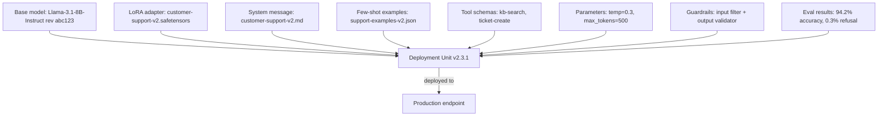

In classical MLOps a deployment ships one artifact — a trained model file. An LLM deployment ships many coupled ones — base model, adapter, prompt, system message, tool schemas, model parameters — and a change to any of them changes what users experience, so they must be versioned together as a single deployable unit. That unit, with its provenance trail, dependency pins, and promotion stages, is what a model registry manages; without one you cannot reliably reproduce, roll back, or audit a production LLM deployment. This note covers the anatomy of the versioned unit, semantic versioning and promotion stages, dependency management for base models, adapters, and tool schemas, and the provenance, rollback, and multi-tenant practices a mature registry enables; [[Inference and Production MOC]] orients the wider area.

> [!info] TL;DR
> A production LLM deployment is not just a model file — it is a bundle of base model + adapter + prompt + system message + tool schemas + model parameters. The registry versions all of these together as a single deployable unit, with provenance tracking, dependency management, and rollback support. Without a registry, you cannot reliably reproduce, roll back, or audit a production LLM deployment.

## What a model registry is

A model registry is a versioned store for ML artifacts. In classical MLOps, it stores trained model files with metadata — training data, hyperparameters, metrics — and the standard examples are MLflow Model Registry, Vertex AI Model Registry, SageMaker Model Registry, and Weights & Biases. In LLMOps the registry must store more than model weights, because a "model" in production is really a **deployment unit**; the contrast between the two worlds is the core of [[LLMOps vs MLOps]].

### The eight parts of a deployment unit

A production deployment unit consists of:

1. **Base model identifier** — e.g., `meta-llama/Llama-3.1-8B-Instruct`, pinned to a specific revision.
2. **Adapter weights** (if PEFT is used) — LoRA or QLoRA checkpoint.
3. **System message** — the prompt that defines the model's role.
4. **Few-shot examples** — demonstrations included in every request.
5. **Tool schemas** — function-calling definitions.
6. **Model parameters** — temperature, top_p, max_tokens, stop sequences.
7. **Guardrail configuration** — input/output filter settings.
8. **Eval results** — benchmark scores from the eval suite run before promotion.

All eight should be versioned together as a single artifact, and changing any one of them is a new version. This is the LLMOps analog of the "container image" in DevOps — a single immutable unit that captures everything needed to deploy:

The diagram's example bundles a pinned Llama base model with a customer-support adapter, its system message and few-shot examples, two tools, generation parameters, guardrail settings, and the eval results — everything an auditor, a promotion gate, or a rollback needs.

## Versioning schemes

### Semantic versioning for LLMs

Semver adapts cleanly to LLM artifacts:

- **Major version** (e.g., v2.0.0): breaking change — different base model, different output format, different tool set. Users must update their integration.
- **Minor version** (e.g., v2.1.0): new capability — new tool, new system message feature, new few-shot example. Backwards compatible.
- **Patch version** (e.g., v2.1.1): bug fix — prompt typo, parameter tweak, guardrail update. Backwards compatible.

This gives consumers a clear contract: minor and patch updates should not break their integration; major updates might.

### Promotion stages

Most registries track a stage for each version:

- **Development** — internal testing only.
- **Staging** — shadow traffic, integration tests.
- **Canary** — small percentage of production traffic.
- **Production** — full production traffic.
- **Archived** — no longer served, retained for audit.

Promotion between stages is gated by eval results and human approval. The staged traffic itself — shadow and canary — is the territory of [[A-B Testing and Shadow Deployment]], and the eval half of the gate is typically [[LLM-as-Judge Evaluation]].

## Dependency management

### Base model pinning

The base model is a dependency of your deployment unit: if the base model provider updates (Meta releases Llama-3.1-8B-Instruct-v2), your deployment unit might break. The registry must pin the exact model revision (commit hash, model card version), track the source (HuggingFace Hub, internal mirror, closed-model API), and detect when the upstream has changed and alert. For closed models (OpenAI, Anthropic), you cannot pin to a model file — but you *can* pin to a model version identifier (e.g., `gpt-4o-2024-08-06`), and the registry should store this version explicitly.

### Adapter compatibility

A LoRA adapter is only compatible with a specific base model — adapters trained on Llama-3.1-8B will not work on Llama-3.2-8B (different architecture). The registry must record which base model the adapter was trained on, refuse to deploy an adapter with an incompatible base model, and detect base model upgrades and trigger adapter retraining. The adapters themselves come from the fine-tuning methods covered in [[13 - Training and Adaptation/Fine-Tuning/LoRA|LoRA]] and [[QLoRA]].

### Tool schema evolution

If your deployment unit includes tool schemas, those schemas are part of the contract: changing a tool's parameter names is a breaking change for any client that calls your endpoint. The registry should version tool schemas alongside the model and detect breaking changes (renamed parameters, removed tools), requiring a major version bump.

## Provenance and audit

A mature registry records the full provenance of each deployment unit:

- **Training data** — what dataset was used to train the adapter, and what version of the training set?
- **Training code** — what commit of the training script produced this adapter?
- **Hyperparameters** — LoRA rank, learning rate, batch size.
- **Eval results** — what scores did it achieve on which benchmarks?
- **Approval** — who approved promotion to production? When?
- **Deployment history** — when was it deployed, to which endpoint, by whom?

This audit trail is essential for **reproducing** a past deployment (e.g., to debug a regression), for **compliance** — many industries require auditable model lineage — and for **incident response**, where you need to know exactly what was deployed when.

## Rollback strategy

The registry enables fast rollback. If a new deployment unit shows regression in production:

1. Identify the previous deployment unit version (still in the registry, marked "Archived" or "Production-previous").
2. Repoint the production endpoint to the previous version.
3. The rollback is a config change, not a redeploy — it takes seconds.

That is much faster than redeploying a previous code version, which may require building images, restarting pods, and so on. The ability to roll back quickly is one of the main practical benefits of a registry, and [[Production Monitoring]] is what tells you when to use it.

## Multi-tenant deployment

In multi-tenant systems (e.g., a SaaS offering LLM features to many customers), each customer may have a different deployment unit: Customer A uses the latest general model, Customer B has a custom LoRA fine-tuned on their data, and Customer C uses an older model version pinned for compliance. The registry must support deploying multiple versions concurrently, with routing logic that directs each customer's traffic to the correct version — the "one base model + many adapters" pattern made operational.

## Tooling

### General-purpose registries

**MLflow Model Registry** is open source, widely used, and supports LLM artifacts as a generic "model." **Weights & Biases** offers a model registry with experiment tracking integration. **HuggingFace Hub** provides model hosting with versioning and can serve as a registry for open-weights models.

### LLM-specific registries

**LangSmith** is a prompt + model registry with eval integration; **Vertex AI Model Registry** plus Vertex AI Extensions is Google Cloud's LLM-aware registry; **Azure ML Model Catalog** is Microsoft's LLM registry.

### Custom registries

Many teams build a custom registry on top of a blob store (S3) + a database (Postgres) + a small API. The implementation is straightforward; the value is in the workflow — review, approval, promotion — wrapped around it.

## Common pitfalls

**Versioning only the model** is the most common mistake: versioning the LoRA adapter but not the prompt. When the prompt changes and quality drops, you cannot tell whether it was the adapter or the prompt — version *everything* together as a deployment unit. **Not pinning base model versions**: using `meta-llama/Llama-3.1-8B-Instruct` unpinned means your deployment can change silently when Meta pushes an update; always pin to a specific revision or model card version. **No eval gate**: promoting a new version without running the eval suite is asking for trouble — even "small" prompt changes can cause large quality regressions on edge cases. **No rollback drill**: teams assume rollback works but never test it. Run a rollback drill periodically — promote a known-bad version, verify the alert fires, roll back, verify traffic shifts. If you wait for a real incident to discover your rollback is broken, you have a multi-hour outage. **Treating closed models as stable**: closed-model providers silently update their models — a versioned identifier like `gpt-4o-2024-08-06` is stable, but the default `gpt-4o` alias can change. Always use the pinned version identifiers in production.

## See also

- [[Inference and Production MOC]] — orientation for the area
- [[LLMOps vs MLOps]] — why the LLM registry stores more than weights
- [[Prompt Management]] — the prompt and system message inside the deployment unit
- [[LLM-as-Judge Evaluation]] — the eval gate for promotion
- [[A-B Testing and Shadow Deployment]] — the staged traffic behind promotion stages
- [[Production Monitoring]] — the regression signals that trigger rollback
- [[13 - Training and Adaptation/Fine-Tuning/LoRA|LoRA]] — the adapter weights in the bundle
- [[QLoRA]] — quantized adapter checkpoints
- [[Guardrails]] — the guardrail configuration component
