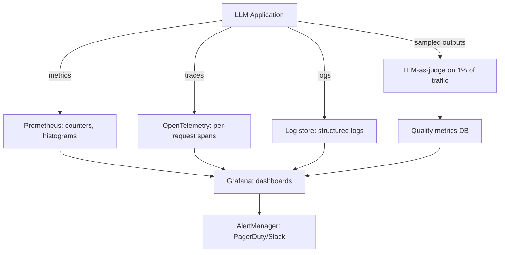

Once an LLM application serves real traffic, the question shifts from "does it work?" to "is it still working — for every user, at every hour, at an acceptable cost?" Production monitoring answers that by tracking five signal classes — latency, cost, quality, safety, and usage — across a stack of structured metrics, traces, logs, and sampled-content evaluation feeding dashboards and alerts. It is the discipline where LLM-specific failure modes (hallucination spikes, prompt injection, silent provider updates) meet classic SRE practice (SLOs, symptom-based alerting, runbooks). This note covers what to measure in each signal class, the stack that carries the signals, alerting discipline, and the recurring production incidents a good setup catches early; [[Inference and Production MOC]] orients the wider area.

> [!info] TL;DR
> LLM production monitoring tracks five signal classes: **latency, cost, quality, safety, and usage**. Classical ML monitoring (latency, accuracy) is necessary but insufficient — LLMs add token-cost tracking, hallucination detection, prompt-injection alerts, and per-user/per-tenant breakdowns. A robust monitoring stack combines structured metrics (Prometheus), trace logs (OpenTelemetry), and content sampling (LLM-as-judge on 1% of traffic).

## What to monitor

Every production LLM deserves instrumentation across five signal classes. Three of them (latency, cost, usage) are numeric and cheap to collect; quality and safety require content-level analysis of inputs and outputs, which is where the LLM-specific machinery concentrates.

### Latency

Latency decomposes into three quantities that map directly onto what a user feels:

- **Time to first token (TTFT)** — how long until the user sees the first response. Dominated by prefill (processing the prompt) and network RTT.
- **Time per output token (TPOT)** — how fast tokens stream once they start. Dominated by decode speed and KV cache efficiency.
- **Total request latency** — TTFT + (output_tokens × TPOT). What the user experiences end-to-end.

For agentic workloads, three more signals matter: tool call latency (time spent in tool execution vs. LLM inference), iteration count (how many ReAct loops before termination), and context size growth (how the conversation grows over turns).

SLOs typically target TTFT < 1s and TPOT < 50ms for interactive use cases. Long-tail latency (p99) matters more than the mean — users notice the slow requests, not the average ones. The decode-side behavior behind TPOT is the territory of [[KV Cache Mechanics]].

### Cost

Cost starts from token accounting and rolls up to business-level views:

- **Tokens per request** — input + output, separately.
- **Cost per request** — `input_tokens × input_price + output_tokens × output_price`.
- **Cost per user / per tenant** — for multi-tenant systems, track per-customer cost.
- **Cost per feature** — which features (chat, summarization, RAG) are the cost drivers?

Cost monitoring should alert on three conditions: per-request cost exceeding a threshold (e.g., $0.50 — usually a bug), daily cost exceeding budget, and sudden cost spikes (often a prompt regression causing longer outputs). [[Cost Optimization]] covers what to do once the signals arrive.

### Quality

Quality is the hardest class to monitor because there is no ground truth at inference time. The practical approaches, usually combined:

- **LLM-as-judge on a sample**: run an LLM judge on 1–5% of production outputs and alert on quality regression — see [[LLM-as-Judge Evaluation]].
- **User feedback**: thumbs-up/down, ratings, follow-up corrections. Sparse but high-signal.
- **Implicit signals**: users re-asking the same question (suggests a bad answer), users abandoning mid-conversation (suggests frustration), users editing outputs (suggests errors).
- **Task-specific metrics**: for RAG, track retrieval recall (did we retrieve the right documents?); for tool-calling, track tool success rate.

### Safety

Safety monitoring watches both directions of the model boundary:

- **Refusal rate** — what percentage of requests does the model refuse? A high refusal rate suggests over-alignment; zero refusal rate may suggest under-alignment.
- **Prompt-injection detection** — classify inputs for known injection patterns and alert on spikes; [[LLM Security and Prompt Injection]] covers the attack side.
- **PII leakage** — scan outputs for personal information (SSNs, emails, phone numbers), the failure mode behind [[PII and Data Leakage]].
- **Toxicity / hate speech** — run a toxicity classifier on outputs.
- **Policy violations** — domain-specific checks (e.g., medical advice restrictions).

These are the passive counterparts to the active defenses described in [[Guardrails]] — a refusal-rate spike or a burst of unusual tool calls is often the first visible symptom that something is leaking through.

### Usage

Usage metrics drive capacity planning and product decisions:

- **Requests per second (RPS)** — overall load.
- **Active users** — distinct users per time window.
- **Feature usage** — which features are used most.
- **Geographic distribution** — for capacity planning and latency optimization.
- **Error rate** — HTTP 4xx/5xx, model errors, tool errors.

## The monitoring stack

The signals above flow through four parallel channels — metrics, traces, logs, and sampled content — which converge on dashboards and alerting:

[[Observability Stack]] treats the tooling side of these channels in depth; this section focuses on what each channel carries for monitoring purposes.

### Metrics

Metrics (Prometheus, Datadog) are structured numerical data, aggregated over time windows. The conventional names:

- `llm_requests_total{model="gpt-4o", tenant="acme"}` — counter.
- `llm_request_duration_seconds` — histogram.
- `llm_tokens_total{direction="input|output"}` — counter.
- `llm_cost_usd_total` — counter.
- `llm_quality_score` — gauge (from LLM-as-judge).

Metrics are cheap to collect and query, which is why they carry the alerting and dashboard load.

### Traces

Traces (OpenTelemetry, LangSmith) are per-request structured logs showing the full execution path: the prompt sent to the model, the model's response, tool calls made and their results, sub-requests (e.g., to a retrieval system), and the latency breakdown by component. Traces are essential for debugging individual requests, but they are expensive to store (kilobytes per request), so they are usually sampled — 10–100% for dev, 1–10% for production.

### Logs

Logs (Loki, ELK, Datadog) are unstructured or semi-structured text, useful for error messages and stack traces, application-level events (user logged in, feature flag changed), and audit logs (who called what when).

### Content sampling

Content sampling is a separate pipeline that samples 1–5% of production traffic, runs LLM-as-judge on it, and stores quality scores. This is the only way to detect quality regressions in production — metrics alone cannot tell you if outputs have become worse.

## Alerting strategy

### Alert on symptoms, not causes

"p99 latency > 5s for 5 minutes" is a clear symptom. "GPU utilization > 80%" is a cause, not a symptom — it may be normal during peak. Symptom alerts stay actionable; cause alerts generate noise.

### Multi-level alerts

Severity determines the response:

- **Warning**: investigate soon (e.g., p95 latency 20% above baseline).
- **Critical**: page on-call (e.g., error rate > 5%, or cost spike > 10×).
- **Emergency**: automatic mitigation (e.g., failover to backup model).

### Alert fatigue

Bad alerts cause alert fatigue, which causes real alerts to be ignored. Three rules keep the channel credible: every alert should have a clear runbook; alert thresholds should be tuned to a <5% false positive rate; and alert history should be reviewed monthly to silence or fix noisy alerts.

## Common production issues

Five incident patterns account for most LLM production pages, and each has a characteristic detection and mitigation path.

### Cost spike

A prompt change causes outputs to be 5× longer: cost per request jumps from $0.01 to $0.05, and daily cost goes from $100 to $500. Detection is the per-request cost alert (>$0.05 triggers investigation) plus the daily budget alert. Mitigation: roll back the prompt ([[Prompt Management]]), add `max_tokens` limits, and route long requests to a cheaper model.

### Latency regression

A new model version is slower — TTFT jumps from 800ms to 2s. Detection is a p95 TTFT alert with comparison to the previous version's baseline. Mitigation: roll back, then investigate the usual suspects (KV cache hit rate? prompt caching enabled? batching?).

### Quality drift

A closed-model provider silently updates and outputs become slightly less helpful — no single request is obviously bad, but aggregate quality metrics drop. Detection: an LLM-as-judge on a 1% sample shows the quality score dropping from 4.2 to 3.9 over a week. Mitigation: pin to a specific model version, re-evaluate the prompt, and consider switching providers.

### Prompt injection

An attacker discovers your system prompt and crafts inputs that extract it or override instructions. Detection: a prompt-injection classifier on inputs, an output classifier for policy violations, and a spike in refusal rate or unusual tool calls. Mitigation: rate-limit the attacker, add input sanitization, and review and harden the system prompt.

### Hallucination spike

A knowledge base update introduces conflicting information, and the model starts hallucinating to resolve the conflicts. Detection: an LLM-as-judge faithfulness check on RAG outputs shows a spike in ungrounded claims. Mitigation: roll back the knowledge base update and add citation requirements to the prompt.

## Tooling

### General-purpose

The general-purpose observability tools apply directly: **Prometheus + Grafana + AlertManager** as the open-source metrics stack, **Datadog** as commercial all-in-one observability, and **OpenTelemetry** as the vendor-neutral tracing standard.

### LLM-specific

A crop of LLM-native tools adds the content-level layer: **LangSmith** (LangChain's observability platform — traces, eval, prompt management), **Helicone** (open-source LLM observability), **Parea AI** (eval + monitoring), **Phoenix** (Arize, open-source LLM observability), and **Braintrust** (eval + monitoring with a focus on prompt iteration).

### Content sampling infrastructure

Most teams end up building the content-sampling pipeline themselves, and it is small: sample 1% of production requests (configurable per feature), send the sampled request + response to an LLM judge, store the judge's scores in a time-series DB, and alert on score regression. It is straightforward to build but essential for catching quality issues that metrics miss.

## Common pitfalls

**Monitoring only latency and cost** is the most common mistake: teams set up latency and cost monitoring because those are easy, and skip quality monitoring because it is hard — then discover quality regressions only when users complain, by which point the damage is done. **No per-tenant breakdown**: in multi-tenant systems, aggregate metrics hide tenant-specific issues — one tenant may be experiencing 5× latency while the average looks fine, so always break down by tenant. **Sampling bias**: if you sample the first 1% of requests per day you miss diurnal patterns — sample uniformly across time, or use reservoir sampling. **No trace for failed requests**: failed requests are often dropped before tracing completes, leaving you with no data to debug — always emit traces for failed requests, with the error captured. **Not pinning model versions in telemetry**: if your telemetry says "model: gpt-4o" without a version, you cannot correlate regressions with provider updates — always include the pinned version identifier in telemetry, the same pinning discipline [[Model Registry and Versioning]] enforces at deploy time.

## See also

- [[Inference and Production MOC]] — orientation for the area
- [[Observability Stack]] — the four pillars and tooling underneath these signals
- [[LLM-as-Judge Evaluation]] — the evaluator behind sampled quality scores
- [[Cost Optimization]] — acting on the cost signals
- [[Model Registry and Versioning]] — pinned versions that make regression correlation possible
- [[Prompt Management]] — the artifact behind prompt-driven cost spikes and quality drift
- [[LLM Security and Prompt Injection]] — the attacks safety monitoring watches for
- [[PII and Data Leakage]] — what output scanning protects against
- [[Production AI Stack]] — the services being monitored
- [[Failure Modes and Graceful Degradation]] — what alerts should catch before users do
- [[LLMOps vs MLOps]] — why LLM monitoring extends classical ML monitoring
