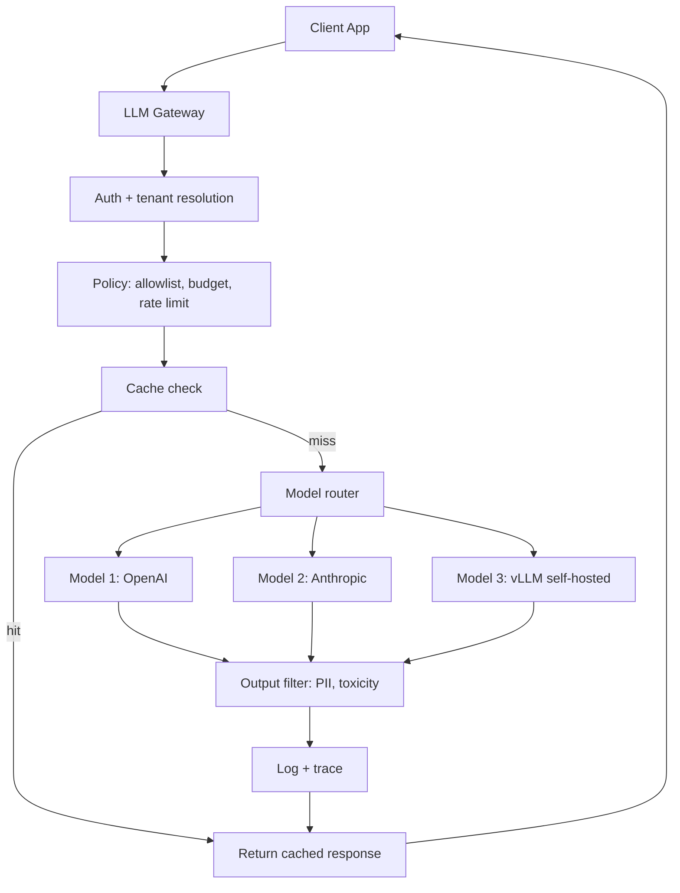

The gateway pattern centralizes authentication, policy, logging, and routing in a single service between client applications and LLM backends; the router pattern extends it with intelligent request routing — cheap model first, expensive model for hard cases, fallback on failure. Together they decouple clients from providers, enable multi-provider strategies, and provide a single control point for cost, safety, and observability. This note covers what a gateway does and why teams adopt one, the four routing strategies, fallback chains and cost-aware routing, the semantic-cache, streaming-proxy, and batch-aggregator patterns built on top, and the production considerations and pitfalls that come with running this layer.

> [!info] TL;DR
> The gateway pattern centralizes authentication, policy, logging, and routing in a single service between clients and LLM backends. The router pattern extends this with intelligent request routing: cheap model first, expensive model for hard cases, fallback on failure. Together, they decouple clients from LLM providers, enable multi-provider strategies, and provide a single control point for cost, safety, and observability.

## The gateway pattern

### What an LLM gateway does

An LLM gateway sits between client applications and LLM providers (OpenAI, Anthropic, self-hosted [[14 - Inference and Production/Inference/vLLM|vLLM]]). It provides:

- **Unified API**: clients call one API regardless of which backend model is used. The gateway translates to provider-specific formats.
- **Authentication**: validates client tokens, maps to tenants/users.
- **Rate limiting**: per-user, per-tenant, per-model throttling.
- **Cost tracking**: per-request cost attribution, budget enforcement.
- **Logging and tracing**: structured logs with trace IDs for every request.
- **Caching**: prefix caching, response caching, semantic caching.
- **Policy enforcement**: input/output filtering, PII redaction, model allowlists.
- **Fallback**: if one provider fails, route to another.

The request path through a full gateway:



### Why use a gateway

**Provider abstraction**: clients don't need to know which provider serves which model. The gateway handles API differences (OpenAI's chat format vs. Anthropic's message format vs. vLLM's OpenAI-compatible format).

**Multi-provider strategy**: avoid lock-in. If OpenAI has an outage, route to Anthropic. If Anthropic raises prices, switch to self-hosted. The gateway makes switching a config change, not a code change.

**Centralized policy**: instead of every client implementing auth, rate limiting, and logging, the gateway does it once. This is especially valuable in enterprises with many teams building LLM features.

**Cost control**: the gateway enforces per-tenant budgets, tracks cost per request, and can route to cheaper models when possible.

**Observability**: all requests flow through one point, making it easy to monitor latency, cost, quality, and errors across the entire organization.

### Gateway implementations

Open-source options include **LiteLLM**, a Python proxy that unifies 100+ LLM APIs and is popular for multi-provider setups, and **OneAPI**, an open-source gateway with multi-provider support. **Portkey** is a commercial gateway with a focus on reliability. On the commercial side, **OpenRouter** offers multi-provider routing as a service, and the cloud providers ship their own gateways: AWS Bedrock, Azure AI, and Google Vertex AI. Many enterprises build custom gateways on top of Kong, Envoy, or FastAPI, tailored to their specific compliance and integration requirements.

## The router pattern

### Why route

Not every request needs the strongest (most expensive) model. A simple factual question can be answered by a small model; a complex reasoning task needs a large model. Routing easy queries to cheap models dramatically reduces cost — typical savings are 50–70% vs. always using the strongest model, with minimal quality impact.

### Fallback chains

Routing also handles failures. If the primary model fails (timeout, rate limit, error), fall back to a secondary:

```python
def route_with_fallback(query):
    for model in [primary_model, secondary_model, tertiary_model]:
        try:
            return model.generate(query, timeout=10)
        except (TimeoutError, RateLimitError, APIError):
            continue
    return fallback_response("All models unavailable")
```

This is essential for high-availability systems. Without fallback chains, a single provider outage takes down the entire application — the surrounding reliability patterns (circuit breakers, bulkheads, timeouts) are covered in [[Failure Modes and Graceful Degradation]].

### Cost-aware routing

Combine routing with cost tracking. If a tenant has exceeded their budget for the strong model, route to the cheap model even if the query is hard. This enforces budget caps without rejecting requests:

```python
def route_query(query, tenant):
    difficulty = classify(query)
    if difficulty == 'hard' and tenant.budget_remaining('expensive') > 0:
        return expensive_model
    elif difficulty == 'hard':
        return mid_model  # downgrade due to budget
    else:
        return cheap_model
```

[[Cost Optimization]] collects the broader set of cost-control techniques this plugs into.

## Routing strategies

### Classifier-based routing

Train a classifier ([[08 - Attention and Transformers/Transformer Architecture/BERT|BERT]], small LLM) on query difficulty. The classifier predicts which model tier (cheap / mid / expensive) should handle the query:

```python
def route_query(query):
    difficulty = classifier.predict(query)  # 'easy', 'medium', 'hard'
    if difficulty == 'easy':
        return cheap_model
    elif difficulty == 'medium':
        return mid_model
    else:
        return expensive_model
```

Pros: fast (no LLM call for routing), cheap. Cons: classifier quality limits routing quality; needs labeled training data.

### LLM-based routing

Use a small LLM (or the same model with a routing prompt) to classify the query:

```python
def route_query(query):
    routing_prompt = f"Classify this query's difficulty (easy/medium/hard): {query}"
    difficulty = small_llm.generate(routing_prompt)
    return select_model(difficulty)
```

Pros: more flexible than a classifier; can handle novel query types. Cons: adds latency (an LLM call before the actual request); costs tokens.

### Cascade routing

Try the cheap model first. If the response is low-confidence (e.g., the model says "I don't know", or a confidence metric is low), retry with a stronger model:

```python
def route_query(query):
    response = cheap_model.generate(query)
    if is_low_confidence(response):
        response = expensive_model.generate(query)
    return response
```

Pros: maximally cheap (only escalates when needed); no classifier needed. Cons: adds latency for escalated requests; defining "low confidence" is tricky.

### Feature-based routing

Route based on input features (length, language, topic) without a learned classifier:

```python
def route_query(query):
    if len(query) < 100:
        return cheap_model
    elif is_code(query):
        return code_specialist_model
    elif is_multilingual(query):
        return multilingual_model
    else:
        return general_model
```

Pros: simple, fast, no training. Cons: coarse; misses nuances that a learned classifier would catch.

## Common patterns

### The semantic cache layer

Before routing, check the cache. If a similar query was answered recently, return the cached response without calling any model:

```python
def handle_query(query):
    cached = semantic_cache.lookup(query)
    if cached and cached.confidence > 0.9:
        return cached.response
    response = router.route(query)
    semantic_cache.store(query, response)
    return response
```

Semantic caches (using embedding similarity) achieve 20–50% hit rates in production, dramatically reducing cost and latency.

### The streaming proxy

For streaming responses, the gateway proxies the stream from the provider to the client, applying transformations (PII redaction, content filtering) on the fly.

### The batch aggregator

For non-interactive workloads, the gateway can aggregate multiple requests into a batch, submit to a batch API (50% discount on OpenAI/Anthropic), and return results when ready.

## Production considerations

### Latency budget

Routing adds latency (classifier call, cache lookup, fallback). Budget this carefully: cache lookup under 5ms; classifier under 50ms; LLM-based routing under 500ms (significant — only use if necessary); fallback adds the full latency of the secondary model.

### Cold start

If the gateway spawns model instances on demand, cold start can add 10–30 seconds. Use warm pools or serverless functions with pre-warmed containers.

### Observability

The gateway is the natural place for observability. Log every request with: client ID and tenant ID; model used, tokens consumed, and cost; latency breakdown (cache lookup, routing, model call); and quality score (from content sampling). The wider monitoring practice is covered in [[Production Monitoring]] and [[Observability Stack]].

### Configuration management

Routing rules, model allowlists, and budget caps change frequently. Manage these as configuration (not code), with hot-reload support.

## Common pitfalls

> [!warning]
> A gateway that is misconfigured or under-provisioned does not just fail to help — it becomes the single point of failure for every client behind it.

**No fallback.** Single-provider setups fail when the provider has an outage. Always have a fallback, even if it's just "sorry, try again later".

**Router misclassification.** A poorly-trained router sends hard queries to the cheap model, producing bad outputs. Monitor routing accuracy and retrain regularly.

**No cache.** Every request hits the model, even repeat queries. Implement at least exact-match caching; semantic caching for higher hit rates.

**Gateway as bottleneck.** If the gateway is single-threaded or under-provisioned, it becomes the bottleneck. Scale the gateway horizontally; use async I/O.

**No cost cap.** Without per-tenant cost caps, a single tenant can rack up thousands of dollars. Always enforce budgets at the gateway.

## See also

- [[Inference and Production MOC]] — orientation for the production-AI family.
- [[Failure Modes and Graceful Degradation]] — fallbacks, circuit breakers, and timeouts in depth.
- [[Cost Optimization]] — cost-aware routing in the wider cost picture.
- [[Production Monitoring]] and [[Observability Stack]] — the monitoring that rides on the gateway.
- [[Guardrails]] — policy enforcement as a gateway concern.
- [[PII and Data Leakage]] — PII redaction policy enforced at the gateway.
- [[LLM Security and Prompt Injection]] — the input/output filtering layers a gateway hosts.
- [[14 - Inference and Production/Inference/vLLM|vLLM]] — self-hosted backend behind the gateway.
- [[Production AI Stack]] — the infrastructure the gateway sits on.
- [[Reference Production Architectures]] — full-stack reference designs.
