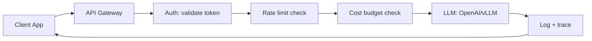
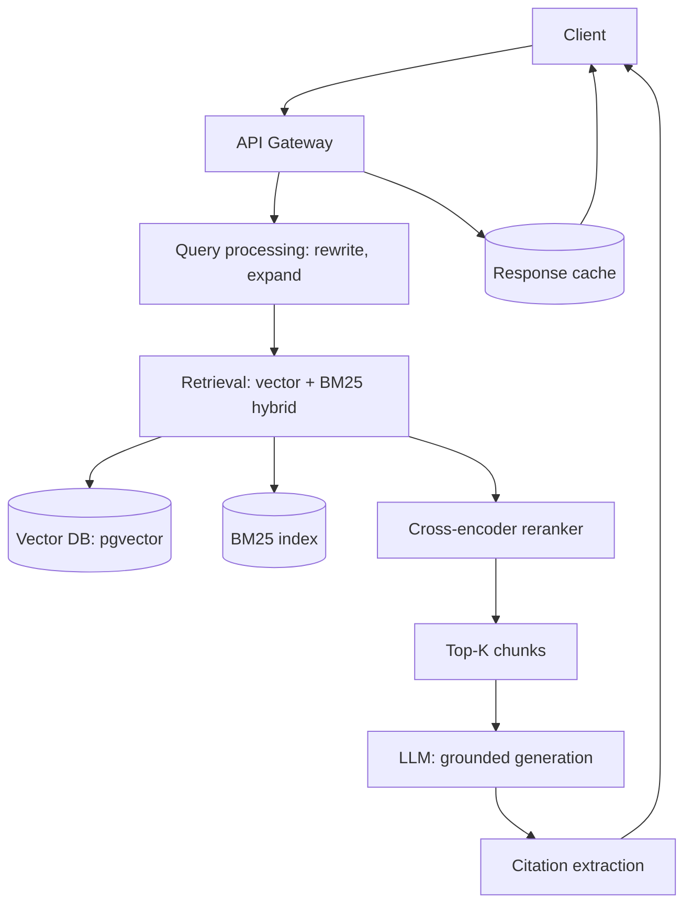
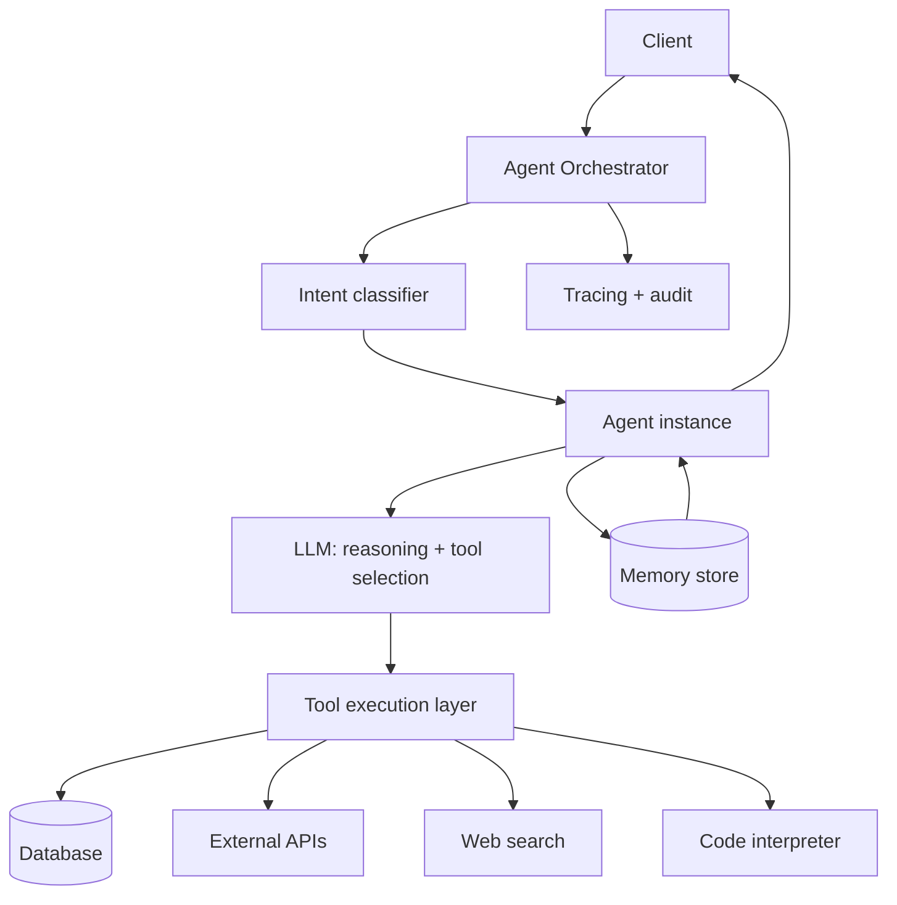
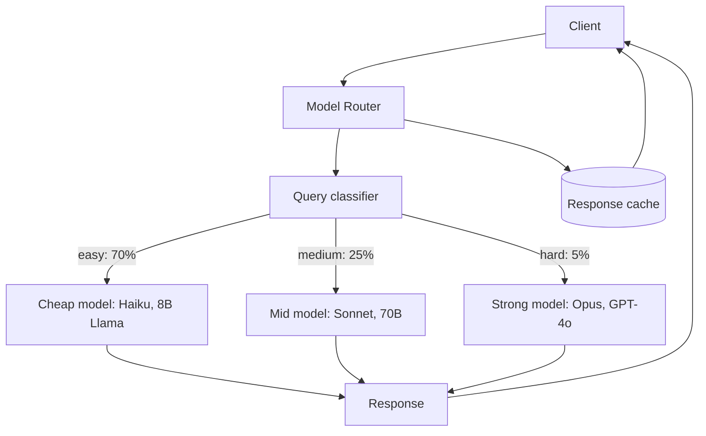

Production AI systems follow a small number of recurring patterns: the API gateway (an LLM behind a service), the RAG platform (retrieval + generation), the agent platform (an LLM with tools and memory), and the multi-model router (cheap model first, expensive model for hard cases). Each pattern has standard components, failure modes, and scaling strategies, and choosing the right pattern up front saves months of rearchitecture. This note walks through the four reference architectures, the observability, cost, and safety components they all share, and the scaling strategies — from bigger GPUs to disaggregated inference — that grow them; [[Inference and Production MOC]] orients the wider area.

> [!info] TL;DR
> Production AI systems follow a small number of recurring patterns: the **API gateway** (LLM behind a service), the **RAG platform** (retrieval + generation), the **agent platform** (LLM with tools and memory), and the **multi-model router** (cheap model first, expensive model for hard cases). Each pattern has standard components, failure modes, and scaling strategies. Choosing the right pattern up front saves months of rearchitecture.

## The four reference architectures

Four patterns cover nearly every production LLM system. Each is presented below with its request path, its components, its use case, and the failure modes it must plan for.

### The API gateway pattern

The simplest production pattern: wrap an LLM (closed or self-hosted) behind an API gateway that handles authentication, rate limiting, logging, and cost control. The request path is a straight pipeline from client to model and back:

Six components make up the pattern:

- API Gateway (FastAPI, Kong, AWS API Gateway).
- Authentication (OAuth, API keys).
- Rate limiter (Redis, in-memory).
- Cost tracker (per-tenant budget enforcement).
- LLM backend (OpenAI API, [[14 - Inference and Production/Inference/vLLM|vLLM]], TGI).
- Logger (structured logs with trace IDs).

Use case: simple LLM features (summarization, classification, completion) where you don't need retrieval, tools, or complex orchestration. Its failure modes and the standard responses:

- LLM provider outage → failover to backup model or cached response.
- Cost spike → rate limiting or budget cap triggers.
- Latency spike → timeout + fallback.

The gateway itself is the subject of [[Gateway and Router Patterns]].

### The RAG platform pattern

The most common production pattern for knowledge-grounded applications. It combines retrieval (vector + keyword search) with generation (the LLM produces grounded answers):

Components:

- Document ingestion pipeline (chunking, embedding, indexing).
- Vector database (pgvector, Qdrant, Pinecone).
- BM25 index (Elasticsearch, Postgres full-text).
- Reranker (cross-encoder model).
- LLM for generation (with citation prompting).
- Response cache (Redis).
- Feedback collector (thumbs up/down).

Use case: knowledge-base Q&A, document search, customer support, any application where answers must be grounded in specific documents. Failure modes and responses:

- Retrieval misses relevant documents → query rewriting, multi-hop retrieval, fallback to broader search.
- Hallucination → faithfulness checking (LLM-as-judge), citation requirements, lower temperature.
- Stale documents → re-indexing pipeline, document versioning.

The vector store is covered in [[Vector Storage with pgvector]], the faithfulness checks lean on [[LLM-as-Judge Evaluation]], and the failure being controlled is [[Hallucination]].

### The agent platform pattern

For applications that need multi-step reasoning, tool use, and stateful interaction. The LLM acts as a controller, deciding which tools to call and how to combine their outputs:

Components:

- Orchestrator (manages agent lifecycle, routing).
- Agent instances (stateful, with conversation history).
- Tool execution layer (sandboxed, with permissions).
- Memory store (per-conversation, per-user).
- Tracing (distributed traces across the agent loop).
- Audit log (every tool call, every decision).

Use case: customer support agents, research assistants, code assistants, any application requiring multi-step workflows. Failure modes and responses:

- Agent loops forever → max iterations, timeout.
- Tool failure → retry, fallback, graceful degradation.
- Hallucinated tool calls → argument validation, schema enforcement.
- Cost runaway → per-request cost cap, tool call rate limit.

Distributed tracing across the agent loop is why [[Observability Stack]] matters more here than in the simpler patterns, and graceful degradation under tool failure is treated in [[Failure Modes and Graceful Degradation]]. Schema enforcement for tool arguments is where [[Constrained Decoding]] enters the picture.

### The multi-model router pattern

For cost optimization: route easy queries to a cheap model, hard queries to an expensive model. A query classifier splits traffic into tiers:

Components:

- Router (LLM-based or classifier-based).
- Multiple model backends (different sizes/providers).
- Fallback logic (if cheap model fails, retry with stronger).
- Cache (exact-match and semantic).

Use case: high-volume applications where cost matters (chatbots, content moderation, classification). Failure modes and responses:

- Router misclassifies → quality regression on misrouted queries. Monitor and retrain.
- Cheap model fails silently → confidence estimation, fallback to stronger model.
- Provider outage → failover to alternative provider.

Routing in depth is the subject of [[Gateway and Router Patterns]], and the budget side of the pattern belongs to [[Cost Optimization]].

## Common components across patterns

Whatever the pattern, three concerns show up in every production AI system: observing it, paying for it, and keeping it safe.

### Observability stack

Every production AI system needs:

- **Metrics** (Prometheus): latency, cost, error rate, quality scores.
- **Logs** (Loki, ELK): structured logs with trace IDs.
- **Traces** (OpenTelemetry): per-request spans across all components.
- **Content sampling**: 1–5% of outputs sampled for LLM-as-judge quality monitoring.

See [[Observability Stack]] for details.

### Cost management

Every production AI system needs:

- Per-request cost tracking.
- Per-tenant budget caps.
- Cost spike alerts.
- Cost optimization (caching, routing, quantization).

See [[Cost Optimization]] for details; [[Quantization]] covers the model-side optimization lever.

### Safety and guardrails

Every production AI system needs:

- Input validation (prompt injection detection, PII scrubbing).
- Output filtering (toxicity, policy violations, hallucination checks).
- Rate limiting (per-user, per-tenant).
- Audit logging (every request, every tool call).

See [[Guardrails]] and [[LLM Security and Prompt Injection]] for details.

## Scaling strategies

Once a pattern is deployed, five strategies scale it, from the simplest hardware upgrade to splitting inference itself across hardware pools.

### Vertical scaling (bigger GPUs)

First approach: use more powerful hardware. Works up to a point, but eventually you hit GPU memory limits or latency requirements. The memory arithmetic behind those limits is the subject of [[GPU Infrastructure and Sizing]].

### Horizontal scaling (more replicas)

Standard approach: run multiple model replicas behind a load balancer. Scales throughput, not single-request latency. Requires stateless model servers — [[14 - Inference and Production/Inference/vLLM|vLLM]] with prefix caching handles shared state.

### Multi-region

For global applications: deploy in multiple regions, route by geography. Reduces latency for distant users, provides disaster recovery.

### Disaggregated inference

Advanced approach: separate prefill (processing the prompt) from decode (generating tokens). Prefill is compute-bound; decode is memory-bound. Different hardware pools for each can improve utilization. See DeepSeek/Mooncake.

### Caching at multiple levels

Caching shows up at four distinct levels:

- **Prefix cache**: shared system prompts, cached at the model server.
- **Response cache**: exact-match queries, cached at the application level.
- **Semantic cache**: similar queries, cached by embedding similarity.
- **Tool result cache**: tool outputs cached for reuse.

## Choosing a pattern

Most use cases map directly onto one pattern:

| Use case | Recommended pattern |
|---|---|
| Simple LLM feature (summary, classify) | API gateway |
| Knowledge-grounded Q&A | RAG platform |
| Multi-step workflow with tools | Agent platform |
| High-volume cost-sensitive chat | Multi-model router |
| Customer support | RAG + agent (hybrid) |
| Code assistant | Agent platform |
| Content moderation | Multi-model router |

Most production systems combine patterns. A customer support platform might use RAG for knowledge retrieval, an agent for multi-step resolution, and a multi-model router for cost optimization.

## See also

- [[Inference and Production MOC]] — orientation for the area
- [[Production AI Stack]] — the concrete services these patterns deploy
- [[Gateway and Router Patterns]] — the gateway and router patterns in depth
- [[Guardrails]] — the safety component every pattern needs
- [[LLM Security and Prompt Injection]] — the threats input validation guards against
- [[Observability Stack]] — the shared metrics, logs, traces, and content sampling
- [[Cost Optimization]] — acting on per-request and per-tenant cost tracking
- [[Vector Storage with pgvector]] — the vector store behind RAG retrieval
- [[Failure Modes and Graceful Degradation]] — the failure-mode responses elaborated
- [[14 - Inference and Production/Inference/vLLM|vLLM]] — the default LLM backend and stateless replica server
- [[KV Cache Mechanics]] — the model-server cache prefix caching shares
- [[LLM-as-Judge Evaluation]] — the faithfulness checker behind RAG quality control
- [[PII and Data Leakage]]
