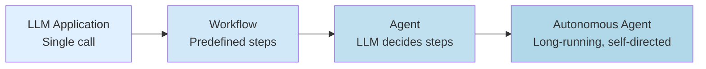

Not every LLM use case is an agent. LLM-powered systems fall on a spectrum: an **LLM application** (single call), a **workflow** (multi-step, predefined flow), an **agent** (LLM decides next step), and an **autonomous agent** (long-running, self-directed). Knowing where on the spectrum you are determines architecture, tools, and cost.

## The spectrum

The four levels form a progression from least to most autonomous:



Each step adds: autonomy + complexity + cost + capability. The sections below walk through the four levels in order, and the comparison table near the end places them side by side.

## LLM application (single call)

The simplest case: prompt in, response out. No tools, no iteration, no state.

```python
response = llm.chat(prompt="Translate to French: Hello")
print(response)  # "Bonjour"
```

Typical examples are translation, single-turn Q&A, classification, and summarization of a single document. The architecture is correspondingly minimal: one LLM call, no state, no tools, and no control flow beyond the call. Use this level when the task fits in a single prompt and doesn't require tools or multi-step reasoning — most "wrap an LLM API" projects start here.

## Workflow (multi-step, predefined flow)

A workflow is a sequence of LLM calls (and possibly other operations) with a **predefined control flow**. The LLM doesn't decide what to do next — the developer does.

```python
# RAG pipeline (simplified)
docs = retrieve(query)
context = compress(docs)
answer = llm.chat(prompt=f"Answer: {query}\nContext: {context}")
citation = llm.chat(prompt=f"Generate citation for: {answer}")
return answer, citation
```

Examples include RAG pipelines (see [[RAG Pipeline Overview]]), document processing pipelines, content moderation, and ETL with LLM transformations. Architecturally, a workflow makes multiple LLM calls in a defined sequence; it may include tools such as retrieval, search, or APIs, but the control flow is hard-coded by the developer. The LLM is invoked at specific steps, yet it doesn't control the flow. Use a workflow when the task has predictable structure and you want reliability — most production LLM features are workflows, not agents.

## Agent (LLM decides next step)

An agent puts the LLM in a loop: it decides what to do next based on observations so far. Tools are available, and the LLM chooses which to call (if any). The loop below is the simplified shape of a ReAct-style agent ([[ReAct Pattern]]), built on the model's tool-calling ability ([[Function Calling]]).

```python
# ReAct-style agent (simplified)
messages = [system_prompt, user_goal]
while True:
    response = llm.chat(messages=messages, tools=available_tools)
    if response.tool_calls:
        for call in response.tool_calls:
            result = execute_tool(call)
            messages.append(tool_result_message(result))
    else:
        return response.content  # final answer
```

Real-world examples include coding assistants (Claude Code, Cursor, Cline), research agents (Perplexity Pro), customer support agents, and autonomous web browsers. The architecture keeps the LLM in a loop with tool access: the LLM decides when to call tools, which to call, and when to stop; state is maintained across iterations as a messages list; and tools are a first-class concept. Use an agent when the task requires adaptive multi-step reasoning — when the right next step depends on what you observed in the previous steps.

## Autonomous agent (long-running, self-directed)

An autonomous agent runs for an extended period (hours, days, indefinitely), pursues high-level goals, manages its own state, and may interact with humans opportunistically.

```python
# Autonomous agent loop (simplified)
while True:
    goals = load_goals()
    plan = planner(goals, current_state)
    for step in plan:
        result = execute(step)
        observe(result)
        if needs_human_input(result):
            await request_human_input()
        update_state(result)
    sleep(until_next_iteration)
```

Examples include Devin (autonomous coder), AutoGPT, BabyAGI, self-driving research agents, and automated DevOps. The architecture is a long-running loop, event-driven or scheduled, with persistent state across sessions (a database, vector store, or knowledge graph), self-planning and self-reflection (see [[Planner-Executor Pattern]] and [[Reflection]]), optional human-in-the-loop checkpoints ([[Human-in-the-Loop Patterns]]), and handling for failure, retry, and escalation. This level suits tasks that are open-ended, long-running, and would benefit from autonomous operation — but be cautious: autonomous agents are hard to debug and can run up large bills.

## Comparison table

| Property            | LLM App    | Workflow             | Agent               | Autonomous Agent   |
|---------------------|------------|----------------------|---------------------|--------------------|
| Control flow        | Single     | Predefined           | LLM decides         | LLM decides + plans|
| Number of LLM calls | 1          | Fixed                | Variable            | Variable, ongoing  |
| Tools               | None       | Fixed                | Available, chosen   | Many, dynamic      |
| State               | None       | Within-pipeline      | Across iterations   | Persistent         |
| Typical duration    | Seconds    | Seconds–minutes      | Minutes–hours       | Hours–days         |
| Cost predictability | High       | High                 | Medium              | Low                |
| Debugging           | Easy       | Easy                 | Hard                | Very hard          |
| Failure mode        | Bad output | Pipeline stage fails | Loop, no convergence | Drift, runaway costs |

The table shows how control flow, call count, tool access, state, duration, cost predictability, debuggability, and failure modes all shift as you move rightward along the spectrum: an LLM application fails with a bad output, a workflow fails when a pipeline stage fails, an agent fails by looping without convergence, and an autonomous agent fails by drifting or running up runaway costs.

## Why this matters

Knowing where on the spectrum you are determines **everything** downstream: architecture, framework choice (see [[Framework Selection Guide]]), cost model, reliability approach, and debugging strategy. Most production use cases should be workflows, not agents — workflows are predictable, testable, and cheap, while agents are powerful but unpredictable. The AI industry has a tendency to over-agent-ify problems; if a workflow solves your problem, use a workflow. True autonomy (level 4) is still research-grade for most applications, so be skeptical of claims of "fully autonomous agents" — they usually have humans in the loop somewhere.

## How to decide

Ask yourself:

1. Can a single LLM call solve this? → **LLM application**.
2. Is the multi-step flow predictable in advance? → **Workflow**.
3. Does the next step depend on what we observe? → **Agent**.
4. Is the task long-running and open-ended? → **Autonomous agent** (proceed with caution).

## Production implications

Default to workflows, and move to agents only when workflows can't solve the problem. When you do ship agents, set strict limits: max iterations, max tool calls, and max cost per run. For autonomous agents, add monitoring and kill switches — they will eventually do something unexpected. Cost management matters because agents can burn through tokens fast, so budget per run, per user, and per day. Finally, invest in observability: trace every LLM call, tool call, and observation, because without traces, agents are impossible to debug.

## Common pitfalls

Most failures on this spectrum come from mislabeling or over-engineering:

- **Calling everything an "agent"** — dilutes the term. A RAG pipeline is a workflow, not an agent.
- **Defaulting to agents when workflows would do** — wastes complexity and cost.
- **No iteration limits on agents** — agents can loop forever, burning money.
- **No tool-call validation** — agents will pass invalid arguments to tools. Validate before executing.
- **Trusting agent output without verification** — agents hallucinate, especially in long contexts. Verify critical actions.

## Further reading

Anthropic's *Building Effective Agents* (2024) is an excellent overview of this territory, Lilian Weng's *LLM Powered Autonomous Agents* (2023) covers the autonomous end of the spectrum in depth, and Harrison Chase's *Agents vs Workflows* on the LangChain blog argues the workflow-first position.

## See also

- [[Agents and Tooling MOC]]
- [[ReAct Pattern]]
- [[Chain of Thought]]
- [[Function Calling]]
- [[Reflection]]
- [[Autonomous Agent Lifecycles]]
- [[Human-in-the-Loop Patterns]]
- [[Planner-Executor Pattern]]
- [[Multi-Agent Architectures]]
- [[RAG Pipeline Overview]]
- [[Framework Selection Guide]]
