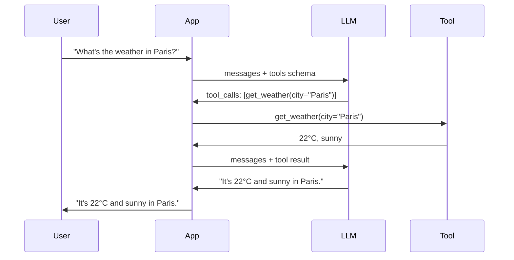

Function calling is the LLM API feature that lets the model invoke external tools via structured JSON: the model decides which function to call and with what arguments, and the framework executes the function and returns the result to the model. It is the modern foundation of agent tool use and the interface between LLMs and the rest of the world. This note covers the two eras of tool invocation, the request flow, tool schema design, parallel calls, forced tool choice, structured output, and the production practices around them.

## The two eras of tool calls

### Text-parsed tool calls (2022–2023)

In the original ReAct pattern, the model produced text like:

```text
Thought: I should search for France's population.
Action: search
Action Input: "France population 2024"
```

The framework parsed this text with regex or LLM-based parsing. Fragile, error-prone, but worked.

### Native function calling (2023–present)

OpenAI introduced the `tools` parameter in June 2023. The model returns a structured `tool_calls` field in the response, already parsed. Other LLM providers followed. This is now the standard.

```python
response = openai.chat.completions.create(
    model="gpt-4o",
    messages=[...],
    tools=[{
        "type": "function",
        "function": {
            "name": "get_weather",
            "description": "Get weather for a city",
            "parameters": {
                "type": "object",
                "properties": {
                    "city": {"type": "string"},
                },
                "required": ["city"],
            },
        },
    }],
)

if response.choices[0].message.tool_calls:
    call = response.choices[0].message.tool_calls[0]
    args = json.loads(call.function.arguments)
    result = get_weather(**args)
    # Feed back to the model
```

## The function calling flow

A single round trip runs through four parties — the user, the application, the LLM, and the tool:



The application sends the messages plus the tool schema, the model responds with a structured tool call instead of prose, the application executes the call, and the tool result is fed back so the model can compose the final natural-language answer.

## Tool schema

Tools are described with JSON Schema (a subset). The schema tells the model the function name, a description of what it does, the parameters (with types, descriptions, required flags), and optionally the return type:

```python
tool_schema = {
    "type": "function",
    "function": {
        "name": "search_web",
        "description": "Search the web for current information. Use for queries about recent events, prices, or anything beyond the model's training cutoff.",
        "parameters": {
            "type": "object",
            "properties": {
                "query": {
                    "type": "string",
                    "description": "The search query, in natural language.",
                },
                "max_results": {
                    "type": "integer",
                    "description": "Maximum results to return.",
                    "default": 5,
                },
            },
            "required": ["query"],
        },
    },
}
```

### Schema design principles

Five principles govern good schemas:

1. **Be specific in descriptions**. The model chooses based on the description. Vague descriptions → wrong tool choices.
2. **Use enums for fixed choices** (e.g., `"enum": ["ASC", "DESC"]`).
3. **Mark required fields as required**. Optional fields with sensible defaults reduce model decision load.
4. **Avoid overly complex schemas**. Nested objects and oneOf/anyOf are supported but harder for the model to use correctly.
5. **Document parameter formats**. If a date is "YYYY-MM-DD", say so.

## Parallel function calling

Modern APIs (OpenAI, Anthropic) support **parallel function calling** — the model can return multiple tool calls in one response, to be executed concurrently:

```python
response = openai.chat.completions.create(
    model="gpt-4o",
    messages=[{"role": "user", "content": "What's the weather in Paris and London?"}],
    tools=[weather_tool, ...],
)
# response.tool_calls = [get_weather(Paris), get_weather(London)]
# Execute both, return both results
```

This is a significant speedup for independent operations.

## Forced tool choice

You can force the model to call a specific tool (or any tool):

```python
response = openai.chat.completions.create(
    model="gpt-4o",
    messages=[...],
    tools=tools,
    tool_choice={"type": "function", "function": {"name": "get_weather"}},  # force this
    # OR
    tool_choice="required",  # must call some tool
    # OR
    tool_choice="auto",  # default — model decides
)
```

This is useful for structured output extraction: force the model to call an `extract_info` function whose schema defines the output format.

## Structured output via function calling

Function calling is also a way to get **structured output** — instead of parsing free text, you force the model to call a function whose arguments match your desired schema:

```python
# Force structured extraction
response = openai.chat.completions.create(
    model="gpt-4o",
    messages=[{"role": "user", "content": text}],
    tools=[{
        "type": "function",
        "function": {
            "name": "extract_entities",
            "parameters": {
                "type": "object",
                "properties": {
                    "people": {"type": "array", "items": {"type": "string"}},
                    "organizations": {"type": "array", "items": {"type": "string"}},
                    "dates": {"type": "array", "items": {"type": "string"}},
                },
                "required": ["people", "organizations", "dates"],
            },
        },
    }],
    tool_choice={"type": "function", "function": {"name": "extract_entities"}},
)
entities = json.loads(response.choices[0].message.tool_calls[0].function.arguments)
```

OpenAI's "Structured Outputs" feature (2024) extends this with strict schema validation — guaranteed to match the schema. Other providers have similar features.

## Implementation patterns

### Single tool call (no agent loop)

For one-shot queries: the model calls one tool, gets the result, and returns the final answer. No iteration.

### ReAct loop

The standard agent loop — see [[ReAct Pattern]]. The model iterates: think, call tool, observe, repeat until done.

### Multi-agent

Multiple agents with different tool sets collaborate. See [[Multi-Agent Architectures]].

## Why this matters

Function calling is the interface between LLMs and the rest of the world — without it, LLMs are isolated text generators. The function-calling API is the foundation of all agent frameworks: LangChain, LangGraph, OpenAI Agents SDK, PydanticAI — all use it. MCP (Model Context Protocol) extends function calling to a standard protocol for cross-application tool sharing (see [[MCP Overview]]). Structured output via function calling has replaced regex/JSON parsing for almost all production extraction tasks.

## Production implications

Seven practices dominate real deployments:

- **Use native function calling** when available. Don't parse text — it's fragile.
- **Validate tool arguments server-side**. The model will sometimes produce invalid arguments (wrong types, missing fields, hallucinated enums). Validate and return clear error messages.
- **Tool descriptions matter as much as schemas**. Spend time writing good descriptions — the model reads them.
- **Limit tool count**. Too many tools confuse the model. 5–20 is typical; >50 is hard.
- **Tool versioning**: if you change a tool's schema, the model may need re-tuning. Pin tool versions in production.
- **Token cost**: tool schemas consume input tokens. A 20-tool setup might add 1000–2000 tokens per request.
- **Caching**: identical tool calls can be cached (e.g., `get_weather(Paris)` is the same for every user in the same minute).

## Common pitfalls

The six recurring mistakes:

- **Vague tool descriptions** — the model doesn't know when to use the tool.
- **Trusting model arguments without validation** — the model will produce invalid args; validate.
- **Returning raw JSON to the user** — the model's final answer should be natural language, not the raw tool output.
- **Forgetting to handle tool errors** — the model should know when a tool failed so it can retry or give up.
- **Long observation text** — tool outputs that are too long blow up context. Summarize or truncate.
- **Tool schema changes mid-deployment** — version your tools; don't change schemas on a running model.

## Further reading

- OpenAI function calling docs: https://platform.openai.com/docs/guides/function-calling
- Anthropic tool use docs: https://docs.anthropic.com/claude/docs/tool-use
- PydanticAI docs: https://ai.pydantic.dev/

## See also

- [[Agents and Tooling MOC]] — the area orientation for agents and tooling.
- [[ReAct Pattern]] — the agent loop built on tool calls.
- [[Agent vs Workflow vs LLM Application]] — where tool-using systems fall on the autonomy spectrum.
- [[Multi-Agent Architectures]] — agents with different tool sets collaborating.
- [[MCP Overview]] — the protocol for cross-application tool sharing.
- [[OpenAI SDK and Agents SDK]] — the native function-calling API surface.
- [[LangChain]] — agent framework built on function calling.
- [[LangGraph]] — graph-structured agent orchestration on function calling.
- [[PydanticAI]] — typed function-calling agents.
- [[Advanced RAG Patterns]] — agentic RAG uses tools for retrieval.
