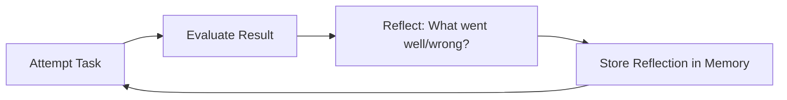

Reflection is the agent pattern of "looking back" on past actions to improve future ones: after completing (or failing) a task, the agent verbalizes what went well, what went wrong, and what to do differently, and the reflection is added to memory and consulted in future attempts. Without it, an agent that fails a task will often fail the same way next time, because it has no memory of past mistakes. This note covers the Reflexion algorithm, a worked example, the main variants, and the production practices and pitfalls of reflective agents.

## The idea

Without reflection, an agent that fails a task will often fail the same way next time — it has no memory of past mistakes. Reflection adds a feedback loop:



This is inspired by how humans learn: we don't just do things, we think about how we did them and adjust.

## The Reflexion algorithm

The canonical reference is the Reflexion algorithm (Shinn et al., 2023). It runs in five steps:

1. **Attempt**: the agent tries the task (using ReAct or similar).
2. **Evaluate**: an evaluator (rule-based, human, or LLM-as-judge) scores the result.
3. **Reflect**: if the result is unsatisfactory, the agent produces a reflection — a verbal summary of what went wrong and what to try differently.
4. **Store**: the reflection is added to long-term memory.
5. **Retry**: the agent attempts again, this time with access to past reflections.

After a few iterations, the agent has built up a "lessons learned" memory that substantially improves performance.

## Worked example

**Task**: Write a function that sorts a list.

**Attempt 1**:

```text
Thought: I'll use bubble sort.
Action: write_code("""
def sort(lst):
    for i in range(len(lst)):
        for j in range(len(lst) - 1):
            if lst[j] > lst[j+1]:
                lst[j], lst[j+1] = lst[j+1], lst[j]
    return lst
""")
Observation: code written
Thought: Done.
Action: finish("sort function written")
```

**Evaluation**: the tests fail. Simple cases such as `sort([3,1,2])` returning `[1,2,3]` and `sort([])` returning `[]` behave correctly, but the suite fails because of an off-by-one error — and the hand-rolled bubble sort is inefficient besides.

**Reflection 1**:

> The bubble sort implementation had an off-by-one error in the inner loop. The condition `range(len(lst) - 1)` should be `range(len(lst) - 1 - i)` to avoid re-checking already-sorted elements. Next time, I should test edge cases (empty list, single element) and consider efficiency.

**Attempt 2** (with reflection in context):

```text
Thought: Past reflection says to use `range(len(lst) - 1 - i)` and to handle edge cases. Let me use Python's built-in sort for simplicity and correctness.
Action: write_code("""
def sort(lst):
    return sorted(lst)
""")
Observation: code written, all tests pass
Action: finish("used built-in sorted()")
```

The reflection led to a better solution.

## Variants

### Self-reflection

The agent evaluates its own work without external feedback. Useful but limited — the agent can't catch errors it doesn't know it's making.

### External evaluation

A separate evaluator (rule-based tests, human review, LLM-as-judge) provides the signal. More reliable but more expensive.

### Reflection on success

Reflect on what went well, not just what failed. Reinforces good strategies. Rare in practice but useful.

### Continuous reflection

Reflect during the task, not just after. The agent periodically steps back and asks "is this approach working?" Useful for long-running agents.

### Reflexion with retrieval

Store reflections in a vector store and retrieve relevant ones for new tasks. Generalizes lessons across tasks, not just within a single task's retries.

## Implementation sketch

```python
def reflexion_agent(task, max_attempts=3):
    reflections = []

    for attempt in range(max_attempts):
        # Attempt the task with past reflections in context
        result, trace = react_agent(task, additional_context=reflections)

        # Evaluate
        score = evaluator(task, result)
        if score == "pass":
            return result

        # Reflect
        reflection = llm.chat(
            f"Task: {task}\nAttempt: {trace}\nResult: {result}\nScore: {score}\n\n"
            f"What went wrong? What should you do differently next time?"
        )
        reflections.append(reflection)

    return result  # best effort after max attempts
```

## Why this matters

Reflection is the self-improvement pattern for agents: without it, agents repeat mistakes; with it, they learn within a session. The Reflexion paper showed substantial improvements on coding (HumanEval), decision-making (ALFWorld), and reasoning (HotpotQA) — often 10–30% absolute improvement. Reflection is the basis for many advanced patterns: Self-Refine, Self-Critique, Constitutional AI, and RLAIF. For long-running autonomous agents, reflection is essential — it's how they accumulate "experience" without retraining.

## Production implications

Five practices dominate real deployments:

- **Add reflection to agents that retry tasks**. A simple "what went wrong?" prompt after failure often yields 10%+ improvement.
- **Store reflections persistently**. Don't lose them between sessions — they're the agent's "experience".
- **Use LLM-as-judge for evaluation** when ground-truth tests aren't available. Cheap and effective.
- **Limit reflection length**. Reflections can ramble; cap at 200–500 tokens per reflection.
- **Reflection is not free** — it adds LLM calls. Use it for high-stakes tasks, not every interaction.

## Common pitfalls

The five recurring mistakes:

- **Reflecting without acting on reflections** — if reflections aren't fed back into context, they don't help.
- **Reflecting too much** — endless reflection loops burn tokens without progress. Cap reflection iterations.
- **Self-evaluation bias** — agents tend to rate themselves too positively. Use external evaluators when possible.
- **Reflection drift** — over many iterations, reflections can drift away from the actual problem. Periodically reset.
- **Forgetting the original goal** — long reflection chains can lose sight of the task. Always include the original task in context.

## Relationship to other concepts

[[ReAct Pattern]] is the base agent loop that reflection enhances, and [[Chain of Thought]] is the reasoning technique used inside the reflection step. [[Tree of Thoughts and Self Consistency]] are alternative reasoning patterns that attack hard problems with search and voting instead of self-critique. [[Autonomous Agent Lifecycles]] covers where reflection sits in long-running agents, and [[Memory Types]] matters because reflections need persistent storage — vector-backed variants are covered by [[Vector Memory Backends]]. The research lineage runs through [[Reflexion]], [[Self-Refine]], and [[Constitutional AI]].

## Interview questions

**What is the Reflexion algorithm and how does it work?** (1) Attempt: the agent tries the task (using ReAct or similar). (2) Evaluate: an evaluator (rule-based, human, or LLM-as-judge) scores the result. (3) Reflect: if unsatisfactory, the agent produces a verbal reflection — what went wrong and what to try differently. (4) Store: the reflection is added to memory. (5) Retry: the agent attempts again with past reflections in context. After a few iterations, the "lessons learned" memory substantially improves performance (10–30% absolute improvement on coding and reasoning tasks).

**When does self-reflection fail?** (1) The agent can't catch errors it doesn't know it's making (self-evaluation bias). (2) Reflections can drift away from the actual problem over many iterations. (3) Endless reflection loops burn tokens without progress. (4) Huang et al. (2022) showed LLMs "cannot self-correct reasoning yet" — self-reflection on reasoning tasks without external feedback often doesn't improve accuracy. Use external evaluators when possible.

**How is reflection different from fine-tuning?** Reflection is in-context learning: the agent stores reflections in the prompt/context for the next attempt, with no weight updates. Fine-tuning updates weights from data. Reflection is instant (no training) but limited to the current session; fine-tuning is permanent but expensive. For production: start with reflection; if the same reflections recur across sessions, consider fine-tuning on them.

**What is the difference between self-reflection and external evaluation?** Self-reflection: the agent evaluates its own work — cheap but limited, because the agent can't catch unknown errors. External evaluation: a separate evaluator (tests, human review, LLM-as-judge) provides the signal — more reliable but more expensive. For coding: use tests (external). For writing: use LLM-as-judge. For creative tasks: use human review.

**How do you prevent reflection loops from running forever?** (1) Max iteration count — a hard limit (e.g., 3 attempts). (2) No-progress detection — if state hasn't changed in N iterations, terminate. (3) Repeated action detection — if the same action is taken 3+ times, terminate. (4) Cost/time budget — hard limits on tokens and wall-clock time. Always have a termination condition.

**How does reflection relate to Constitutional AI and RLAIF?** Constitutional AI uses AI feedback (a model critiques its own outputs against principles) instead of human feedback. This is large-scale reflection — the model reflects on its outputs during training, not just inference. The reflection pattern (inference-time) and RLAIF (training-time) are the same idea applied at different scales: inference-time self-critique vs training-time self-critique.

## Further reading

- Shinn et al. (2023), *Reflexion: Language Agents with Verbal Reinforcement Learning*.
- Madaan et al. (2023), *Self-Refine: Iterative Refinement with Self-Feedback*.
- Huang et al. (2022), *Large Language Models Cannot Self-Correct Reasoning Yet* (a counterpoint — self-reflection doesn't always work).

## See also

- [[Agents and Tooling MOC]] — the area orientation for agents and tooling.
- [[ReAct Pattern]] — the base agent loop that reflection enhances.
- [[Chain of Thought]] — the reasoning technique used in reflection.
- [[Tree of Thoughts and Self Consistency]] — alternative reasoning patterns.
- [[Function Calling]] — the tool layer reflective agents act through.
- [[Autonomous Agent Lifecycles]] — reflection in long-running agents.
- [[Memory Types]] — reflections need persistent storage.
- [[Vector Memory Backends]] — storing and retrieving reflections across tasks.
- [[LLM-as-Judge Evaluation]] — the evaluator signal when tests aren't available.
- [[Reflexion]] — the paper.
- [[Self-Refine]] — iterative refinement.
- [[Constitutional AI]] — training-time reflection.
