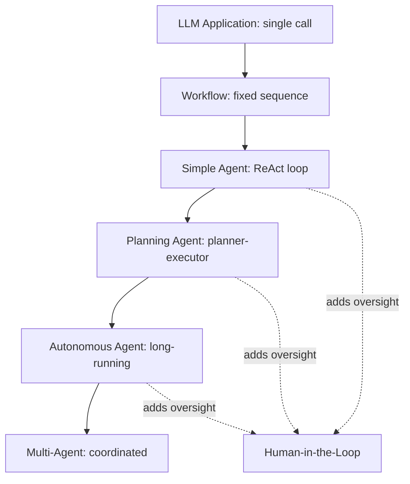
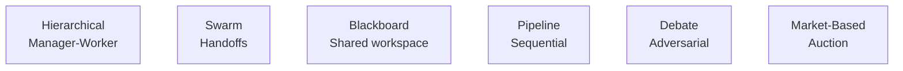
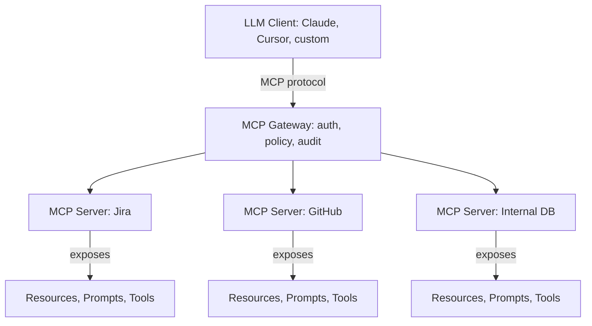
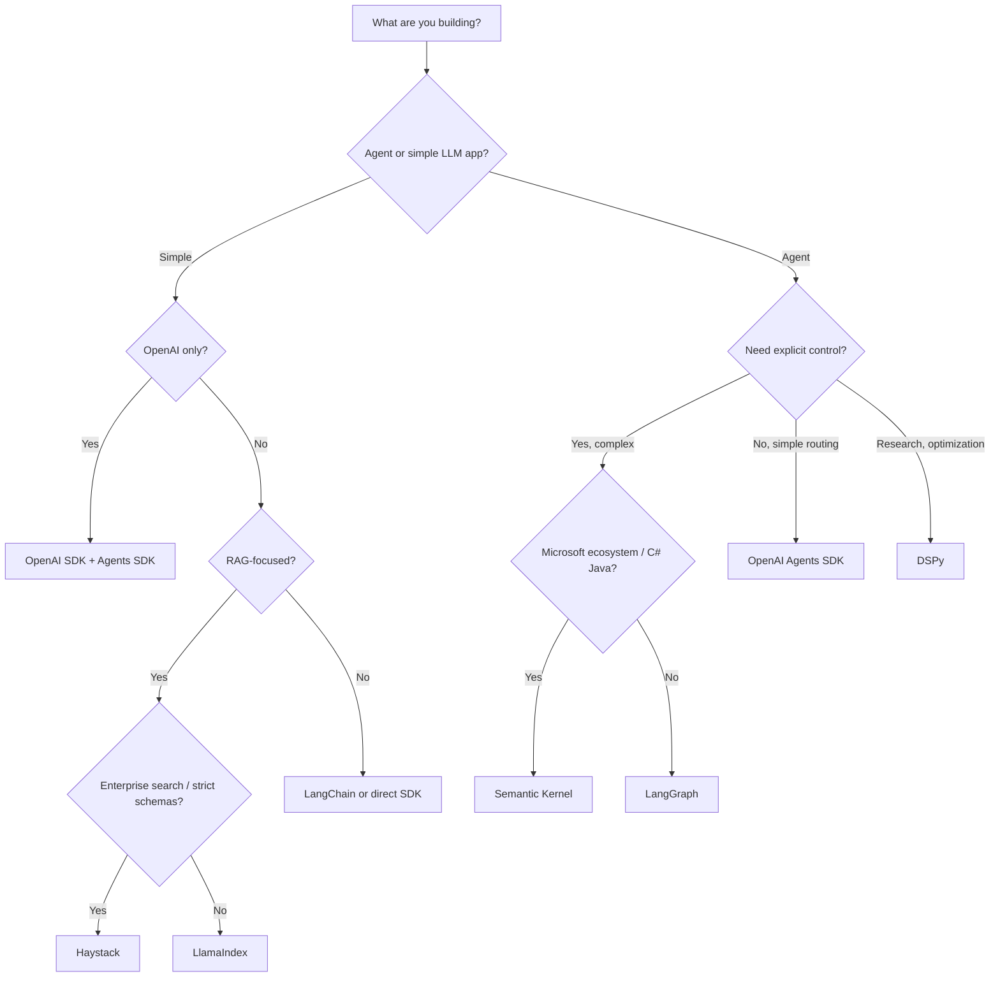

This area covers everything between a language model and a system that acts: agents that reason, call tools, and iterate toward a goal; the retrieval, memory, and protocol layers that give those agents knowledge and persistent context; and the frameworks and serving engines that turn the patterns into running software. It spans six sub-families — AI Agents, Multi-Agent Systems, Retrieval Augmented Generation, Memory Systems, Model Context Protocol, and Frameworks and Tools. The reading order below covers all 40 content notes of the area, and the sub-family sections then explain what each family contributes, why it matters, and how the families interlock.

> [!info] Scope
> **AI Agents** covers the patterns that make a single agent work — agents are LLMs that take actions in the world via tool calls, observe results, and iterate. **Multi-Agent Systems** covers multiple agents coordinating to solve complex tasks. **Retrieval Augmented Generation** covers the pattern that lets LLMs answer questions about your private data without retraining. **Memory Systems** gives LLMs persistent context across turns and conversations. **Model Context Protocol** standardizes how LLMs connect to external data sources, tools, and services. **Frameworks and Tools** holds deep technical guides for the 16 major frameworks and serving engines used to build LLM applications, agents, and serving systems.

## Reading order

The order follows the natural learning progression: single-agent foundations first — what an agent is, how it reasons, how it calls tools — then coordination across multiple agents, then the three context layers (retrieval, memory, protocol), and finally the frameworks that implement all of it. The agent family itself builds from definition to autonomy: what is (and isn't) an agent, the foundational reasoning technique, the agent loop, tool invocation, self-improvement via reflection, advanced multi-branch reasoning, upfront planning, and finally production lifecycles and human oversight.

| # | Note | Sub-family | Sub-domain | Purpose |
|---|------|------------|------------|---------|
| 00 | [[Agents and Tooling MOC\|This note]] | Orientation | — | The area map; start here. |
| 01 | [[Agent vs Workflow vs LLM Application]] | AI Agents | Architecture | What is (and isn't) an agent. |
| 02 | [[Chain of Thought]] | AI Agents | Reasoning | The foundational reasoning technique. |
| 03 | [[ReAct Pattern]] | AI Agents | Reasoning | Reasoning + acting; the agent loop. |
| 04 | [[Function Calling]] | AI Agents | Tool Calling | How agents invoke tools. |
| 05 | [[Reflection]] | AI Agents | Patterns | Self-improvement via past attempts. |
| 06 | [[Tree of Thoughts and Self Consistency]] | AI Agents | Reasoning | Advanced multi-branch reasoning. |
| 07 | [[Planner-Executor Pattern]] | AI Agents | Planning | Upfront planning + sequential execution. |
| 08 | [[Autonomous Agent Lifecycles]] | AI Agents | Autonomy | Production engineering for long-running agents. |
| 09 | [[Human-in-the-Loop Patterns]] | AI Agents | Autonomy | Approval gates, escalation, supervision. |
| 10 | [[Multi-Agent Architectures]] | Multi-Agent Systems | Architectures | Patterns: hierarchical, swarm, blackboard, etc. |
| 11 | [[Communication Patterns]] | Multi-Agent Systems | Communication | Direct, broadcast, pub/sub, blackboard. |
| 12 | [[Coordination and Consensus]] | Multi-Agent Systems | Coordination | Task allocation, voting, debate, negotiation. |
| 13 | [[Enterprise Multi-Agent Architectures]] | Multi-Agent Systems | Enterprise | Multi-tenancy, audit, policy, observability. |
| 14 | [[RAG Pipeline Overview]] | Retrieval Augmented Generation | Ingestion & Retrieval | The end-to-end picture. |
| 15 | [[Chunking, Hybrid Search, and Reranking]] | Retrieval Augmented Generation | Ingestion & Retrieval | The three biggest quality levers. |
| 16 | [[Advanced RAG Patterns]] | Retrieval Augmented Generation | Advanced Patterns | Agentic RAG, GraphRAG, Self-RAG, CRAG. |
| 17 | [[Memory Types]] | Memory Systems | Types | Working, episodic, semantic, procedural. |
| 18 | [[MemGPT and Letta]] | Memory Systems | Architectures | OS-inspired memory hierarchy for agents. |
| 19 | [[Memory Operations]] | Memory Systems | Operations | Write, read, consolidate, decay, forget. |
| 20 | [[Vector Memory Backends]] | Memory Systems | Vector Memory | pgvector, Pinecone, Qdrant, Weaviate, Milvus. |
| 21 | [[MCP Overview]] | Model Context Protocol | Architecture | What MCP is and why it exists. |
| 22 | [[MCP Components]] | Model Context Protocol | Components | Resources, Prompts, Tools — the three primitives. |
| 23 | [[MCP Security]] | Model Context Protocol | Security | Authentication, authorization, prompt injection. |
| 24 | [[MCP Enterprise Integration]] | Model Context Protocol | Integration | Gateway, multi-tenancy, audit, policy. |
| 25 | [[Framework Selection Guide]] | Frameworks and Tools | — | Decision framework for choosing frameworks. |
| 26 | [[LangChain]] | Frameworks and Tools | LLM Frameworks | General LLM framework; broad integrations. |
| 27 | [[LangGraph]] | Frameworks and Tools | Agent Frameworks | Graph-based agent orchestration. |
| 28 | [[DSPy]] | Frameworks and Tools | LLM Frameworks | Declarative prompt optimization. |
| 29 | [[LlamaIndex]] | Frameworks and Tools | LLM Frameworks | RAG-focused data framework. |
| 30 | [[OpenAI SDK and Agents SDK]] | Frameworks and Tools | LLM Frameworks | Official OpenAI tooling. |
| 31 | [[15 - Agents and Tooling/Frameworks and Tools/vLLM\|vLLM]] | Frameworks and Tools | Serving | Production LLM serving engine. |
| 32 | [[Ollama and llama.cpp]] | Frameworks and Tools | Serving | Local LLM inference. |
| 33 | [[AutoGen]] | Frameworks and Tools | Agent Frameworks | Conversational multi-agent framework. |
| 34 | [[CrewAI]] | Frameworks and Tools | Agent Frameworks | Role-based agent framework. |
| 35 | [[PydanticAI]] | Frameworks and Tools | Agent Frameworks | Type-safe agent framework. |
| 36 | [[TGI]] | Frameworks and Tools | Serving | HuggingFace Text Generation Inference. |
| 37 | [[15 - Agents and Tooling/Frameworks and Tools/TensorRT-LLM\|TensorRT-LLM]] | Frameworks and Tools | Serving | NVIDIA-optimized serving engine. |
| 38 | [[SGLang]] | Frameworks and Tools | Serving | RadixAttention + structured generation. |
| 39 | [[Semantic Kernel]] | Frameworks and Tools | Agent Frameworks | Microsoft's multi-language (Python/C#/Java) agent framework. |
| 40 | [[Haystack]] | Frameworks and Tools | LLM Frameworks | deepset's RAG-focused pipeline framework. |

Read the families in sequence for a complete course, or enter through whichever family matches the problem at hand; each section below says what its notes cover and how they fit together.

## Sub-families

Six families in dependency order: the agent patterns first, then coordination across agents, then the three context layers (retrieval, memory, protocol), then the frameworks that implement everything. Each family carries its own reading order, sub-domains, and production guidance.

### AI agents

Agents are LLMs that take actions in the world via tool calls, observe results, and iterate. The family organizes into six sub-domains: **Architecture** — [[Agent vs Workflow vs LLM Application]], what is (and isn't) an agent; **Reasoning** — [[Chain of Thought]] (the foundational reasoning technique), [[ReAct Pattern]] (reasoning + acting; the agent loop), and [[Tree of Thoughts and Self Consistency]] (advanced multi-branch reasoning); **Tool Calling** — [[Function Calling]], how agents invoke tools; **Patterns** — [[Reflection]], self-improvement via past attempts; **Planning** — [[Planner-Executor Pattern]], upfront planning plus sequential execution, that is, global planning as the alternative to ReAct's greedy step-by-step; and **Autonomy** — [[Autonomous Agent Lifecycles]] (production engineering for long-running agents) and [[Human-in-the-Loop Patterns]] (approval gates, escalation, supervision — oversight added at critical points).

The agent landscape, from simplest to most capable:

Each level adds capability but also complexity. Most production agents are at the "Planning Agent" level; autonomous and multi-agent systems are emerging. Human-in-the-loop is not a level but an overlay: oversight can be added to simple, planning, and autonomous agents alike.

Agents are the frontier of LLM applications, and understanding these patterns is essential for four engineering jobs:

- **Building production agents**: choosing the right pattern (ReAct, planner-executor, hierarchical).
- **Adding oversight**: knowing when and how to add human-in-the-loop.
- **Designing lifecycles**: production agents need checkpointing, monitoring, cost control.
- **Choosing frameworks**: LangGraph, AutoGen, CrewAI, and PydanticAI each suit different patterns.

### Multi-agent systems

Multiple agents coordinating to solve complex tasks. The sub-domains are **Architectures** — [[Multi-Agent Architectures]], the patterns: hierarchical, swarm, blackboard, etc.; **Communication** — [[Communication Patterns]]: direct, broadcast, pub/sub, blackboard; **Coordination** — [[Coordination and Consensus]]: task allocation, voting, debate, negotiation; and **Enterprise** — [[Enterprise Multi-Agent Architectures]]: multi-tenancy, audit, policy, observability.

The architecture patterns at a glance:

In words: hierarchical (manager-worker), swarm (handoffs), blackboard (shared workspace), pipeline (sequential), debate (adversarial), and market-based (auction). Why the family matters:

- Multi-agent systems unlock tasks that single agents cannot solve: complex research, multi-step coding, enterprise workflows.
- The communication pattern is the architecture's backbone — it determines scalability and emergent behavior.
- Enterprise deployment requires multi-tenancy, audit, and policy enforcement that research prototypes ignore.
- Most production multi-agent systems are hierarchical or pipeline; debate and auction patterns are rare in production.

The production implications distilled:

- **Start simple**: hierarchical or pipeline. Don't reach for swarm or debate until you've validated the simpler patterns can't do the job.
- **Observability first**: distributed tracing across the agent graph is non-negotiable.
- **Tenant isolation**: every shared state must be tenant-scoped.
- **Cost governance**: every LLM call attributed to a tenant and a request.

Framework support for these patterns — LangGraph, AutoGen, CrewAI — is compared in [[Framework Selection Guide]], and the production and operations disciplines the enterprise note builds on are covered in [[Inference and Production MOC]].

### Retrieval augmented generation

Retrieval-Augmented Generation is the pattern that lets LLMs answer questions about your private data without retraining. Three notes cover it end to end: [[RAG Pipeline Overview]] gives the end-to-end picture of ingestion and retrieval; [[Chunking, Hybrid Search, and Reranking]] covers the three biggest quality levers — chunking, retrieval, and reranking are each treated inside it; and [[Advanced RAG Patterns]] collects the advanced patterns: agentic RAG, GraphRAG, Self-RAG, and CRAG.

Sub-domain-wise, ingestion and retrieval span the first two notes and advanced patterns the third. Embeddings are deliberately not duplicated here — they live with the models themselves in [[Embedding Models for Retrieval]] — and the sparse side of hybrid search is classic lexical ranking, covered in [[BM25]]. An evaluation sub-domain (RAGAS, TruLens) is planned but not yet written. Agentic RAG is where this family meets the agent families: the retriever becomes a tool the agent decides when and how to call.

### Memory systems

Agent memory systems give LLMs persistent context across turns and conversations. The sub-domains are **Types** — [[Memory Types]]: working, episodic, semantic, procedural; **Architectures** — [[MemGPT and Letta]], the OS-inspired memory hierarchy for agents; **Operations** — [[Memory Operations]]: write, read, consolidate, decay, forget; and **Vector Memory** — [[Vector Memory Backends]]: pgvector, Pinecone, Qdrant, Weaviate, Milvus.

Why the family matters:

- Without persistent memory, every conversation starts from scratch — agents cannot learn user preferences, recall past interactions, or maintain state.
- The OS-inspired memory hierarchy (MemGPT) is the most influential long-term-memory architecture for agents.
- Memory operations (consolidation, decay, forgetting) are as important as storage — without them, memory grows unboundedly and quality degrades.
- Vector databases are the storage layer; the choice of DB affects scale, ops cost, and search quality.

The production implications distilled:

- **Start with pgvector**: integrated, simple, sufficient for most use cases.
- **Implement decay and consolidation from day one**: retrofitting is painful.
- **Multi-tenant isolation is mandatory**: never let tenant A's memories leak to tenant B.
- **Memory is an active system, not a passive store**: budget engineering effort for the operations layer, not just storage.

Retrieval is the read operation of memory — this family and the RAG family are two views of one storage-and-recall problem — and agents use MCP, the next family, to access memory servers.

### Model context protocol

The Model Context Protocol standardizes how LLMs connect to external data sources, tools, and services. The sub-domains are **Architecture** — [[MCP Overview]], what MCP is and why it exists; **Components** — [[MCP Components]], the three primitives: Resources, Prompts, Tools; **Security** — [[MCP Security]]: authentication, authorization, prompt injection (supply-chain threats included); and **Integration** — [[MCP Enterprise Integration]]: gateway, multi-tenancy, audit, policy.

The architecture at a glance:

An LLM client (Claude, Cursor, or a custom one) speaks the MCP protocol to a gateway that centralizes authentication, policy, and audit; the gateway fronts MCP servers — Jira, GitHub, an internal DB — each exposing Resources, Prompts, and Tools. Why the family matters:

- MCP standardizes the "last mile" between LLMs and external systems — replacing bespoke integrations with a common protocol.
- The three component types (Resources, Prompts, Tools) cleanly separate passive context, user workflows, and model actions.
- Security is the central challenge — prompt injection via retrieved content is a real attack surface, not a theoretical concern.
- Enterprise adoption requires a gateway pattern with authentication, policy enforcement, and audit logging.

The production implications distilled:

- **Treat every tool call as untrusted**: prompt injection means the model may be tricked into calling destructive tools.
- **Defense-in-depth**: combine input sanitization, output validation, tool allowlists, and human-in-the-loop for high-risk actions.
- **Audit every call**: who, when, what, why — essential for incident response and compliance.
- **Use a gateway**: centralize authentication, policy, and audit; don't distribute these concerns across clients.

MCP builds directly on [[Function Calling]] — function calling is how a model invokes a tool, MCP is how tools, data, and prompts are exposed to clients — and its multi-tenancy, audit, and policy concerns mirror those of [[Enterprise Multi-Agent Architectures]]. The prompt-injection attack surface itself is treated in depth in [[LLM Security and Prompt Injection]].

### Frameworks and tools

Deep technical guides for the major frameworks used to build LLM applications, agents, and serving systems — 16 frameworks and serving engines in total, with coverage complete. [[Framework Selection Guide]] leads the family as the decision framework for choosing among the rest, and the remaining notes split into three sub-domains. **Agent Frameworks** holds [[LangGraph]] (graph-based agent orchestration), [[AutoGen]] (conversational multi-agent framework), [[CrewAI]] (role-based agent framework), [[PydanticAI]] (type-safe agent framework), and [[Semantic Kernel]] (Microsoft's multi-language Python/C#/Java agent framework). **LLM Frameworks** holds [[LangChain]] (general LLM framework, broad integrations), [[DSPy]] (declarative prompt optimization), [[LlamaIndex]] (RAG-focused data framework), [[OpenAI SDK and Agents SDK]] (official OpenAI tooling), and [[Haystack]] (deepset's RAG-focused pipeline framework). **Serving** holds [[15 - Agents and Tooling/Frameworks and Tools/vLLM|vLLM]] (production LLM serving engine), [[Ollama and llama.cpp]] (local LLM inference), [[TGI]] (HuggingFace Text Generation Inference), [[15 - Agents and Tooling/Frameworks and Tools/TensorRT-LLM|TensorRT-LLM]] (NVIDIA-optimized serving engine), and [[SGLang]] (RadixAttention + structured generation).

Two neighboring topics are pointed at rather than duplicated: vector databases are covered from the agent-memory side in [[Vector Memory Backends]], with the Postgres-first operational detail in [[Vector Storage with pgvector]]; and an orchestration sub-family (Prefect, Airflow) is planned but not yet written. The final two notes completed the coverage: Semantic Kernel — Microsoft's enterprise multi-language agent framework with planner-based orchestration — and Haystack — deepset's RAG-focused pipeline framework with type-safe DAG-based components.

Why the choice deserves its own family — framework choice affects:

- **Development speed**: some frameworks are easier to start with.
- **Production reliability**: some frameworks are more battle-tested.
- **Performance**: some frameworks have better optimizations.
- **Lock-in**: some frameworks are tightly coupled to a vendor.

Selection heuristics:

- **For prototyping**: LangChain or LlamaIndex (lots of integrations, easy to start).
- **For production agents**: LangGraph (stateful, durable, well-tested) or PydanticAI (type-safe, clean abstractions).
- **For enterprise C# / Java stack**: Semantic Kernel (multi-language parity, Microsoft integration).
- **For production search + RAG**: Haystack (type-safe DAG pipelines, Elasticsearch/OpenSearch first-class).
- **For systematic prompt optimization**: DSPy (declarative compilation).
- **For RAG-focused applications**: LlamaIndex (best data loaders, index variety).
- **For OpenAI-centric apps**: OpenAI SDK + Agents SDK (official, minimal).
- **For serving**: [[15 - Agents and Tooling/Frameworks and Tools/vLLM|vLLM]] (open-source standard) or [[15 - Agents and Tooling/Frameworks and Tools/TensorRT-LLM|TensorRT-LLM]] (NVIDIA, max performance).
- **For local dev**: Ollama (easy install, good UX).
- **For vector DB**: pgvector (if you already use Postgres) or Qdrant (standalone, fast).

The same decision as a flowchart:

Start from what you are building. Simple LLM apps that are OpenAI-only stay on the official SDKs; other simple apps go to LlamaIndex if RAG-focused (Haystack when enterprise search or strict schemas matter), or LangChain / a direct SDK otherwise. Agents that need explicit, complex control choose LangGraph — or Semantic Kernel in a Microsoft C#/Java ecosystem — while simple routing stays on the OpenAI Agents SDK, and research-style prompt optimization goes to DSPy. What the agent frameworks help build is the subject of the two agent families above; what the serving engines optimize is covered in [[Inference and Production MOC]]; and where everything runs is the AI-infrastructure side of that same area.

## How the families fit together

The six families interlock rather than sit in parallel. RAG is a tool agents use: an agent's retriever is one more tool it calls, and agentic RAG closes the loop by letting the agent decide when and what to retrieve. Agents need memory, and retrieval is the read operation of memory — so the RAG and memory families are two views of one storage-and-recall problem, one aimed at knowledge grounding over private data, the other at conversation state.

MCP exposes tools to agents, standardizing the bridge that [[Function Calling]] crosses, and agents in turn use MCP to access memory servers. The framework family implements everything else: agent frameworks build the single- and multi-agent patterns, LLM frameworks build the RAG and application layer, and serving engines run the models underneath. The enterprise concerns repeat across families — multi-tenancy, audit, policy, and observability appear in [[Enterprise Multi-Agent Architectures]] and [[MCP Enterprise Integration]] alike — and the landmark papers behind the agent and RAG patterns are collected in [[Papers MOC]].

## Why this area matters

Agents are the frontier of LLM applications, and each family removes one specific bottleneck on the road to production. Multi-agent coordination unlocks tasks that single agents cannot solve — complex research, multi-step coding, enterprise workflows. RAG lets LLMs answer questions about private data without retraining. Memory systems give agents persistent context; without them every conversation starts from scratch, and without consolidation and decay, memory grows unboundedly and quality degrades. MCP standardizes the last mile between LLMs and external systems, replacing bespoke integrations with a common protocol. Framework choice, finally, is an engineering trade-off rather than a taste preference — it affects development speed, production reliability, performance, and lock-in.

Two calibration facts are worth carrying into any design discussion. Most production agents today sit at the planning-agent level of the landscape above; autonomous and multi-agent systems are emerging. And most production multi-agent systems are hierarchical or pipeline — debate and auction patterns are rare in production, so reach for them only once the simpler patterns demonstrably cannot do the job.

## Future expansion

The expansion list for the agent families:

- Tool selection strategies.
- Error recovery patterns.
- Long-running memory consolidation.
- Agent evaluation methodologies.

Two smaller gaps are acknowledged where they fall: RAG evaluation (RAGAS, TruLens) under the retrieval family, and workflow orchestration (Prefect, Airflow) under frameworks.

## Reading paths and next steps

- **New to agents?** Read the AI agents family in order (notes 01–09): it defines what an agent is before anything else, then builds the reasoning, tool-calling, planning, and autonomy stack step by step.
- **Building a multi-agent system?** [[Multi-Agent Architectures]] → [[Communication Patterns]] → [[Coordination and Consensus]], then [[Enterprise Multi-Agent Architectures]] when production concerns arrive.
- **Building RAG?** [[RAG Pipeline Overview]] → [[Chunking, Hybrid Search, and Reranking]] → [[Advanced RAG Patterns]]; go deeper on the retrieval mechanics with [[Embedding Models for Retrieval]] and [[BM25]].
- **Choosing a stack?** Start with [[Framework Selection Guide]] and the decision tree above, then read the note for the framework you picked.

When you are ready to go outside the area: the transformer models underneath all of this are covered in [[Attention and Transformers MOC]]; the serving techniques the serving engines implement — and the infrastructure, LLMOps, and production disciplines the enterprise notes assume — are covered in [[Inference and Production MOC]]; the injection defenses behind [[MCP Security]] are detailed in [[LLM Security and Prompt Injection]]; and the landmark agent papers are collected in [[Papers MOC]].

## See also

- [[Attention and Transformers MOC]] — the transformer models agents are built on.
- [[Inference and Production MOC]] — what serving frameworks optimize, where everything runs, and the production/operations discipline the enterprise notes assume.
- [[Embedding Models for Retrieval]] — the embedding models RAG retrieves with.
- [[BM25]] — the lexical ranking behind hybrid search.
- [[LLM Security and Prompt Injection]] — the attack surface MCP security defends against.
- [[Vector Storage with pgvector]] — the Postgres-first vector store the memory family recommends starting with.
- [[Papers MOC]] — landmark agent papers.
- [[Framework Selection Guide]] — the detailed decision framework behind the selection heuristics.
