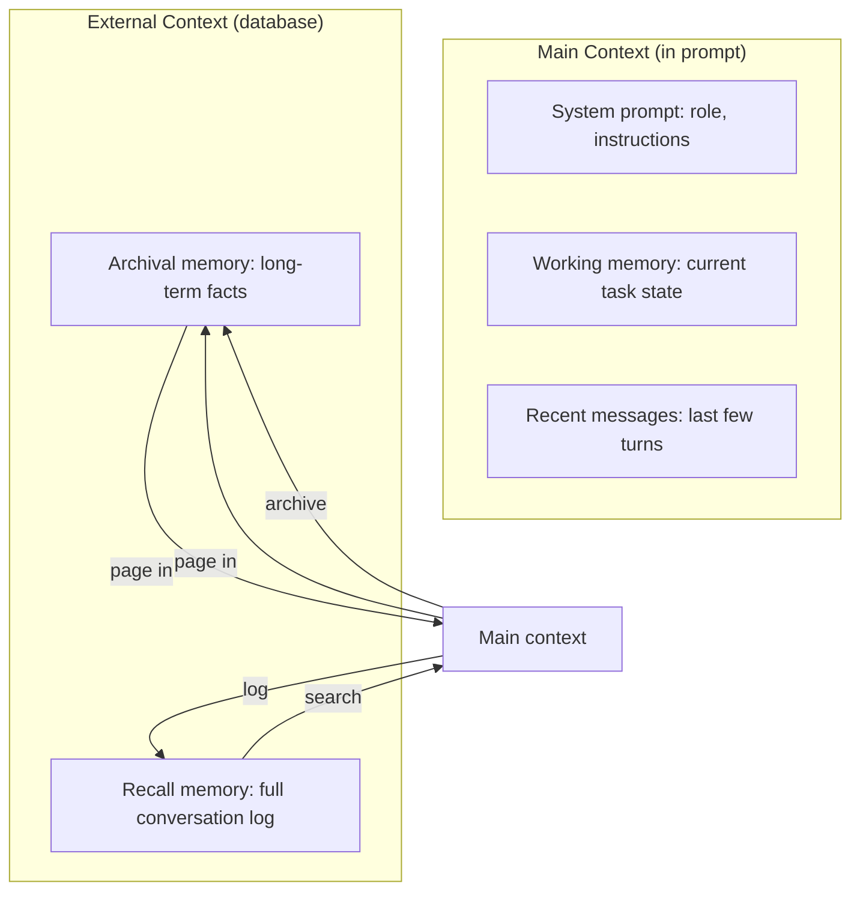

MemGPT (Packer et al., 2023) introduced an OS-inspired memory hierarchy for LLM agents: a small "main context" (the prompt) backed by a larger "external context" (a database) that the agent can page in and out via function calls. The agent manages its own memory — deciding what to remember, what to summarize, and what to forget. The project was renamed **Letta** (the company and the framework) in 2024 and remains one of the most influential long-term-memory architectures for agents. This note covers the problem MemGPT solves, its architecture, why it worked, its limitations, the Letta productization, comparisons with alternatives, and the production patterns and failure modes of memory-tiered agents.

## Citation

Packer, C., Wooders, S., Lin, K., Fang, V., & Gonzalez, J. E. (2023). *MemGPT: Towards LLMs as Operating Systems*. arXiv:2310.08560.

## The problem being solved

LLM agents have a fundamental memory problem: the context window is finite. A 128k-token context seems large but fills up quickly in long conversations. A typical budget breaks down as system prompt 1–5k tokens, tool descriptions 1–3k tokens, few-shot examples 1–5k tokens, conversation history growing with every turn, and retrieved documents at 5–50k tokens per retrieval. After a few hours of conversation or a few hundred tool calls, the context is full: the model cannot add new information without dropping old information. Standard approaches — truncating old messages, summarizing periodically — lose information irreversibly and require application-level logic.

MemGPT's insight is that this is the same problem operating systems solved decades ago with virtual memory. The OS gives each process the illusion of unlimited memory by paging data between RAM (fast, limited) and disk (slow, large). The OS decides what to keep in RAM and what to page out, transparently to the process.

MemGPT applies the same pattern to LLM context. The agent has access to memory-management functions (like syscalls) that let it explicitly move information between main context (the prompt) and external context (a database). The agent decides what to remember, what to archive, and what to retrieve.

## The architecture

### Memory tiers

MemGPT splits memory into two tiers, with explicit paging between them:



**Main context** is the LLM's prompt. It contains the system instructions (the agent's role), working memory (current task, recent state), and the recent conversation turns (the last few messages).

**External context** is a database the agent accesses via function calls. It contains **archival memory** — long-term facts the agent has chosen to remember, indexed for semantic search — and **recall memory** — the full, raw conversation log, also indexed for search.

The agent decides what to write to archival memory, what to retrieve, and what to forget. The OS analogy: main context is RAM, external context is disk, and the agent is the process managing its own memory.

### Memory management functions

The agent has function-calling access to memory operations:

```python
# Write to archival memory
def archival_memory_insert(content: str, metadata: dict = None):
    """Store a fact or summary in long-term memory."""

# Search archival memory
def archival_memory_search(query: str, limit: int = 5):
    """Retrieve relevant facts from long-term memory."""

# Search recall memory
def conversation_search(query: str, limit: int = 5):
    """Search past conversation history."""

# Send a message (and trigger context management internally)
def send_message(message: str):
    """Send a message to the user. May trigger internal memory updates."""
```

The agent calls these functions autonomously, deciding when to remember something, when to search for past information, and when to summarize and archive. This is agent-directed use of [[Function Calling]].

### Self-editing memory

The most distinctive MemGPT feature is that the agent can edit its own system prompt. If the agent learns a new fact about the user (e.g., "the user prefers concise answers"), it can call `core_memory_replace` to update its system prompt with this fact. On the next turn, the updated system prompt is in context — the agent has "learned" persistently.

This is a form of in-context learning that persists across conversations. The agent's behavior evolves based on experience, without any weight updates.

### Context window management

When the main context approaches the limit, MemGPT automatically:

1. Summarizes older messages into a compact summary.
2. Archives the original messages to recall memory.
3. Replaces the old messages in main context with the summary.

This is transparent to the agent — it sees a coherent conversation, but the underlying context has been compressed. The agent can later retrieve the original messages from recall memory via search.

## Why it worked

### The OS analogy maps cleanly

The virtual-memory analogy is not just metaphorical — it directly informs the design. The patterns OS designers developed (paging, working sets, LRU eviction) apply almost unchanged. This gave the MemGPT team a rich design vocabulary to draw from.

### Agent self-management

Rather than application code managing memory (truncating, summarizing), the agent itself manages memory. This is more flexible: the agent knows what's important (it wrote the messages) and can make better eviction decisions than a fixed policy.

### Persistent learning without weight updates

Self-editing the system prompt gives the agent a form of persistent learning without fine-tuning. This is valuable for personal assistants, customer-support agents, and other long-running agents that should adapt to individual users.

### Searchable external memory

By indexing archival and recall memory for semantic search, the agent can retrieve specific past information without loading everything into context. This scales to arbitrarily long histories.

## Limitations

MemGPT-style memory has real costs, which is why it is not the default everywhere:

- **Memory management overhead**: the agent spends tokens on memory operations. For short conversations, this overhead is wasteful; MemGPT shines only in long-running sessions.
- **Agent skill required**: the agent must learn when to archive, what to search for, and how to summarize. Smaller models struggle with this; GPT-4-class models are typically required.
- **Latency**: each memory operation is an extra LLM call. Long conversations can take many seconds per turn.
- **State consistency**: if the agent archives a fact and later retrieves a stale version, it may act on outdated information. Memory invalidation is hard.
- **No formal model of what to remember**: the agent decides heuristically. For high-stakes use cases (medical, legal), this is insufficient — you need explicit knowledge management.

## Letta (2024+)

In 2024, the MemGPT team founded **Letta** (the company) and released the Letta framework, which productionizes MemGPT with a REST API, persistent storage, and multi-tenant support; adds "agents as a service" — long-running agent processes accessible via HTTP; supports multiple backing stores (Postgres, Redis, vector databases); and integrates with LangChain, LlamaIndex, and other frameworks.

Letta's commercial pitch: stateful agents as a managed service, so developers don't have to build memory management themselves.

## Comparison with alternatives

### Mem0

Mem0 is a simpler approach: extract facts from conversations automatically (using an LLM), store them in a vector DB, and retrieve relevant facts on each new turn. There is no agent self-management — the system handles memory transparently. The upside is simplicity, compatibility with smaller models, and no memory-management overhead; the downside is less flexibility — the system decides what to remember, not the agent. Use it for simpler assistants where the OS-style control is overkill.

### LangGraph persistent state

LangGraph supports persistent state across runs via checkpointing. State is structured (Pydantic models) and stored in a database; each invocation resumes from the checkpoint. This gives explicit, typed state that is good for workflow-style agents, but it is not a general memory system — you must design the state schema upfront. Use it for workflow agents with well-defined state.

### Custom vector DB plus summary

Most production teams build a custom solution: a vector DB (Pinecone, Qdrant, pgvector) for long-term facts, a summary service that periodically compresses old turns, and application logic that decides what to retrieve. This gives full control and can be optimized for the specific use case, but it takes significant engineering effort and is easy to get wrong.

## Production patterns

### Hybrid agent-managed and automatic memory

Combine agent-managed memory (for explicit facts the agent decides to remember) with automatic extraction (a background process extracts facts from every turn). The agent gets both explicit and ambient memory.

### Tiered storage

- **Hot tier** (in-context): last few turns, current task state.
- **Warm tier** (Redis, low-latency vector DB): frequently accessed facts, recent summaries.
- **Cold tier** (Postgres, S3): full history, rarely accessed facts.

The agent searches the warm tier first (fast) and falls back to the cold tier (slower) only if the warm tier misses.

### Memory compaction

Periodically (e.g., every 50 turns), run a compaction job that identifies and deduplicates facts, re-summarizes old summaries (summaries of summaries), and archives low-value memories to cold storage. Without compaction, archival memory grows unboundedly and search quality degrades.

### Per-user and per-tenant isolation

Memory must be scoped to the user (a user's memories should not leak to other users) and to the tenant (in multi-tenant systems, tenant isolation is mandatory). Use row-level security in the database, or explicit tenant filtering on every query.

## Common pitfalls

### No memory validation

The agent stores a fact that's wrong (hallucination). On later retrieval, it acts on the wrong fact. Validate stored facts against external sources when possible; mark uncertain facts with confidence scores.

### Memory pollution

Adversarial inputs (prompt injection) cause the agent to store malicious facts. These persist across turns and can compromise future behavior. Sanitize inputs before storing; periodically audit stored memories.

### Search quality issues

If the vector embedding model is poor, or if memories are stored without good metadata, retrieval returns irrelevant results. Invest in embedding quality, store rich metadata (source, timestamp, confidence), and use hybrid search (vector + keyword).

### Unbounded growth

Without compaction, memory grows forever. Search latency increases and retrieval quality decreases. Implement compaction from day one.

### No memory invalidation

A fact stored on day 1 ("the user lives in New York") may be wrong on day 100 ("the user moved to London"). Without invalidation, the agent acts on stale facts. Allow the agent to update or invalidate past memories explicitly.

## Modern developments (2024–2026)

### Letta's Agent File standard

Letta formalized a serializable agent definition — the **Agent File** — a JSON document capturing the agent's LLM, system prompt, memory blocks, tools, and memory configuration. This makes stateful agents portable across environments (local dev → cloud → on-prem) and version-controllable in git. The Agent File is to stateful agents what Dockerfile is to containers: a reproducible specification of a running system.

### Sleep-time agents

A 2025 line of research (Packard et al., extending MemGPT) introduced **sleep-time compute** for memory: while the user is away, the agent runs background jobs to (1) re-summarize old conversations, (2) extract structured facts, (3) re-rank archival memory by importance, and (4) prefetch likely-relevant memories for the next session. This mirrors the OS pattern of background daemons performing filesystem defragmentation and journaling during idle time. Sleep-time agents reduce per-turn latency and improve recall by ~30–40% on long-horizon benchmarks compared to eager (online-only) memory. [[Memory Operations]] covers the consolidation jobs this enables.

### Memory layers (Mem0 + MemGPT hybrids)

Mem0 v2 (2025) added an optional "agent-managed" mode that mimics MemGPT's `core_memory_replace` and `archival_memory_insert` calls, but uses Mem0's automatic fact-extraction pipeline as a fallback when the agent doesn't explicitly manage memory. This hybrid pattern gives you the simplicity of automatic extraction for most turns and the precision of agent-managed edits when the agent decides a fact is worth persisting.

### Long-context models reduce — but don't eliminate — the need

With 1M-token context windows (Gemini 1.5 Pro, Claude Opus 4.5, GPT-5), some argue MemGPT-style paging is unnecessary. In practice this is wrong for three reasons:

1. **Cost**: a 1M-token prompt at $5/Mtok input = $5,000 per query. Paging hot subsets is orders of magnitude cheaper.
2. **Attention degradation**: models exhibit *lost-in-the-middle* effects beyond ~32k tokens; paging relevant context into the active region improves retrieval.
3. **Cross-session memory**: context is per-conversation; archival memory persists across sessions, devices, and model upgrades. A 1M context window doesn't help when the user starts a new chat.

### Benchmarks for long-term memory (LoCoMo, LongMemEval)

Two benchmarks have emerged for evaluating long-term memory: **LoCoMo** (Long Context Memory) and **LongMemEval**. Both test multi-session conversations where the model must recall specific facts stated sessions ago. MemGPT-style architectures score 2–3x higher than naive long-context approaches on these benchmarks, confirming that explicit memory management beats raw context stuffing for long horizons.

## Worked example: a personal assistant with Letta

```python
from letta import Letta
from letta.schemas.memory import ChatMemory

# Define memory blocks (each is a chunk of text the agent sees every turn)
memory = ChatMemory(
    blocks=[
        {"name": "human",     "value": "First name: Sarah\nInterests: rock climbing, jazz piano"},
        {"name": "persona",   "value": "I am Sarah's personal assistant. I am concise and proactive."},
    ]
)

client = Letta(base_url="http://localhost:8283")
agent = client.agents.create(
    name="sarah_assistant",
    memory=memory,
    llm_config={"model": "gpt-4o", "model_endpoint_type": "openai"},
    tools=["archival_memory_insert", "archival_memory_search",
           "conversation_search", "core_memory_replace"],
)

# First conversation
agent.send_message("I just moved to Lisbon for a new job at a fintech startup.", role="user")
# Agent autonomously:
#  1. Calls core_memory_replace to update "human" block (location: Lisbon, job: fintech startup)
#  2. Calls archival_memory_insert to store details about the move
#  3. Replies with welcome message

# Days later, new session — agent still "remembers"
agent.send_message("Where did I say I was working again?", role="user")
# Agent calls archival_memory_search("Lisbon job") OR reads updated core_memory block
# Replies: "You mentioned working at a fintech startup in Lisbon."
```

Three observations stand out. The agent **edits its own system prompt** (`core_memory_replace`) — a form of persistent in-context learning. Long-term facts are stored in archival memory and **retrieved on demand**, not stuffed into context. And cross-session continuity works because memory is **external to the model** — it survives context resets.

## Common failure modes

Memory-tiered agents fail in recognizable ways. The diagnostic table maps the observable symptom to its likely cause and the fix.

| Symptom                                | Likely Cause                                      | Fix                                                          |
|----------------------------------------|---------------------------------------------------|--------------------------------------------------------------|
| Agent ignores retrieved facts          | Retrieved facts placed at end of context (lost-in-middle) | Place retrieved facts near the user message              |
| Agent stores hallucinations            | No validation on `archival_memory_insert`         | Add a validator LLM call; require source citation           |
| Memory grows unbounded                 | No compaction job                                 | Schedule nightly compaction; archive low-confidence facts   |
| Latency spikes every N turns           | Periodic summarization runs synchronously         | Move summarization to background / sleep-time               |
| Agent forgets recent facts             | Working memory block too small or overwritten     | Increase block size; use multiple named blocks              |
| Cross-user memory leakage              | No tenant filter on archival search               | Add `tenant_id` to all memory queries; use RLS in Postgres  |
| Agent loops on memory ops              | No tool-call budget per turn                      | Cap memory ops per turn at 3–5; force-send on limit         |

## Interview questions

**How does MemGPT's memory hierarchy differ from a simple vector DB + retrieval pipeline?** A vector DB pipeline retrieves facts **transparently** based on the user's query embedding. MemGPT gives the **agent** explicit memory-management tools (`archival_memory_insert`, `core_memory_replace`) so the agent decides what's worth remembering and can edit its own system prompt. The OS analogy: vector DB pipelines are like an OS-managed page cache (the process is unaware), while MemGPT is like exposing mmap/syscalls to the process so it controls its own paging policy.

**When does MemGPT-style memory beat naive long-context?** Three regimes: (1) very long horizons (100+ sessions) where stuffing all history exceeds even 1M-token windows; (2) cost-sensitive production where paging is cheaper than million-token prompts; (3) cross-session continuity where context is reset but memory persists. For short, single-session tasks, naive context is simpler and faster.

**What is "core memory" in MemGPT and why is it powerful?** Core memory is a small editable block (typically the system prompt region) that the agent can rewrite via `core_memory_replace`. Because it's loaded on every turn, edits to core memory persist across the conversation. This gives the agent a form of **persistent in-context learning** without weight updates — it can "learn" that the user prefers concise answers, and that preference persists for the session lifetime.

**How would you prevent prompt injection from poisoning long-term memory?** Layered defense: (1) sanitize user input before it reaches `archival_memory_insert` — separate the "what to remember" decision from the "what was said" observation; (2) require a confidence score and source citation for each stored fact; (3) periodic audit jobs that scan archival memory for known injection patterns; (4) tenant isolation so injected facts can't leak across users; (5) mark facts from untrusted sources as low-confidence and down-rank them in retrieval.

**Why did the MemGPT team rename to Letta, and what changed commercially?** Letta (2024) is the company/product built on MemGPT. Commercially, Letta added: a REST API for long-running agents (agents-as-a-service), multi-tenant isolation, pluggable backing stores (Postgres/Redis/vector DBs), an Agent File standard for portable agent definitions, and integrations with LangChain/LlamaIndex. The research ideas remained MemGPT; the productization made them production-grade.

**How do you size the working memory block vs archival memory?** Working memory (in-context) should be small enough to fit alongside the system prompt + recent turns — typically 1–4k tokens. Archival memory is unbounded (vector DB backed). Rule of thumb: working memory holds *current task state + identity facts*; archival memory holds *historical facts retrieved on demand*. If the agent retrieves the same archival fact every turn, promote it to working memory.

## Relationship to other concepts

[[Memory Types]] provides the cognitive-science taxonomy MemGPT draws from (working/episodic/semantic), and [[Memory Operations]] describes the primitive ops (write/read/consolidate/decay) MemGPT implements. [[Vector Memory Backends]] is the storage layer MemGPT and Letta use for archival memory. [[Autonomous Agent Lifecycles]] covers how stateful agents fit into long-running lifecycles, and [[RAG Pipeline Overview]] is conceptually similar — RAG retrieval is like `archival_memory_search` but over external documents. [[MCP Overview]] matters because MCP servers can expose memory operations as tools (Letta ships an MCP-compatible memory server), and Letta integrates with agent frameworks like [[LangChain]], [[LlamaIndex]], and [[LangGraph]]. [[Reflexion]] is the earlier verbal-reinforcement memory pattern that MemGPT generalizes to structured storage, and [[KV Cache Mechanics]] is the complementary intra-turn memory (KV cache) to MemGPT's cross-turn memory.

## See also

- [[Agents and Tooling MOC]] — the area orientation for agents and tooling.
- [[Memory Types]] — the cognitive-science taxonomy MemGPT draws from.
- [[Memory Operations]] — the primitive operations MemGPT implements.
- [[Vector Memory Backends]] — the storage layer for archival memory.
- [[Autonomous Agent Lifecycles]] — stateful agents in long-running lifecycles.
- [[RAG Pipeline Overview]] — retrieval over external documents.
- [[Chunking, Hybrid Search, and Reranking]] — search quality for archival retrieval.
- [[MCP Overview]] — exposing memory operations as tools.
- [[Function Calling]] — the mechanism behind memory-management functions.
- [[LangChain]] — framework integration for Letta.
- [[LlamaIndex]] — framework integration for Letta.
- [[LangGraph]] — checkpoint-based persistent state alternative.
- [[Reflexion]] — the earlier verbal-reinforcement memory pattern.
- [[KV Cache Mechanics]] — intra-turn memory vs MemGPT's cross-turn memory.
