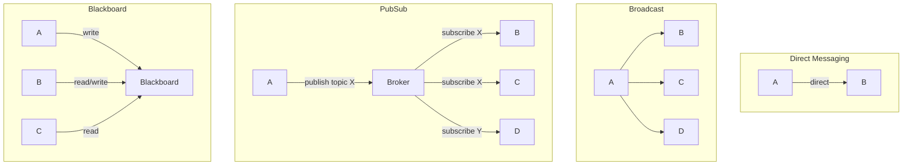

Multi-agent systems need structured communication protocols, because several LLMs — each with its own memory, tools, and goals — must exchange partial results, requests for help, and coordination signals. The four canonical patterns are direct messaging (one agent sends to another), broadcast (one agent sends to all), publish-subscribe (agents subscribe to topics), and blackboard (agents read/write a shared workspace). The choice of communication pattern determines the system's scalability, fault tolerance, and emergent behavior, and it interacts closely with the coordination mechanisms in [[Coordination and Consensus]].

> [!info] TL;DR
> Multi-agent systems need structured communication protocols. The four canonical patterns are: **direct messaging** (one agent sends to another), **broadcast** (one agent sends to all), **publish-subscribe** (agents subscribe to topics), and **blackboard** (agents read/write to a shared workspace). The choice of communication pattern determines the system's scalability, fault tolerance, and emergent behavior.

## Why communication patterns matter

A single-agent system has one LLM, one memory, one set of tools. Communication is trivial — everything happens in one process. A multi-agent system has multiple LLMs, each with its own memory, tools, and goals. The agents need to exchange information: partial results, requests for help, status updates, coordination signals. The communication pattern is the architecture's backbone — it determines what's easy, what's hard, and what's possible.

Poor communication design leads to common pathologies:

- **Flooding** — every agent broadcasts everything, overwhelming the system.
- **Starvation** — critical information does not reach the agent that needs it.
- **Deadlock** — agents wait for each other's responses forever.
- **Inconsistent state** — agents disagree about the world because they have different information.

The right pattern depends on the task topology, the agent count, and the latency requirements. The overall system shapes these patterns define are covered in [[Multi-Agent Architectures]].

## The four canonical patterns

### Direct messaging (point-to-point)

Agent A sends a message directly to Agent B. The message is addressed and delivered only to B.

```python
# Agent A
response = agent_b.handle(request={"from": "A", "type": "lookup", "query": "..."})

# Agent B
def handle(self, request):
    return self.process(request)
```

Direct messaging is simple to reason about, has low overhead (no broker, no topic infrastructure), and gives direct request/response semantics — natural for "ask Agent B for X" interactions. Its weaknesses: agents must know about each other (tight coupling), it does not scale to many agents — N agents need O(N²) pairwise channels — and it is hard to add new agents, because existing agents must be updated to know about them. Use it for small systems (2–5 agents) and for hierarchical systems where a manager agent dispatches to specific workers.

### Broadcast

Agent A sends a message to all other agents. Every agent receives every message.

```python
# Agent A
for agent in all_agents:
    if agent != self:
        agent.receive(message)

# Or via a broker
broker.broadcast(message, sender="A")
```

Broadcast is simple to implement and needs no addressing logic — every agent sees everything — which makes it good for global announcements (e.g., "task complete, all agents stop"). It does not scale, because every agent processes every message; agents must filter (decide what's relevant), which adds work; and it has privacy costs, since agents see messages not intended for them. Use it for very small systems (2–3 agents), or for specific control messages (shutdown, status query) that genuinely need to reach everyone.

### Publish-subscribe (pub/sub)

Agents publish messages to topics; agents subscribe to topics they care about. A broker routes messages from publishers to subscribers.

```python
# Agent A publishes
broker.publish(topic="task.completed", message={"task_id": "..."})

# Agent B subscribes
broker.subscribe(topic="task.completed", callback=b.on_task_completed)
```

Pub/sub is decoupled — publishers and subscribers don't need to know about each other; scalable — agents only receive messages on their subscribed topics; extensible — add a new agent by subscribing to relevant topics, with no changes to publishers; and async — publishers don't block waiting for subscribers. The costs: it requires a broker (additional infrastructure), topic design is non-trivial (too few topics → flooding; too many → fragmentation), and it is hard to reason about who receives a given message (you must trace subscriptions). Use it for medium-to-large systems (5+ agents), event-driven architectures, and systems that need to scale or evolve over time.

### Blackboard (shared workspace)

All agents read from and write to a shared data structure (the "blackboard"). Agents monitor the blackboard for relevant changes and act when they see something they can contribute to.

```python
# Shared blackboard
blackboard = {
    "facts": [],
    "hypotheses": [],
    "decisions": [],
}

# Agent A writes
blackboard["facts"].append({"source": "A", "content": "..."})

# Agent B reads
def monitor(blackboard):
    for fact in blackboard["facts"]:
        if is_relevant(fact, self.specialty):
            self.act(fact)
```

The blackboard offers maximum decoupling — agents don't communicate directly at all; it is natural for problems where multiple specialists contribute partial results; it is easy to add/remove agents without disrupting others; and it supports opportunistic reasoning, where an agent contributes when it can rather than when called. Its weaknesses: concurrency control is hard (multiple agents writing simultaneously), performance can degrade (every agent polls the blackboard), and it is hard to debug (no explicit message flow; behavior is emergent). Use it for problems with multiple specialist contributors (medical diagnosis, intelligence analysis) and for research-style multi-agent exploration.

## Comparing the patterns

| Pattern | Coupling | Scalability | Latency | Use Case |
|---|---|---|---|---|
| Direct | High | Poor (O(N²)) | Low | Small systems, hierarchical |
| Broadcast | Medium | Very poor | Low | Control messages, very small systems |
| Pub/Sub | Low | Good | Medium | Event-driven, evolving systems |
| Blackboard | Very low | Medium | Variable | Specialist collaboration |



The comparison captures the essential tradeoff: as coupling decreases from direct to blackboard, scalability and flexibility improve, but latency becomes less predictable and message flow becomes harder to trace.

## Message structure

Regardless of pattern, messages need structure. A typical message envelope:

```text
{
  "id": "msg_001",
  "from": "agent_researcher",
  "to": "agent_writer",  // or "topic": "drafts.ready"
  "type": "draft.complete",
  "content": {
    "draft_id": "draft_42",
    "summary": "...",
    "needs_review": true
  },
  "metadata": {
    "timestamp": "2026-08-07T12:00:00Z",
    "trace_id": "...",
    "reply_to": "msg_000"
  }
}
```

The key fields: **id** is a unique identifier for the message (for tracing and dedup); **from / to / topic** carry the routing information; **type** is a string identifying the message type (for handler dispatch); **content** is the actual payload (often JSON); and **metadata** carries trace IDs, timestamps, and reply chains.

Strongly-typed messages (Pydantic models, Protocol Buffers) catch errors at write time and make the system debuggable — this is the same type-safety argument behind [[PydanticAI]]. Avoid free-form string messages — they're a recipe for protocol drift.

## Communication topologies

Beyond the pattern, the **topology** of who-talks-to-whom matters.

### Star (hub-and-spoke)

One central agent (the "hub") communicates with all others; other agents do not communicate directly. It is simple with centralized control, but the hub is a bottleneck and a single point of failure. Example: a manager agent dispatching tasks to worker agents.

### Mesh

Every agent can communicate with every other agent. This gives maximum flexibility with no bottleneck, at the cost of O(N²) channels that are hard to reason about. Example: a small research team where everyone talks to everyone.

### Ring

Agents communicate in a cycle: A → B → C → A. The ring is simple, fair, and predictable, but slow, because a message must traverse the ring. Example: a pipeline of agents (extractor → analyzer → writer → reviewer → extractor).

### Hierarchy

A tree structure: a root agent has child agents, which have their own children. Hierarchies scale well with clear delegation, but information is lost at each level and the structure is rigid. Example: a CEO agent with department-head agents, each with team-lead agents.

## Frameworks and implementation

### LangGraph

LangGraph provides explicit graph-based agent communication. You define nodes (agents) and edges (communication channels). It supports both direct messaging (an edge from A to B) and conditional routing (the edge decides which agent goes next based on state).

### AutoGen

AutoGen is a conversational agent framework. Agents communicate via "conversable" messages — each agent has a `send` and `receive` method. It supports group chat, a special broadcast pattern.

### CrewAI

CrewAI is a role-based agent framework. Agents have roles (researcher, writer, reviewer) and communicate via "tasks" — a task is assigned to one agent, who produces an output that flows to the next agent in the pipeline.

### Semantic Kernel

Semantic Kernel is Microsoft's framework. It uses a "kernel" that orchestrates plugin calls. Communication is implicit through plugin invocations rather than explicit messages.

### Custom stacks (Pydantic + Redis/RabbitMQ)

For production systems with strict requirements, many teams build custom: Pydantic models for message types, Redis pub/sub or RabbitMQ for the broker, FastAPI for the agent endpoints, and OpenTelemetry for tracing. This is more work than using a framework but gives full control over scalability, observability, and error handling. [[Framework Selection Guide]] helps decide when that trade is worth it.

## Common pitfalls

- **No schema enforcement** — free-form message content (just a string or unstructured dict) leads to protocol drift: Agent A sends a field that Agent B doesn't expect, and the failure is silent. Always use typed message schemas.
- **Synchronous communication in async systems** — Agent A blocks waiting for Agent B's response. If B is slow or fails, A hangs. Use async messaging (publish-subscribe, message queues) for systems that need to scale.
- **No timeout** — an agent sends a message and waits forever for a response. Always set timeouts and have a fallback (retry, default response, error to caller).
- **No idempotency** — the same message delivered twice causes the agent to act twice. Use message IDs and dedup.
- **No dead letter queue** — messages that fail to process are silently dropped. Use a dead letter queue to capture failed messages for inspection and replay.
- **Tracing gap** — without distributed tracing (trace IDs propagated through messages), multi-agent bugs are nearly impossible to debug. Always propagate trace IDs.

## See also

- [[Agents and Tooling MOC]] — orientation for the agents and tooling area.
- [[Multi-Agent Architectures]] — the system-level patterns these communications support.
- [[Coordination and Consensus]] — task allocation, consensus, and negotiation on top of communication.
- [[Enterprise Multi-Agent Architectures]] — production concerns: tenancy, audit, governance.
- [[LangGraph]] — graph-based communication with explicit nodes and edges.
- [[AutoGen]] — conversable agents and group chat.
- [[CrewAI]] — task-based communication between roles.
- [[Semantic Kernel]] — implicit communication via plugin invocations.
- [[PydanticAI]] — type-safe agents and typed message schemas.
- [[Framework Selection Guide]] — choosing a framework.
- [[Build a Multi-Agent System]] — a project implementing these patterns.
