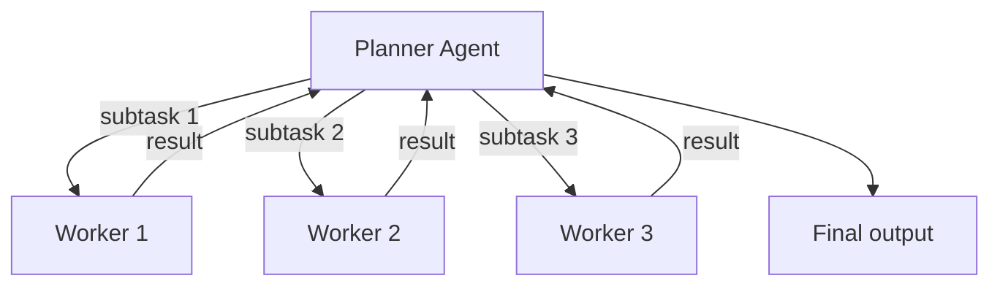
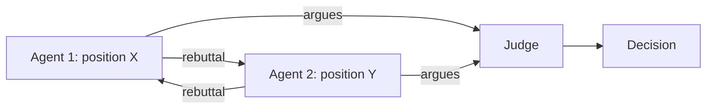

Coordination is the process by which multiple agents decide who does what, when. Its three core problems are task allocation (who works on which subtask), consensus (how agents agree on a shared state), and negotiation (how agents with conflicting goals reach agreement). Patterns range from simple (a centralized planner) to complex (market-based auctions, voting protocols), and the right choice depends on agent count, task structure, and fault-tolerance requirements. This note complements [[Communication Patterns]], which covers how the messages between coordinating agents actually flow, and [[Multi-Agent Architectures]], which covers the overall system shapes.

> [!info] TL;DR
> Coordination is the process by which multiple agents decide who does what, when. The three core problems are: **task allocation** (who works on which subtask), **consensus** (how do agents agree on a shared state), and **negotiation** (how do agents with conflicting goals reach agreement). Patterns range from simple (centralized planner) to complex (market-based auctions, voting protocols). The right choice depends on agent count, task structure, and fault-tolerance requirements.

## Why coordination is hard

Multiple agents working on the same problem create classic distributed-systems issues:

- **Concurrency** — agents act in parallel, possibly on overlapping subtasks.
- **Conflicting information** — different agents may have different views of the world.
- **Conflicting goals** — agents may optimize for different objectives (e.g., speed vs. accuracy).
- **Failure handling** — if Agent A fails mid-task, who picks up the work?
- **Aggregation** — how do you combine multiple agents' outputs into a coherent result?

Without explicit coordination, multi-agent systems exhibit emergent but often undesirable behavior: agents duplicate work, contradict each other, or produce inconsistent outputs. Coordination patterns make the system's behavior predictable and debuggable.

## Task allocation

### Centralized planner

A single "planner" agent decomposes the task, assigns subtasks to worker agents, and aggregates results.



The centralized planner is simple to implement and reason about, predictable (the planner controls all decisions), and makes it easy to add or remove workers (the planner reroutes). Its weaknesses: the planner is a bottleneck and single point of failure, it doesn't scale well to many subtasks (the planner becomes the limit), and workers cannot adapt to discovered subtasks — they wait for the planner. Use it for hierarchical decomposition with clear subtask boundaries (e.g., a "research, then write, then review" pipeline) — the same shape as the [[Planner-Executor Pattern]].

### Market-based allocation (auction)

Subtasks are "auctioned" to agents. Each agent bids based on its suitability (capacity, expertise, current load). The auctioneer assigns the subtask to the highest bidder.

```python
def auction(subtask, agents):
    bids = []
    for agent in agents:
        bid = agent.bid(subtask)  # returns a score or cost
        bids.append((agent, bid))
    winner = min(bids, key=lambda x: x[1])  # lowest cost wins
    winner[0].assign(subtask)
```

Auctions are decentralized — no central planner needs to know each agent's state; adaptive — agents bid based on current load, so work is balanced; and scalable — new agents just join the auction. The weaknesses: bidding logic is non-trivial (how does an agent estimate its cost?), there is auction overhead per subtask, and strategic agents may "game" the auction (bid low to win, then do poor work). Use auctions for heterogeneous agent pools (agents with different specialties) and dynamic workloads.

### Self-assignment

Agents monitor a shared task queue and pick up tasks they can handle. No central planner or auction.

```python
def worker_loop(agent, task_queue):
    while True:
        task = task_queue.get_next_compatible(agent.capabilities)
        if task:
            task_queue.mark_in_progress(task, agent)
            result = agent.execute(task)
            task_queue.mark_complete(task, result)
```

Self-assignment is fully decentralized with no coordinator, workers can be added or removed freely, and it is naturally load-balanced (busy workers don't pick up new tasks). The weaknesses: race conditions (two workers grab the same task) — it needs locking; there is no global optimization (a worker picks the next task, not the best task); and it is hard to enforce priorities. Use it for homogeneous agent pools, simple task structures, and fault-tolerant workloads.

## Consensus

Consensus is the problem of getting multiple agents to agree on a shared state. It is necessary when agents have different observations of the world, when the system needs a single "truth" to act on, and when fault-tolerant decisions are required (one agent's failure should not corrupt the decision).

### Voting

Each agent proposes an answer; the majority (or plurality) wins.

```python
def vote(answers):
    counts = Counter(answers)
    return counts.most_common(1)[0][0]
```

Voting is simple, well-understood, and needs no special infrastructure. But the majority can be wrong (especially on hard questions), it does not weight by confidence or expertise, and for free-form outputs "voting" requires a similarity metric to cluster answers. Use it when multiple agents independently solve the same problem — the single-agent analogue is [[Self-Consistency]], and the generalization is [[Tree of Thoughts and Self Consistency]].

### Debate

Agents argue for their proposed answer. A judge (another agent or human) decides.



Debate forces agents to justify their answers and catches errors through adversarial scrutiny. It is expensive (multiple rounds of LLM calls), and judge quality matters. Use it for high-stakes decisions where errors are costly (medical, legal, safety-critical).

### Aggregation (mixture of experts)

Combine multiple agents' outputs rather than picking one. For numeric answers: average. For text: have a "synthesizer" agent merge them.

```python
def aggregate(answers):
    if all_numeric(answers):
        return mean(answers)  # or median, more robust to outliers
    else:
        return synthesizer_agent.merge(answers)
```

Aggregation leverages all agents' contributions and is often more accurate than any single agent. The weaknesses: the synthesizer is another LLM call, and aggregation logic is task-specific. Use it for tasks where multiple perspectives add value (research summaries, code reviews).

### Quorum

A subset of agents (the quorum) must agree before a decision is committed. This is the pattern used in distributed systems for fault tolerance. Quorum is tolerant of faulty agents (Byzantine fault tolerance), but slower (you need to wait for the quorum) and complex to implement. Use it for safety-critical systems and multi-region deployments.

## Negotiation

When agents have conflicting goals (e.g., a buyer agent wants low price, a seller agent wants high price), they need to negotiate.

### Alternating offers

Agents take turns proposing terms. If the other accepts, deal. If not, they counter-offer. Bounded by a deadline.

```python
def negotiate(buyer, seller, item, deadline):
    offer = seller.initial_offer(item)
    while not deadline.reached():
        if buyer.accepts(offer):
            return offer
        counter = buyer.counter(offer)
        if seller.accepts(counter):
            return counter
        offer = seller.counter(counter)
    return None  # failed
```

Alternating offers are simple and capture the natural back-and-forth of negotiation. The weaknesses: it is slow, and agents may have incentive to stall. Use it in clearly adversarial settings (price negotiation, resource allocation).

### Auction-based

Multiple agents bid; the highest bidder wins. Used for resource allocation (compute, attention). Auctions are fast and market-driven, but agents with more resources dominate and the outcome may not optimize for fairness.

### Mediated

A neutral "mediator" agent proposes terms that both sides can accept. Mediation breaks deadlocks and the mediator can optimize for fairness, but the mediator's quality determines outcomes. Use it for high-stakes negotiations where a deal is critical (e.g., supply-chain agreements).

## Failure handling

Coordination systems must handle agent failures gracefully. Four patterns cover the main cases.

**Timeout and retry.** If an agent does not respond within a deadline, treat it as failed. Reassign the task or proceed without the result.

**Checkpointing.** Periodically save intermediate state. On failure, restart from the last checkpoint rather than the beginning.

**Redundancy.** Assign critical tasks to multiple agents. Use the first result that completes.

**Circuit breaker.** If an agent fails repeatedly, stop sending it tasks (assume it's broken). Periodically probe to see if it has recovered.

## Common pitfalls

- **Deadlock** — agents wait for each other's responses forever. Always have timeouts and a fallback.
- **Livelock** — agents keep responding to each other without making progress. Cap the number of rounds.
- **Starvation** — a "loud" agent dominates the conversation; quieter agents never contribute. Use round-robin or turn-taking enforcement.
- **Inconsistent state** — agents disagree about the world because they have different observations. Use a shared state store (blackboard, database) as the source of truth.
- **No trace** — without tracing, multi-agent bugs are impossible to debug. Log every message, every decision, every failure. Use distributed tracing (OpenTelemetry).

## Frameworks

LangGraph provides graph-based coordination with explicit state and conditional routing. AutoGen provides conversational coordination with group chat patterns. CrewAI provides role-based coordination with task assignment. OpenAI Swarm offers a lightweight agent handoff pattern (experimental). For production systems, custom implementations on top of Redis/RabbitMQ with strong tracing are common — the tradeoffs are laid out in [[Framework Selection Guide]] and the production requirements in [[Enterprise Multi-Agent Architectures]].

## See also

- [[Agents and Tooling MOC]] — orientation for the agents and tooling area.
- [[Multi-Agent Architectures]] — the system-level patterns being coordinated.
- [[Communication Patterns]] — how coordinating agents exchange messages.
- [[Enterprise Multi-Agent Architectures]] — production coordination at scale.
- [[Planner-Executor Pattern]] — the centralized-planner allocation pattern in detail.
- [[Tree of Thoughts and Self Consistency]] — sampling and voting over reasoning paths.
- [[Self-Consistency]] — the paper behind majority-vote decoding.
- [[LangGraph]] — graph-based coordination with explicit state.
- [[AutoGen]] — conversational coordination with group chat.
- [[CrewAI]] — role-based task assignment.
- [[Framework Selection Guide]] — choosing a framework.
- [[Build a Multi-Agent System]] — a project implementing these patterns.
