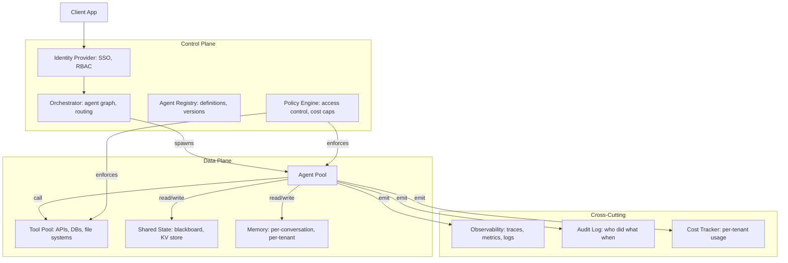

Enterprise multi-agent systems are not just "multiple LLMs chatting" — they are production systems with strict requirements for multi-tenancy, audit trails, access control, observability, cost governance, and graceful degradation. The reference architecture combines a control plane (orchestrator, agent registry, policy engine, identity provider) with a data plane (agent pool, tool pool, shared state, memory) and integrates with enterprise identity, monitoring, and governance systems. Where [[Communication Patterns]] and [[Coordination and Consensus]] describe *how* agents cooperate, this note describes what it takes to deploy that cooperation inside a real organization.

> [!info] TL;DR
> Enterprise multi-agent systems are not just "multiple LLMs chatting." They are production systems with strict requirements: multi-tenancy, audit trails, access control, observability, cost governance, and graceful degradation. The reference architecture combines a control plane (orchestrator, registry, policy engine) with a data plane (agents, tools, shared state) and integrates with enterprise identity, monitoring, and governance systems.

## Why enterprise multi-agent is different

The base patterns describe how agents talk to each other and how they allocate work. Enterprise architectures add the concerns that make a multi-agent system deployable inside a real organization:

- **Multi-tenancy** — different teams or customers share the same infrastructure but must be isolated.
- **Access control** — Agent A can call Tool X on Tenant 1's data but not Tenant 2's.
- **Auditability** — every action must be traceable to a user, a policy, and a decision.
- **Cost governance** — per-tenant cost caps, chargebacks, budget enforcement.
- **Compliance** — GDPR, HIPAA, SOC 2, internal data-handling policies.
- **Observability** — distributed tracing across the agent graph, metrics per tenant, alerting.
- **Reliability** — graceful degradation when LLM providers fail, when tools are unavailable, when context limits are exceeded.

A multi-agent system that handles these concerns looks very different from a research prototype. The rest of this note describes the reference architecture that does so.

## Reference architecture

Three planes divide the responsibilities. The control plane decides who runs, in what order, and under which policies. The data plane does the actual work — LLM-backed agents calling tools and sharing state. Cross-cutting concerns (observability, audit, cost) are emitted by the data plane and consumed by operators and compliance systems.

## The control plane

### Orchestrator

The orchestrator is the entry point for client requests. It receives the request and authenticates the caller (via the identity provider), loads the agent graph definition from the registry, determines which agents to invoke and in what order, enforces policies (cost caps, rate limits, access control), and returns the final result to the client.

The orchestrator is the **only** component exposed to clients. Agents and tools are never directly callable — clients cannot bypass the orchestrator's policy enforcement.

### Agent registry

The registry stores versioned definitions of every agent: the agent's role and capabilities, the model + prompt + tools it uses, the agent's input/output schema, and version history with rollback support. Agents are deployed by promoting versions through dev → staging → production, just like any other service.

### Policy engine

The policy engine is the centralized enforcement point for access control (which users/tenants can invoke which agents and tools), cost caps (per-tenant daily/monthly budgets; requests that would exceed the cap are rejected), rate limits (per-user, per-tenant, per-agent throttling), data residency (certain data cannot leave certain regions or be processed by certain models), and tool allowlists (only specific tools can be called by specific agents in specific contexts).

The policy engine is consulted on every request and every tool call. Without centralized policy enforcement, multi-agent systems develop ad-hoc policies in each agent — a security and compliance nightmare.

### Identity provider

The identity provider integrates with enterprise SSO (Okta, Azure AD, etc.) and maps users to tenants, roles, and permissions. The orchestrator accepts SSO tokens and resolves them to identity context that the policy engine can use.

## The data plane

### Agent pool

The agent pool holds the actual LLM-backed agents. In a production system, agents run as separate processes (or containers) for isolation, each agent has its own model client, prompt, and tool definitions, and agents scale horizontally based on load. Agents are stateless between requests — conversation state lives in the memory store, not in the agent.

Stateless agents are essential for horizontal scaling and fault tolerance. If an agent process crashes, the orchestrator can retry on another instance.

### Tool pool

Tools are the external systems the agents call: databases, APIs, file stores, code interpreters. Each tool has a versioned schema (parameters, return type), its own access control (which agents can call it, on which data), rate limits and quotas, and logs every call for audit.

Tools are the most security-sensitive component — they have real-world effects (writing to databases, calling external APIs). Treat them as untrusted: validate inputs, sanitize outputs, log everything.

### Shared state

For agents to coordinate, they need shared state. The options are the blackboard pattern — a shared KV store (Redis, Postgres) that agents read/write (see [[Communication Patterns]]); a message broker — Redis pub/sub, Kafka, RabbitMQ for async messaging; and workflow state — LangGraph-style explicit state passed through the agent graph.

For multi-tenant systems, every state object must be tagged with tenant ID and access-controlled.

### Memory

Memory is per-conversation and per-tenant. It spans conversation history (the messages exchanged so far), long-term memory (facts learned about the user, preferences, past interactions), and working memory (intermediate state for the current task) — the same taxonomy covered in [[Memory Types]].

Memory must be tenant-isolated. A common bug: Agent A reads Agent B's memory because the memory store does not enforce tenant scoping. Use database-level row-level security or explicit tenant filtering on every query.

## Cross-cutting concerns

### Observability

Observability has four pillars. Distributed tracing gives every request a trace ID, with every agent invocation and tool call as a span — use OpenTelemetry. Metrics track per-agent latency, per-tool call rate, per-tenant cost, and error rates. Logs take the form of structured logs with trace IDs, tenant IDs, and agent IDs. Content sampling samples 1% of agent outputs for LLM-as-judge quality monitoring.

Without distributed tracing, multi-agent bugs are nearly impossible to debug — a failure in Agent D might be caused by a bad input from Agent A three steps earlier.

### Audit log

The audit log is an immutable record of every decision: who (user, tenant) initiated the request, which agents were invoked and in what order, which tools were called and with what arguments, what the final output was, and when each step happened.

Audit logs are required for compliance in most enterprises. They must be tamper-evident (append-only, cryptographically signed) and retained per regulatory requirements.

### Cost tracking

Cost tracking covers per-request cost (tokens consumed by each agent + tool calls), per-tenant aggregation (daily, monthly totals), chargeback (assigning costs to tenants or departments), and budget enforcement (requests that would exceed a tenant's cap are rejected).

Cost tracking must be granular enough to attribute costs accurately. A single user request might invoke 3 agents, each making 5 LLM calls and 2 tool calls — all of which contribute to the cost.

## Common architectures

### Hierarchical (manager-worker)

A manager agent decomposes the task, dispatches to specialist worker agents, and synthesizes results. The upside is a clear control flow that is easy to reason about; the downside is that the manager is a bottleneck and the design doesn't leverage worker autonomy. Typical use: customer support, where a manager routes to billing/support/technical workers.

### Pipeline (sequential)

Agents execute in a fixed sequence: Agent A → B → C → D. This is simple, predictable, and easy to monitor, but there is no parallelism and one slow agent blocks all subsequent ones. Typical use: content generation (researcher → writer → editor → publisher).

### Debate / adversarial

Multiple agents argue for different positions and a judge picks the winner. Debate catches errors through adversarial scrutiny and suits high-stakes decisions, but it is expensive (multiple LLM calls per decision) and slow. Typical use: medical diagnosis, legal analysis, safety review.

### Swarm (OpenAI Swarm-style)

Lightweight agents with simple handoff: Agent A does its part, then hands off to Agent B with full context. The abstraction is simple and new agents are easy to add, but coordination is less explicit and global policies are harder to enforce. Typical use: customer support with many specialist agents.

## Reliability patterns

### Provider failover

If OpenAI is down, fall back to Anthropic or a self-hosted model. The orchestrator abstracts the provider; agents don't know which provider served their request.

### Tool failure handling

If a tool is unavailable, retry with backoff for transient failures, fall back to a degraded mode (for example return cached data, or skip the tool and proceed without its result), or fail gracefully (return a clear error to the user, not a stack trace).

### Context limit handling

If a conversation grows beyond the model's context window, summarize older turns, drop irrelevant turns, or use long-context models for the affected requests.

### Cost cap enforcement

If a request would exceed the tenant's remaining budget, reject the request with a clear message, or degrade gracefully (use a cheaper model, skip optional steps).

## Common pitfalls

- **No tenant isolation in shared state** — agents read other tenants' data because the state store doesn't enforce scoping. Use row-level security or explicit tenant filtering.
- **Agent logic in the orchestrator** — the orchestrator should only coordinate, not do agent work. Logic creeps in over time and becomes unmaintainable.
- **No audit trail for tool calls** — tools have real-world effects. Every call must be logged with arguments, caller, timestamp. Without this, you cannot investigate incidents.
- **Cost leaks** — a "helper" agent that runs in the background and isn't tracked can rack up costs invisibly. Every LLM call must be attributed to a tenant and a request.
- **Synchronous provider calls** — if an agent makes a synchronous LLM call, the entire request blocks. Use async patterns (LangGraph, async/await) for concurrent agent execution.

## Tooling

LangGraph provides graph-based orchestration with state management and is best for complex workflows. OpenAI Swarm offers the lightweight handoff pattern and is a good starting point for simple systems. AutoGen is the conversational multi-agent framework, good for research and prototyping. CrewAI is role-based and easy to reason about, well suited to content-generation pipelines.

For strict enterprise requirements (multi-tenancy, audit, compliance), many teams build custom on top of Kubernetes with Istio/Linkerd for service mesh, OpenTelemetry for tracing, and a policy engine like OPA. [[Framework Selection Guide]] summarizes the tradeoffs, and [[Multi-Agent Architectures]] covers the underlying coordination patterns.

## See also

- [[Agents and Tooling MOC]] — orientation for the agents and tooling area.
- [[Multi-Agent Architectures]] — the coordination patterns this architecture deploys.
- [[Communication Patterns]] — how agents exchange messages.
- [[Coordination and Consensus]] — task allocation, consensus, and negotiation.
- [[MCP Enterprise Integration]] — enterprise integration of the Model Context Protocol.
- [[Memory Types]] — the conversation/long-term/working memory taxonomy.
- [[LangGraph]] — graph-based orchestration with state management.
- [[AutoGen]] — conversational multi-agent framework.
- [[CrewAI]] — role-based multi-agent framework.
- [[Framework Selection Guide]] — choosing a framework.
- [[Build a Multi-Agent System]] — a project implementing these patterns.
- [[Production AI Stack]]
- [[Inference and Production MOC]]
