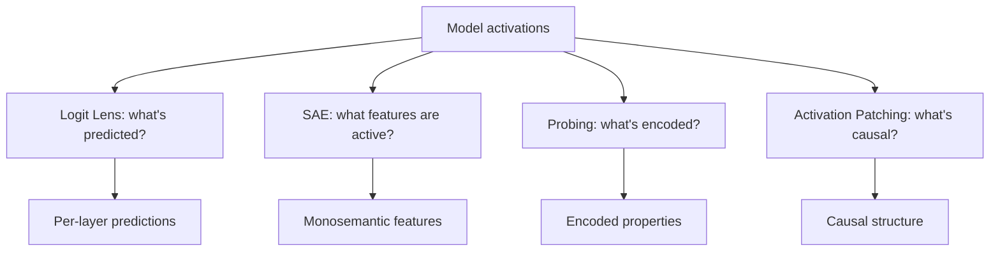
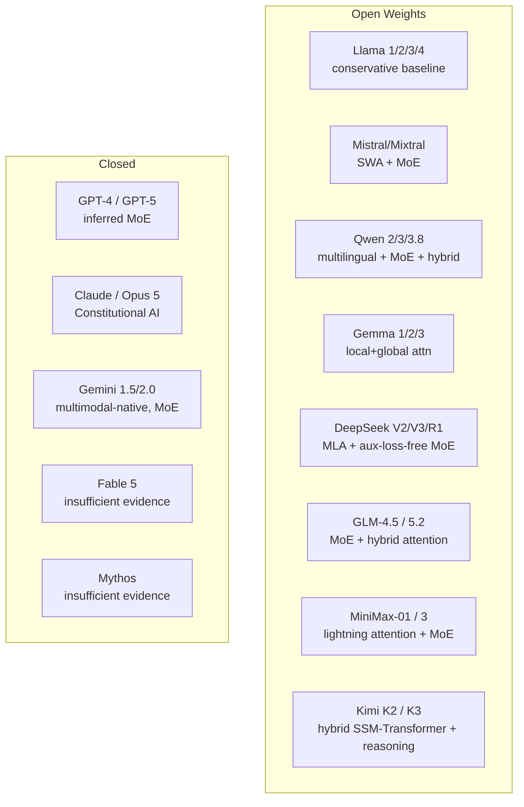

This area gathers three research-facing families side by side. **Interpretability** builds the tools for understanding what neural networks actually compute; **model architecture research** documents what the frontier models are made of, family by family, with an explicit evidence convention for closed-source claims; and **research frontiers** tracks where sequence-model architecture went in 2024–2026 — state space models, hybrid architectures, test-time compute, and long context. The reading order below indexes all 30 content notes of the area, and the sub-family sections that follow explain what each family covers, how its notes group into sub-domains, and how the three families interlock.

> [!info] Scope
> **Interpretability** covers the four core techniques for seeing inside a network — logit lens, sparse autoencoders, activation patching, and probing. **Model Architecture Research** holds the per-model deep dives: 16 model architecture notes across the open-source and closed-source families, plus one synthesis note on the converged 2026 recipe. **Research Frontiers** covers the 2024–2026 research frontier — state space models, hybrid architectures, reasoning via test-time compute, and long-context architectures — with a synthesis note that re-verifies every note against the 2026 state of the field.

## Reading order

The order follows a natural progression: the tools first, then the current landscape, then the frontier. Interpretability opens with the field overview — circuits and induction heads — and then takes the four core techniques in turn. Model architecture research opens with DeepSeek's influential design (MLA plus aux-loss-free MoE), compares the three dominant open families, walks each open family, adds the 2026 wave of model notes, moves to the closed-source models, and closes on the synthesis. Research frontiers opens with its own overview note, walks the architectural lines (state space models, then the linear-time and convolution-based hybrids), then the capability lines (reasoning, long context), and ends with the 2026 verification note.

| # | Note | Sub-family | Sub-domain | Purpose |
|---|------|------------|------------|---------|
| 00 | [[Interpretability and Research MOC\|This note]] | Orientation | — | The area map; start here. |
| 01 | [[Mechanistic Interpretability]] | Interpretability | Mechanistic | Circuits, induction heads, overview. |
| 02 | [[Logit Lens and Tuned Lens]] | Interpretability | Mechanistic | Apply unembedding to intermediate activations. |
| 03 | [[Sparse Autoencoders]] | Interpretability | Sparse Autoencoders | Decompose activations into interpretable features. |
| 04 | [[Activation Patching and Causal Tracing]] | Interpretability | Mechanistic | Intervention-based causal analysis. |
| 05 | [[Probing]] | Interpretability | Probing | Train classifiers on activations. |
| 06 | [[DeepSeek Architecture]] | Model Architecture Research | Open Source | MLA + aux-loss-free MoE. |
| 07 | [[Llama Mistral Qwen Comparison]] | Model Architecture Research | Open Source | The three dominant open families. |
| 08 | [[Llama Family Architecture]] | Model Architecture Research | Open Source | Llama 1/2/3/4 evolution. **Officially Confirmed**. |
| 09 | [[Mistral and Mixtral Architecture]] | Model Architecture Research | Open Source | SWA + MoE. **Officially Confirmed**. |
| 10 | [[Qwen Family Architecture]] | Model Architecture Research | Open Source | Multilingual + MoE. **Officially Confirmed**. |
| 11 | [[Gemma Architecture]] | Model Architecture Research | Open Source | Local+global attention, distillation. **Officially Confirmed**. |
| 12 | [[GLM 5.2 Architecture]] | Model Architecture Research | Open Source | 2026 Chinese open-weights MoE + hybrid attention. **Strong inference**. |
| 13 | [[Qwen 3.8 Architecture]] | Model Architecture Research | Open Source | 2026 Qwen refinement. **Strong inference**. |
| 14 | [[MiniMax 3 Architecture]] | Model Architecture Research | Open Source | 2026 hybrid lightning attention + MoE. **Strong inference**. |
| 15 | [[Fable 5 Architecture]] | Model Architecture Research | Closed Source | 2026 model — **insufficient public evidence**. |
| 16 | [[Kimi K3 Architecture]] | Model Architecture Research | Closed Source | 2026 hybrid + reasoning successor. **Strong inference**. |
| 17 | [[Opus 5 Architecture]] | Model Architecture Research | Closed Source | 2026 Anthropic successor. **Insufficient public evidence**. |
| 18 | [[Mythos Architecture]] | Model Architecture Research | Closed Source | 2026 model — **insufficient public evidence**. |
| 19 | [[GPT-4 Inferred Architecture]] | Model Architecture Research | Closed Source | Community analysis. **Strongly Inferred**. |
| 20 | [[Claude Architecture]] | Model Architecture Research | Closed Source | Constitutional AI; mostly undisclosed. **Strongly Inferred**. |
| 21 | [[Gemini Architecture]] | Model Architecture Research | Closed Source | Multimodal-native, MoE, 1M context. **Officially Confirmed** (partial). |
| 22 | [[Frontier Model Synthesis 2026]] | Model Architecture Research | Synthesis | The converged 2026 architectural recipe. |
| 23 | [[SSMs Mamba and Frontiers]] | Research Frontiers | State Space Models | Mamba, hybrids, reasoning, long-context overview. |
| 24 | [[Mamba-2 and Structured Attention]] | Research Frontiers | State Space Models | SSD unification with attention; larger state. |
| 25 | [[RWKV and RetNet]] | Research Frontiers | Hybrid Architectures | Linear-time predecessors of Mamba. |
| 26 | [[Hyena and Long Convolutions]] | Research Frontiers | Hybrid Architectures | FFT-based long convolutions for sequence mixing. |
| 27 | [[DeltaNet and Titans]] | Research Frontiers | State Space Models | Delta rule update; neural memory at test time. |
| 28 | [[Test-Time Compute Scaling]] | Research Frontiers | Reasoning | o1/R1 paradigm; inference-time reasoning. |
| 29 | [[Long-Context Architectures]] | Research Frontiers | Long-Context | Ring Attention, Infini-Attention, LongRoPE, hybrid. |
| 30 | [[Research Frontier Update 2026]] | Research Frontiers | Synthesis | 2026 verification of the family's notes; identifies what's still current and what's been superseded. |

Read the families in sequence for the complete picture, or enter through whichever family matches the question at hand; each section below says what its notes cover and how they fit together. The bold tags in the purpose column are evidence labels — the convention behind them is explained in the model architecture research section.

## Sub-families

Three families, in the order the area teaches them. Each carries its own sub-domains and reading order, and — where the material warrants it — epistemic-status guidance and production implications.

### Interpretability

Interpretability is the study of understanding what neural networks actually compute, and this family centers on the four core interpretability techniques: logit lens, sparse autoencoders, activation patching, and probing. The sub-domains group the five notes as follows. **Mechanistic** holds the field overview and two of the techniques: [[Mechanistic Interpretability]] (circuits, induction heads, overview), [[Logit Lens and Tuned Lens]] (apply the unembedding to intermediate activations), and [[Activation Patching and Causal Tracing]] (intervention-based causal analysis). **Sparse Autoencoders** holds [[Sparse Autoencoders]], which decomposes activations into interpretable features. **Probing** holds [[Probing]], which trains classifiers on activations. An **Attention Analysis** sub-domain — attention rollout and attention flow — is planned but not yet written.

All four techniques start from the same raw material — model activations — and ask different questions of it:



In words: the logit lens asks what's predicted, yielding per-layer predictions; the SAE asks what features are active, yielding monosemantic features; probing asks what's encoded, yielding encoded properties; and activation patching asks what's causal, yielding causal structure.

Why the family matters:

- Interpretability is essential for safety: understanding what models compute is the first step to ensuring they behave as intended.
- The four core techniques answer different questions: what's predicted (logit lens), what's represented (SAE/probing), what's causal (patching).
- SAEs are the leading approach to scaling interpretability — they turn opaque activations into sparse, human-reviewable features.
- Activation patching is the gold standard for causality — it establishes whether an activation *causes* behavior, not just correlates.

On the production side, interpretability is mostly research in 2025–2026, but feature steering — using SAE features to control behavior — is approaching production readiness. The logit lens is useful for debugging, because you can see when a model "knows" the answer at intermediate layers even if the final output is wrong. Probing can detect biases and safety-relevant properties in production models.

Two bridges out of the family: attention head specialization is a mechanistic finding about [[Multi-Head Attention]], and induction heads are the mechanism that enables [[In-Context Learning]]. The transformer machinery underneath is covered in [[Attention and Transformers MOC]], and the safety applications on the production side live in [[Inference and Production MOC]].

### Model architecture research

This family is the per-model architecture deep-dive collection. It grew in two waves: first the deep dives for Llama, Mistral, Qwen, and Gemma (open-source) and GPT-4, Claude, and Gemini (closed-source, with every claim source-labelled); then a 2026 wave of seven model notes — Fable 5, Kimi K3, Opus 5, Mythos, GLM 5.2, Qwen 3.8, and MiniMax 3 — plus a synthesis note. In total: 16 model architecture notes and one synthesis note.

The sub-domains split them. **Open Source** (notes 06–14 in the reading order) covers the open-weights families: [[DeepSeek Architecture]] (MLA + aux-loss-free MoE), the comparative analysis [[Llama Mistral Qwen Comparison]] (the three dominant open families), the family evolutions — [[Llama Family Architecture]] (Llama 1/2/3/4), [[Mistral and Mixtral Architecture]] (SWA + MoE), [[Qwen Family Architecture]] (multilingual + MoE), and [[Gemma Architecture]] (local+global attention and distillation) — and the 2026 wave — [[GLM 5.2 Architecture]] (Chinese open-weights MoE + hybrid attention), [[Qwen 3.8 Architecture]] (the 2026 Qwen refinement), and [[MiniMax 3 Architecture]] (hybrid lightning attention + MoE). **Closed Source** (notes 15–21) covers the 2026 models [[Fable 5 Architecture]], [[Kimi K3 Architecture]] (hybrid + reasoning successor), [[Opus 5 Architecture]] (the Anthropic successor), and [[Mythos Architecture]], alongside [[GPT-4 Inferred Architecture]] (community analysis), [[Claude Architecture]] (Constitutional AI; mostly undisclosed), and [[Gemini Architecture]] (multimodal-native, MoE, 1M context). **Comparative Analysis** is the comparison note itself, **2026 Frontier Synthesis** is [[Frontier Model Synthesis 2026]] on the converged 2026 architectural recipe, and an **Architectural Components** sub-domain is planned but not yet written.

Because so many of these models are closed, the family carries a source-labelling convention: every architectural claim about a closed-source model must be tagged as one of

- **Officially Confirmed** — documented by the developer.
- **Research-Backed** — supported by published research.
- **Strongly Inferred** — supported by evidence but not officially confirmed.
- **Speculative** — insufficient evidence.

Open-source models need no such hedging — they can be confirmed by reading the technical reports and code. The bold tags in the reading-order table carry each note's standing: the established open families are Officially Confirmed, the 2026 open notes are Strong inference, and the closed-source notes range from Strongly Inferred (GPT-4, Claude) through Officially Confirmed in part (Gemini) to insufficient public evidence (Fable 5, Opus 5, Mythos).

The architecture landscape this family documents:



In words: the open-weights side spans Llama 1/2/3/4 (the conservative baseline), Mistral/Mixtral (SWA + MoE), Qwen 2/3/3.8 (multilingual + MoE + hybrid), Gemma 1/2/3 (local+global attention), DeepSeek V2/V3/R1 (MLA + aux-loss-free MoE), GLM-4.5/5.2 (MoE + hybrid attention), MiniMax-01/3 (lightning attention + MoE), and Kimi K2/K3 (hybrid SSM-Transformer + reasoning). The closed side spans GPT-4/GPT-5 (inferred MoE), Claude/Opus 5 (Constitutional AI), and Gemini 1.5/2.0 (multimodal-native, MoE), with Fable 5 and Mythos resting on insufficient evidence.

Why the family matters:

- The open-weights ecosystem has converged on a common architecture (Llama-style: pre-norm, RMSNorm, RoPE, SwiGLU, GQA — see [[GQA MQA and MLA]]) with variations (SWA, MoE, MLA, hybrid attention — see [[Sliding Window Attention]] and [[Mixture of Experts]]).
- Closed-source models are less transparent, but inference based on cost/capability suggests similar architectural choices (likely MoE for frontier-scale).
- Understanding the per-family architectural choices clarifies when to use which model and why.
- The 2026 frontier has further converged on **MoE + hybrid attention + reasoning training** as the default recipe (see [[Frontier Model Synthesis 2026]]).

The family's open research questions: the 2026 architectural details of GPT-5, Claude 4.x/5, and Gemini 2.x; verifying the existence of the 2026 models — Fable 5, Opus 5, Mythos, GLM 5.2, Qwen 3.8, MiniMax 3 — a question the per-model notes partially resolve; the latest MoE routing techniques; and the latest hybrid attention formulations (lightning attention, Mamba-2 SSD, and the like). The primary papers behind the open families are [[LLaMA]], [[Mistral 7B]], and [[DeepSeek-V2 and V3]]; the model categories they belong to are surveyed in [[Foundation Models and Multimodal MOC]].

### Research frontiers

This family covers the 2024–2026 research frontier. It also grew in two waves: the core frontier notes — [[Mamba-2 and Structured Attention]], [[RWKV and RetNet]], [[Hyena and Long Convolutions]], [[DeltaNet and Titans]], [[Test-Time Compute Scaling]], and [[Long-Context Architectures]] — and then [[Research Frontier Update 2026]], which synthesizes the family's notes against the 2026 state of the field, identifying what's still current, what's been superseded, and what the open research questions are. [[SSMs Mamba and Frontiers]] leads the family as the overview: Mamba, hybrids, reasoning, and long context in one pass.

The sub-domains are **State Space Models** — [[SSMs Mamba and Frontiers]] (the overview), [[Mamba-2 and Structured Attention]] (SSD unification with attention; larger state), and [[DeltaNet and Titans]] (delta rule update; neural memory at test time); **Hybrid Architectures** — [[RWKV and RetNet]] (linear-time predecessors of Mamba) and [[Hyena and Long Convolutions]] (FFT-based long convolutions for sequence mixing); **Reasoning** — [[Test-Time Compute Scaling]] (the o1/R1 paradigm; inference-time reasoning); **Long-Context** — [[Long-Context Architectures]] (Ring Attention, Infini-Attention, LongRoPE, hybrid); and the **2026 Synthesis** note. A **Memory** sub-domain has no notes of its own — it is covered inside [[DeltaNet and Titans]] (Titans' neural memory at test time) — and emerging 2026 developments are tracked through the open research questions below.

The research landscape, 2024–2026:

```mermaid
graph TD
  Attention[Full Attention<br/>O(N²), exact retrieval]
  SSM[SSMs<br/>Mamba, Mamba-2<br/>O(N), weaker retrieval]
  Linear[Linear Attention<br/>Performer, RWKV, RetNet<br/>O(N), fixed decay]
  Conv[Convolutions<br/>Hyena<br/>O(N log N), position-based]
  Hybrid[Hybrid Architectures<br/>Jamba, Kimi Linear, MiniMax-01, GLM-4.5, Qwen 3<br/>SSM + attention - 2026 frontier default]
  Memory[Memory-Augmented<br/>Titans, DeltaNet<br/>neural memory, test-time learning - research only]
  Reasoning[Reasoning Models<br/>o1, R1, Qwen3-Thinking, Kimi K1.5<br/>test-time compute scaling - 2026 commodity]

  Attention --> Hybrid
  SSM --> Hybrid
  Linear --> SSM
  Conv --> SSM
  SSM --> Memory
  Attention --> Reasoning
  Hybrid --> Reasoning
```

In words: full attention is O(N²) with exact retrieval; SSMs (Mamba, Mamba-2) are O(N) with weaker retrieval; linear attention (Performer, RWKV, RetNet — see [[Linear Attention]]) is O(N) with fixed decay; convolutions (Hyena) are O(N log N) and position-based; hybrid architectures (Jamba, Kimi Linear, MiniMax-01, GLM-4.5, Qwen 3) combine SSM + attention and are the 2026 frontier default; memory-augmented architectures (Titans, DeltaNet) add neural memory and test-time learning but remain research only; and reasoning models (o1, R1, Qwen3-Thinking, Kimi K1.5) scale test-time compute and became a 2026 commodity.

Why the family matters:

- The pure-attention era is ending. 2024–2026 frontier models use hybrids (SSM + attention) or memory-augmented architectures.
- Test-time compute scaling (o1, R1) opened a new dimension — models can "think longer" at inference to improve quality.
- Long-context architectures (Ring Attention, LongRoPE) enabled million-token contexts, opening new application categories.
- Understanding these frontiers clarifies where the field is heading and what to evaluate when choosing a model.
- The 2026 Research Frontier Update note confirms what's still current and what's been superseded.

The production implications distilled:

- **For long context (>256K)**: consider hybrid models (Jamba, Kimi Linear, MiniMax-01, GLM-4.5, Qwen 3) or models with efficient attention.
- **For reasoning-heavy tasks**: use reasoning models (o1, R1, Qwen3-Thinking, Kimi K1.5, Claude Thinking) — they dramatically outperform standard models on math/code.
- **For efficiency-critical serving**: MoE + hybrid attention + EAGLE-3 spec decoding is the 2026 efficiency stack ([[EAGLE-3]], [[Speculative Decoding]]).
- **For research**: watch Titans — it represents the next direction in memory-augmented architectures, but has not yet reached production at frontier scale.

The open research questions for 2026–2027, from the Open Research Questions section of [[Research Frontier Update 2026]]:

- Can test-time learning scale to frontier?
- What's the theoretical limit of spec decoding?
- Will MoE granularity keep increasing?
- Can reasoning be combined with multimodal?
- What's beyond MoE + hybrid attention?
- How to evaluate 1M+ context reliably?
- Can RLVR extend to non-verifiable domains?

The foundational papers behind the family: [[Mamba]] (the foundational SSM paper), [[Kimi Linear]] (the hybrid architecture paper), and [[DeepSeek-R1]] (the reasoning model paper). What the frontier challenges is full attention itself — [[Attention and Transformers MOC]] — and the reasoning-model line it feeds is surveyed in [[Reasoning Models]].

## How the families fit together

The three families study the same object — the frontier Transformer — from three angles: what it computes (interpretability), what it is made of (model architecture research), and where it is going (research frontiers). The connections are concrete rather than metaphorical. The hybrid-attention designs in the 2026 architecture notes — GLM 5.2, MiniMax 3, Kimi K3, Qwen 3.8 — continue the hybrid wave the research landscape shows (Jamba, Kimi Linear, MiniMax-01, GLM-4.5, Qwen 3), and the reasoning training in Kimi K3's "hybrid + reasoning successor" design is the test-time-compute story of [[Test-Time Compute Scaling]]. The two synthesis notes meet in the middle: [[Frontier Model Synthesis 2026]] names MoE + hybrid attention + reasoning training as the converged recipe, and [[Research Frontier Update 2026]] re-verifies the frontier notes — including what has been superseded — against the 2026 field. Interpretability cuts across both: its lens, features, probes, and patches are how you check what any of these architectures actually compute, and its debugging use — seeing that a model "knows" an answer at intermediate layers — applies to the very models the architecture notes document.

## Why this area matters

Each family removes a different blind spot. Without interpretability, models are black boxes that work for unknown reasons — and safety, debugging, and trust all start with knowing what is computed. Without per-family architecture knowledge, model choice is folklore: the open families differ in real, documented ways (SWA versus full attention, MoE, multilingual coverage), and even the closed models can be reasoned about from cost and capability. Without frontier literacy, today's defaults look permanent when they are not — the pure-attention era is ending, test-time compute went from research topic to commodity inside the 2024–2026 window, and million-token contexts opened application categories that did not exist before. Two calibration facts are worth carrying into any discussion: the 2026 frontier has converged on MoE + hybrid attention + reasoning training as the default recipe, and memory-augmented architectures like Titans remain research-only — the next direction to watch rather than a shipping technology.

## Reading paths and next steps

- **New to the area?** Read the interpretability family first (notes 01–05): it defines the lens — circuits, features, causality — that makes the rest of the area readable.
- **Want to know what a specific model is made of?** Go to the architecture family; start with [[Llama Mistral Qwen Comparison]] if you are choosing among the dominant open families, or jump straight to the model's note. Check the evidence label before trusting any closed-source claim.
- **Choosing a model by workload?** Use the research frontiers' production guidance: hybrid models or efficient attention for >256K context, reasoning models for math and code, and MoE + hybrid attention + EAGLE-3 spec decoding for efficiency-critical serving.
- **Following the research?** Read the two synthesis notes — [[Frontier Model Synthesis 2026]] and [[Research Frontier Update 2026]] — then work through the open research questions in each family section above.

When you are ready to go outside the area: the architecture being researched and challenged is covered in [[Attention and Transformers MOC]], including the specific mechanisms the model notes vary — [[GQA MQA and MLA]], [[Sliding Window Attention]], [[Linear Attention]], and [[Mixture of Experts]]; foundation-model categories and the reasoning-model survey are in [[Foundation Models and Multimodal MOC]] and [[Reasoning Models]]; [[In-Context Learning]] explains the capability that induction heads enable; the serving stack behind the 2026 efficiency recipe is in [[Inference and Production MOC]]; and the primary papers — [[LLaMA]], [[Mistral 7B]], [[DeepSeek-V2 and V3]], [[DeepSeek-R1]], [[Mamba]], and [[Kimi Linear]] — are collected in [[Papers MOC]].

## See also

- [[Attention and Transformers MOC]] — the architecture this area researches, extends, and challenges.
- [[Foundation Models and Multimodal MOC]] — foundation-model categories.
- [[Reasoning Models]] — the reasoning-model line that test-time compute scaling feeds.
- [[In-Context Learning]] — the capability that induction heads enable.
- [[Multi-Head Attention]] — head specialization.
- [[Inference and Production MOC]] — safety applications of interpretability and the serving stack behind the efficiency recipe.
- [[Speculative Decoding]] and [[EAGLE-3]] — the spec-decoding side of the 2026 efficiency stack.
- [[Papers MOC]] — the primary papers behind the open families and the frontier lines.
