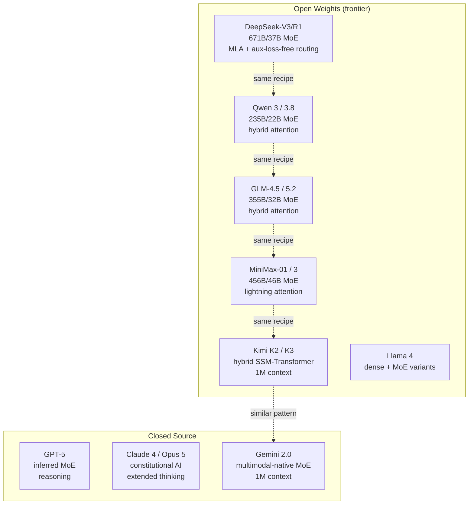

By mid-2026, the frontier LLM landscape has converged on a recognizable architectural recipe: MoE capacity plus hybrid attention, reasoning training, multimodal fusion, long context, and speculative decoding. Every frontier lab — DeepSeek, Qwen, GLM, MiniMax, Kimi, Anthropic, Google, OpenAI — is shipping variants of this recipe. This reference note synthesizes what's converged, what's still diverging, and what is genuinely novel in 2026; it sits above the per-model architecture notes, which treat each family individually. See [[Interpretability and Research MOC]] for the surrounding area.

## The converged 2026 frontier recipe

By mid-2026, the following components are standard across frontier models:

| Component                | 2026 Default                                       | Who Uses It                                                       |
|--------------------------|----------------------------------------------------|-------------------------------------------------------------------|
| Attention                | Hybrid linear + full attention, 7:1 ratio         | MiniMax-01, Kimi K2, GLM-4.5, Qwen 3 (and expected in K3, 3.8, MiniMax 3) |
| Sparse capacity          | MoE with 8–256 experts, 2–8 active                  | DeepSeek-V3, Qwen 3, GLM-4.5, MiniMax-01, Mixtral, Gemini 1.5/2.0 |
| Positional encoding      | RoPE with YaRN or NTK-aware scaling                  | Llama 3, Mistral, Qwen, DeepSeek, GLM                              |
| Normalization            | RMSNorm (pre-norm)                                  | All modern LLMs                                                   |
| Activation               | SwiGLU                                              | All modern LLMs                                                   |
| Long context             | 256K–1M tokens                                       | Kimi K2 (1M), MiniMax-01 (1M), Gemini 1.5/2.0 (1M), Claude 4 (200K-1M) |
| Reasoning                | RL on verifiable rewards (GRPO)                      | DeepSeek-R1, Kimi K1.5, Qwen 3-Thinking, MiniMax-M1, GLM-Z1, o1, Claude thinking |
| Multimodal fusion        | Native multimodal (early fusion)                    | Gemini (since 1.0), Claude 4 (inferred), GPT-4o (inferred); expected in Qwen 3.8, MiniMax 3 |
| Inference acceleration   | EAGLE-2/EAGLE-3 spec decoding, FP8                   | vLLM, TensorRT-LLM, SGLang (all major serving engines)             |

The convergence is striking: the 2024 "Llama-style" recipe (GQA + RoPE + SwiGLU + RMSNorm + pre-norm) has been extended with sparse capacity ([[Mixture of Experts|MoE]]) and hybrid attention. By 2026, every frontier model follows roughly this pattern.

## What's still diverging

### Specific linear-attention variant

Different labs use different linear-attention formulations:

- **MiniMax-01**: lightning attention (custom kernel-friendly formulation).
- **Kimi K2**: hybrid SSM-Transformer (Mamba-style selective scan variant).
- **GLM-4.5**: hybrid attention with sparse pattern (specific variant in technical report).
- **Qwen 3**: hybrid attention with sparse/linear layers (specific variant in technical report).

It's unclear which formulation will win. Each has tradeoffs in kernel efficiency, training stability, and quality. Mamba-2's SSD framework provides a theoretical unification, but production implementations differ — see [[Mamba-2 and Structured Attention]].

### MoE granularity

Different labs use very different expert configurations:

- **Mixtral 8x22B**: 8 experts, 2 active — coarse-grained.
- **Mixtral 8x7B**: 8 experts, 2 active — coarse-grained.
- **DeepSeek-V3**: 256 experts, 8 active — fine-grained.
- **Qwen 3 235B**: 94 experts, 8 active — medium-grained.
- **GLM-4.5**: ~128 experts (estimated from 355B/32B ratio).
- **MiniMax-01**: 32 experts, 2 active — coarse-grained.

Fine-grained MoE (DeepSeek-style, 100+ experts) gives better specialization but more routing overhead. Coarse-grained (Mixtral-style, 8 experts) is simpler but less specialized. The 2026 trend is toward fine-grained — compare [[DeepSeek Architecture]] and [[Mistral and Mixtral Architecture]] for the two poles.

### Open vs closed

The open-weights camp spans DeepSeek-V3/R1, Qwen 3, GLM-4.5, MiniMax-01, Kimi K2, Llama 3/4, Mistral, and Gemma; the closed/API-only camp covers GPT-4/5, Claude 3.5/4/5, and Gemini 1.5/2.0. The open-weights ecosystem has caught up to the closed ecosystem on most benchmarks. By 2026, the quality gap is small enough that production decisions often hinge on cost, latency, and self-hosting requirements rather than capability.

### Reasoning architecture

How the reasoning trace is exposed differs across labs:

- **Visible CoT** (user sees the reasoning trace): DeepSeek-R1, Kimi K1.5, Claude 3.7+ extended thinking.
- **Hidden CoT** (reasoning is internal): OpenAI o1/o3, GPT-5 (inferred).
- **No CoT** (standard inference): Llama 3, Mistral, Gemma.

The visible-vs-hidden debate is unresolved. Visible CoT allows debugging and trust-building; hidden CoT protects IP and avoids prompt injection via the reasoning trace.

## What's genuinely novel in 2026

### Test-time-learning architectures (Titans)

Titans (Google, 2024) introduced a persistent neural memory module updated via gradient descent at inference. This is genuinely beyond attention (no persistent state) and SSMs (fixed-size state). Whether Titans-style architectures reach production in 2026 frontier models is an open question — see [[Titans]] and [[DeltaNet and Titans]].

### Speculative decoding as default

By 2026, speculative decoding (EAGLE-2/EAGLE-3) is no longer optional in production serving — it's the default. Major serving engines (vLLM, TensorRT-LLM, SGLang) ship with EAGLE-2/EAGLE-3 support out of the box. This represents a major shift from 2023 when spec decoding was research-grade. See [[Medusa and EAGLE]] and [[EAGLE-3]] for the technique, [[Speculative Decoding]] for the general mechanism, and [[14 - Inference and Production/Inference/vLLM|vLLM]], [[14 - Inference and Production/Inference/TensorRT-LLM|TensorRT-LLM]], and [[SGLang]] for the serving stacks.

### Multimodal-native becomes default

Gemini pioneered native multimodal (text+image+audio+video from training start). By 2026, GPT-4o, Claude 4 (inferred), and likely Qwen 3.8 / MiniMax 3 follow this pattern. Stitched multimodal (LLaVA-style: separate vision encoder + projector + LLM) is increasingly seen as legacy — see [[Multimodal AI Overview]] and [[LLaVA]].

### Hybrid attention goes mainstream

In 2024, hybrid attention was niche (Jamba, H3, Mamba-2). By 2026, every major open-weights frontier model (Kimi K2, MiniMax-01, GLM-4.5, Qwen 3) uses some form of hybrid attention. Pure softmax attention is becoming the exception, not the rule, at frontier scale. See [[RWKV and RetNet]] and [[SSMs Mamba and Frontiers]].

### FP8 training

Hopper (H100) GPUs added FP8 support. By 2026, FP8 training is standard for frontier-scale pretraining (DeepSeek-V3 was among the first to use FP8 extensively). FP8 reduces memory and doubles throughput vs BF16 — see [[Mixed Precision Training]].

### RL on verifiable rewards as default for reasoning

DeepSeek-R1 (Jan 2025) demonstrated that RL on verifiable rewards (math correctness, code tests) produces reasoning capability emergently. By 2026, every frontier reasoning model uses some variant of this recipe. The earlier PPO + reward-model approach (InstructGPT, original GPT-4) is fading. See [[DeepSeek-R1]], [[Process Reward Models]], and [[InstructGPT]].

## The 2026 frontier architecture map

The map below summarizes the landscape: the open-weights frontier models share the converged recipe (dotted edges), with Kimi's hybrid pattern most similar to closed-source Gemini.

## Architectural verification status

Not every model's architecture is publicly disclosed, and the strength of the evidence varies widely:

| Model          | Architecture Disclosed? | Source                                          |
|----------------|-------------------------|-------------------------------------------------|
| DeepSeek-V3/R1 | Yes (full)              | Technical report                                |
| Qwen 3         | Yes (partial)           | Technical report + model card                   |
| GLM-4.5        | Yes (partial)           | Technical report                                |
| MiniMax-01      | Yes (full)              | Technical report                                |
| Kimi K2        | Yes (full)              | Technical report (Kimi Linear)                   |
| Llama 3/4       | Yes (full)              | Technical report + model card                   |
| Mistral        | Yes (full)              | Blog posts + model card                         |
| Gemma          | Yes (full)              | Technical report + model card                   |
| GPT-4 / GPT-5   | No                      | Strong inference only                           |
| Claude 4 / Opus 5| No                     | Strong inference only                           |
| Gemini 1.5/2.0 | Partial                 | Technical report (partial disclosure)           |
| Fable 5        | No                      | Insufficient public evidence                    |
| Mythos         | No                      | Insufficient public evidence                    |

The per-model notes track each family in detail: [[DeepSeek Architecture]], [[Qwen Family Architecture]], [[Qwen 3.8 Architecture]], [[GLM 5.2 Architecture]], [[MiniMax 3 Architecture]], [[Llama Family Architecture]], [[Mistral and Mixtral Architecture]], and [[Gemma Architecture]] on the open-weights side; [[Kimi K3 Architecture]], [[GPT-4 Inferred Architecture]], [[Claude Architecture]], [[Gemini Architecture]], and [[Opus 5 Architecture]] among the closed or partially disclosed models; and [[Fable 5 Architecture]] and [[Mythos Architecture]] for the two with insufficient public evidence.

## Why this synthesis matters

**Architectural convergence is real.** By 2026, the open-weights frontier has converged on a recognizable recipe. This is different from 2023 when there was genuine architectural diversity (Mistral vs Llama vs Qwen had meaningful differences; today they share most components) — see [[Llama Mistral Qwen Comparison]].

**The remaining divergence is in implementation.** Linear-attention variant, MoE granularity, attention schedule, and reasoning training method. These are implementation details, not architectural revolutions.

**Closed-source models are increasingly hard to differentiate.** Without architectural disclosure, we can only infer that GPT-5, Claude 5, and Gemini 2.0 use some variant of the converged recipe. The actual differences may be small.

**The next architectural revolution is unclear.** Beyond Titans (test-time learning) and continued hybrid-attention refinement, there's no clear "next big thing" in 2026. The field may be entering a period of consolidation rather than revolution — the research-side view is tracked in [[Research Frontier Update 2026]].

## See also

- [[Interpretability and Research MOC]]
- [[DeepSeek Architecture]]
- [[Qwen Family Architecture]]
- [[GLM 5.2 Architecture]]
- [[MiniMax 3 Architecture]]
- [[Kimi K3 Architecture]]
- [[GPT-4 Inferred Architecture]]
- [[Claude Architecture]]
- [[Gemini Architecture]]
- [[Llama Mistral Qwen Comparison]]
- [[Long-Context Architectures]]
- [[Test-Time Compute Scaling]]
- [[Research Frontier Update 2026]]
- [[Titans]]
- [[DeepSeek-R1]]
