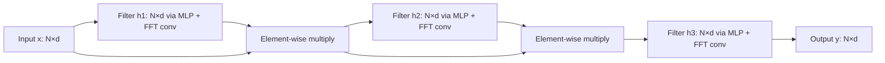

Hyena (2023) replaced attention with long convolutions — position-wise multiplications in the frequency domain via FFT. The key innovation is an "implicit parameterization" that lets a small number of parameters define a very long filter, enabling $O(N \log N)$ sequence mixing, and Hyena demonstrated that convolutions could match attention quality at sub-quadratic cost, broadening the design space beyond attention and SSMs. See [[Interpretability and Research MOC]] for the surrounding research area.

## The problem being solved

Hyena was published as *Hyena Hierarchy: Towards Larger Convolutional Language Models* (Poli, M., Massaroli, S., Nguyen, E., Fu, D. Y., Berto, F., Yuan, J., et al., 2023; ICML 2023; arXiv:2302.10866). By early 2023, attention's $O(N^2)$ cost was a clear bottleneck. [[Reformer]], [[Longformer]], and [[Linformer]] had all tried to reduce attention's cost, but each made trade-offs. The open question: are there fundamentally different sequence-mixing mechanisms that are sub-quadratic and match attention quality?

Convolutions are a natural candidate — they're $O(N \cdot k)$ for kernel size k, and they're well-studied in signal processing. But standard convolutions with small kernels (k=3, k=7) are too local for language modeling — they can't capture long-range dependencies. Hyena's insight: use long convolutions (kernels as long as the sequence) but parameterize them implicitly, so the kernel doesn't need to be stored explicitly. The convolution is computed via FFT in $O(N \log N)$ time.

## The key idea: implicit long convolutions

### The Hyena operator

Hyena replaces attention with a sequence of operations:

```text
y = (x · h_1) · h_2 · h_3 · ...
```

where $\cdot$ is an element-wise (position-wise) multiplication and the $h_i$ are "filters" computed via two steps: a small neural network (an MLP) generates the filter coefficients, and the filter is applied as a long convolution via FFT.

The key is that the filter $h$ has length N (the sequence length), but it's parameterized by a small MLP (a few thousand parameters). This "implicit parameterization" lets a small model define a very long filter.

### The long convolution via FFT

A length-N convolution, computed naively, is $O(N^2)$. But via the FFT, it's $O(N \log N)$:

1. FFT both the input and the filter.
2. Multiply pointwise in the frequency domain.
3. Inverse FFT the result.

This is much faster than attention's $O(N^2)$ for long sequences, and it's a well-optimized operation (cuFFT on GPUs).

### The implicit filter

The filter $h$ is generated by taking a fixed "position encoding" (e.g., sinusoidal), passing it through a small MLP, and reading the MLP's output as the filter coefficients:



The MLP has a few thousand parameters, but it generates a filter of any length. This is the key to scaling: the filter grows with the sequence, but the parameter count doesn't.

### Comparison to attention

Attention mixes tokens via a content-based N×N matrix. Hyena mixes tokens via a position-based N-length filter (the convolution). The convolution is less expressive (position-based, not content-based) but much cheaper.

## Key results

Hyena matched or approached Transformer quality on language modeling:

| Model         | The Pile (PPL) | Inference Speed (8K) |
|---------------|----------------|----------------------|
| Transformer   | 2.88           | 1.0×                 |
| Hyena         | 2.95           | 2.0× (faster)        |
| Mamba         | 2.97           | 2.5× (faster)        |

Hyena was competitive with Transformers at moderate sequence lengths and faster. For very long sequences, the speed advantage grew ($O(N \log N)$ vs $O(N^2)$).

## Why Hyena worked

**FFT convolutions are hardware-efficient.** FFT is one of the most optimized numerical algorithms. On GPUs, cuFFT is extremely fast. Hyena leverages this existing optimization, getting sub-quadratic cost "for free".

**Implicit parameterization scales.** The MLP-generated filter can be any length, so the same model handles different sequence lengths without retraining. This is more flexible than fixed-size attention masks.

**Stacking creates expressivity.** A single Hyena operator is a simple position-based filter. But stacking multiple operators (with the element-wise multiplications between them) creates a highly expressive sequence mixer — the composition of simple operations gives complex behavior.

**No attention matrix materialization.** Unlike attention, Hyena never materializes an N×N matrix. The convolution operates on length-N vectors, keeping memory $O(N)$ rather than $O(N^2)$.

## Limitations

**Position-based, not content-based.** Hyena's filter is a function of position, not content. It can't implement content-based retrieval ("find the most similar token"). This limits its expressivity for tasks requiring selective attention.

**Weaker retrieval than attention.** Like all sub-quadratic models, Hyena underperforms attention on retrieval tasks. The convolution smooths information, making exact retrieval harder.

**Less flexible than Mamba.** Mamba's selectivity (input-dependent parameters) gives it more flexibility than Hyena's position-based filter. Mamba generally outperformed Hyena on most benchmarks.

**FFT overhead.** For short sequences, the FFT overhead (constant factor) makes Hyena slower than attention. Hyena's advantage only appears at longer sequences (N > ~2K).

**Limited adoption.** Hyena didn't gain significant adoption. Mamba, released shortly after, offered better quality and clearer theoretical motivation. Hyena's main legacy is conceptual — it demonstrated that convolutions could work for language modeling.

## Related architectures

Three architectures extend the long-convolution idea in different directions.

### H3 (Hungry Hungry Hippos)

H3 (Fu et al., 2023) is a related architecture that uses long convolutions in a different formulation, specifically designed to address the state-copying task (which SSMs and convolutions struggled with). H3 influenced Mamba's design.

### Based

Based (Peng et al., 2024) combines short convolutions (for local patterns) with linear attention (for global patterns). It's a hybrid that uses convolutions as one component.

### StripedHyena

StripedHyena is a hybrid model from Together AI that interleaves Hyena layers and attention layers. It's similar in spirit to Jamba (Mamba + attention), represented among the paper notes by [[Jamba]].

## Impact and legacy

Hyena's influence on the field runs through four contributions. It broadened the design space: before Hyena, the field focused on attention variants (sparse, linear, low-rank), and Hyena showed that completely different mechanisms (convolutions) could work, expanding the design space. It influenced Mamba: Hyena, H3, and related work influenced Mamba's design, and the progression from structured state spaces to selective SSMs was informed by the convolution-based approaches.

It also established FFT as a tool for sequence modeling — the use of FFT for long convolutions became a standard technique in subsequent sub-quadratic models. And its implicit parameterization (a small MLP generates a large filter) is a general technique that appears in other contexts (e.g., neural fields, implicit neural representations).

For AI engineers, Hyena is mostly of historical interest — Mamba and hybrid architectures have largely superseded it. But understanding Hyena clarifies the broader landscape of sub-quadratic sequence models and the trade-offs between different approaches (attention, SSMs, convolutions, hybrids).

## Further reading

The primary sources for this line of work:

- Original paper: arXiv:2302.10866
- H3: arXiv:2212.14052
- Based: arXiv:2402.01068

## See also

- [[Interpretability and Research MOC]] — the area orientation for interpretability and research.
- [[RWKV and RetNet]] — the linear-attention models of the same era.
- [[SSMs Mamba and Frontiers]] — the state-space lineage.
- [[Mamba-2 and Structured Attention]] — the unification with attention.
- [[Long-Context Architectures]] — where sub-quadratic mixing enables million-token contexts.
- [[Mamba]] — the successor that dominated.
- [[Linear Attention]] — the attention-variant family Hyena bypassed.
- [[Reformer]] — an earlier attempt to cut attention's cost.
- [[Longformer]] — an earlier attempt to cut attention's cost.
- [[Linformer]] — an earlier attempt to cut attention's cost.
- [[H3]] — the closely related long-convolution architecture.
- [[Based]] — the hybrid that reuses short convolutions.
- [[Jamba]] — hybrid Mamba + attention, the same spirit as StripedHyena.
