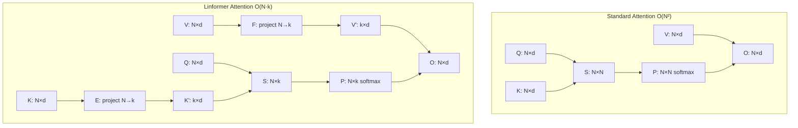

Linformer reduced attention from O(N²) to O(N) by projecting the N×N attention matrix to a low-rank N×k form. The key insight: the attention matrix is empirically low-rank — most of its information is captured by its top-k singular values. By projecting keys and values from N dimensions to k dimensions (where k << N), Linformer achieves linear complexity with minimal quality loss. The low-rank attention idea influenced subsequent work on linear attention and efficient Transformers. See [[Papers MOC]] for the papers index and [[Linear Attention]] for the family it feeds into.

## Citation

Wang, S., Li, B., Khabsa, M., Fang, H., & Ma, H. (2020). *Linformer: Self-Attention with Linear Complexity*. arXiv:2006.04768.

## The problem being solved

Standard self-attention has O(N²) complexity because it computes an N×N attention matrix. For N=8192, this matrix has 67M entries — expensive in both memory and compute.

[[Reformer]] attacked this by hashing queries to relevant keys. [[Longformer]] attacked it by restricting attention to local windows. Linformer took a third approach: **low-rank approximation**.

The empirical observation: attention matrices in trained Transformers are low-rank. The top-k singular values capture most of the information. If you could compute attention in the low-rank space directly, you'd avoid the O(N²) cost.

## The key idea: project keys and values to a fixed dimension

Standard attention:

```text
S = Q K^T              # (N, N) — the expensive part
P = softmax(S)         # (N, N)
O = P V                # (N, d)
```

Linformer projects K and V from N tokens to k tokens *before* the attention computation:

```text
K' = E_i K              # (k, d)  — E_i is a learned N×k projection
V' = F_i V              # (k, d)  — F_i is a learned N×k projection
S = Q K'^T              # (N, k)  — linear in N
P = softmax(S)          # (N, k)
O = P V'                # (N, d)
```

The projections `E_i` and `F_i` reduce the key/value dimension from N to k. The attention matrix is now (N, k) instead of (N, N), giving O(N · k) complexity — linear in N for fixed k.

The key insight: `E_i` and `F_i` are *learned* projections (each layer has its own). They learn to select the k most informative "virtual tokens" from the N real tokens. The model learns what to keep and what to discard.



## Key design choices

### Per-layer, per-head projections

Each layer and each head has its own projection matrices `E_i^h` and `F_i^h`. This gives the model flexibility to project differently at different depths and for different attention heads (one head might focus on local patterns, another on global).

### Shared projections across heads (optional)

The paper also experimented with sharing projections across heads in the same layer. This reduces parameters and was found to work nearly as well in practice.

### Projection dimension k

The paper found that k = 128 or k = 256 was sufficient for sequence lengths up to 8K. The choice of k is a quality-speed trade-off: smaller k is faster but loses more information.

### Approximation vs. exact

Unlike [[Reformer]] (which approximates by hashing) or [[Longformer]] (which approximates by sparsifying), Linformer approximates by low-rank projection. The approximation is deterministic (no randomness) and smooth (the projection is a learned linear map).

## Key results

Linformer achieved comparable or slightly lower quality than vanilla Transformers on standard benchmarks (WikiText-103, IMDB, MNLI) while being 2–4× faster and using 2–4× less memory for sequence lengths of 4K–8K.

| Sequence Length | Vanilla Transformer | Linformer (k=256) | Speedup |
|-----------------|---------------------|-------------------|---------|
| 512             | 1.0×                | 0.9×              | (slower — projection overhead) |
| 1024            | 1.0×                | 1.5×              |         |
| 4096            | OOM                 | 1.0×              | ∞       |
| 8192            | OOM                 | 1.0×              | ∞       |

The key finding: Linformer's advantage grows with sequence length. At short lengths (512), the projection overhead makes Linformer slightly slower. At long lengths (4K+), vanilla Transformers run out of memory while Linformer continues to scale linearly.

## Why it worked

### Attention matrices are empirically low-rank

The paper's empirical analysis showed that the singular value spectrum of attention matrices decays rapidly — the top-k singular values capture >90% of the energy. This means the N×N matrix is well-approximated by a rank-k matrix. Linformer exploits this directly.

### Learned projections are better than random

Random projections (Johnson-Lindenstrauss) would also reduce dimensionality, but learned projections can do better by adapting to the structure of the data. The model learns which "virtual tokens" are most informative.

### Smooth approximation

Unlike LSH (Reformer) or sparse attention (Longformer), low-rank projection is a smooth, differentiable operation. This makes training more stable and the quality more predictable.

## Limitations

### Projection dimension must be chosen

The choice of k is a hyperparameter. Too small, and quality suffers; too large, and the speed advantage disappears. There's no universally optimal k — it depends on the task and sequence length.

### Fixed sequence length at training time

The projection matrices `E_i` and `F_i` are N×k, where N is the training sequence length. At inference, if the sequence is longer than N, the projections don't apply. This means Linformer cannot easily extrapolate to longer sequences than it was trained on — a significant limitation for long-context applications.

### Quality gap on hard tasks

On simple tasks (classification, short QA), Linformer matches vanilla Transformers. On harder tasks (long-range dependency modeling, retrieval), the low-rank approximation loses information and quality drops.

### Superseded by FlashAttention

[[17 - Papers/Efficiency/FlashAttention|FlashAttention]] (2022) made exact attention fast enough for most practical sequence lengths, removing the main motivation for low-rank approximation. For very long contexts (>32K), sparse attention (Longformer-style) is generally preferred over low-rank attention.

## Impact and legacy

Linformer's direct influence on production systems is limited, but its conceptual contributions were significant:

1. **Established that attention is low-rank**. The empirical analysis of attention matrix rank influenced subsequent work. [[Linear Attention|Linear attention]] variants (Performer, linearized attention) build on the same observation.

2. **Projection-based approximation**. The idea of projecting keys/values to a lower dimension before attention appears in modified form in several modern architectures. MLA (Multi-head Latent Attention, used in DeepSeek-V2/V3) projects KV to a latent space for memory efficiency — a direct descendant of Linformer's idea. See [[DeepSeek-V2 and V3]] and [[GQA MQA and MLA]].

3. **Linear complexity without sparsity**. Linformer showed that you could achieve linear complexity without restricting the attention pattern (no sparsity, no hashing). This opened a different design axis for efficient attention.

4. **Approximation quality analysis**. The paper's analysis of when low-rank approximation works (and when it doesn't) provided a framework for evaluating other efficient attention variants.

For AI engineers, Linformer is mostly of historical interest. Modern long-context models use FlashAttention (for exact attention at moderate scale) or sparse attention (for very long contexts). But understanding Linformer clarifies the design space: attention can be reduced via sparsity (Longformer), hashing (Reformer), low-rank projection (Linformer), or kernel methods (Performer) — each with different trade-offs.

The low-rank attention idea lives on in MLA (DeepSeek), which projects KV to a low-dimensional latent space for memory efficiency. This is the modern incarnation of Linformer's core insight.

## Further reading

- Original paper: arXiv:2006.04768
- [[Linear Attention]] — kernel-based linear attention variants.
- [[GQA MQA and MLA]] — MLA (Multi-head Latent Attention) is a modern descendant.

## See also

- [[Papers MOC]] — the papers index.
- [[Sparse Attention]] — the sparsity-based alternative.
- [[Linear Attention]] — the kernel-based linear-attention family.
- [[Reformer]] and [[Longformer]] — the contemporary efficient-attention papers.
- [[BigBird]] — the sparse hybrid variant.
- [[17 - Papers/Efficiency/FlashAttention|FlashAttention]] — the exact-attention approach that superseded it.
- [[DeepSeek-V2 and V3]] — where the low-rank idea lives on as MLA.
