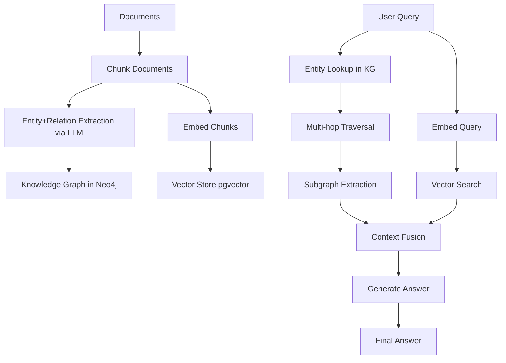

This capstone builds an end-to-end GraphRAG pipeline that constructs a knowledge graph from documents — LLM-based entity and relation extraction, graph storage in Neo4j, multi-hop traversal — and uses that graph for retrieval-augmented generation. GraphRAG excels at multi-hop reasoning, entity-centric queries, and questions that require connecting information across documents, which are exactly the cases where the vector RAG of [[RAG Pipeline Overview]] fails. The build combines retrieval, graph storage, and a hybrid vector-plus-graph retrieval layer with fusion, and finishes with an evaluation harness comparing vector RAG vs GraphRAG vs hybrid. The full capstone index lives in [[Projects MOC]].

> [!info] TL;DR
> Build an end-to-end GraphRAG pipeline that constructs a knowledge graph from documents (entity extraction, relation extraction, graph storage) and uses it for retrieval-augmented generation. GraphRAG excels at multi-hop reasoning, entity-centric queries, and questions that require connecting information across documents — cases where vector RAG fails. This capstone produces a production-grade GraphRAG system.

## Project goals

By the end of this project, you will have built:

1. An entity-and-relation extraction pipeline (LLM-based, with prompts).
2. A knowledge graph storage layer (Neo4j or NetworkX).
3. A graph query layer (entity lookup, multi-hop traversal, subgraph extraction).
4. A hybrid retrieval layer (vector + graph, with fusion).
5. A generation layer that uses graph context alongside vector context.
6. An evaluation harness comparing vector RAG vs GraphRAG vs hybrid.

## Architecture



Documents are chunked once and consumed by two parallel paths: an LLM extracts entities and relations that populate the knowledge graph, while the same chunks are embedded into a vector store. At query time, entity lookup and multi-hop traversal produce a subgraph, vector search produces chunks, and the two are fused into the context the generator cites in its answer.

## Prerequisites

```bash
pip install neo4j pyvis networkx openai sentence-transformers
pip install neo4j-graphrag  # Microsoft's GraphRAG library (optional)
# Or use Microsoft GraphRAG directly: pip install graphrag
docker run -d -p 7474:7474 -p 7687:7687 neo4j:latest  # local Neo4j
```

Requires: OpenAI API key (or local LLM via Ollama), Neo4j instance.

## Document ingestion and chunking

Ingestion loads documents from JSON and splits them with a recursive character splitter — 1200-character chunks with 200 characters of overlap — keeping document IDs and chunk indices so every extracted entity and relation can be traced back to its source chunk:

```python
from langchain.text_splitter import RecursiveCharacterTextSplitter
from datasets import load_dataset

def ingest_documents(doc_path: str) -> list:
    """Load and chunk documents."""
    splitter = RecursiveCharacterTextSplitter(
        chunk_size=1200,
        chunk_overlap=200,
        separators=["\n\n", "\n", ". ", " "],
    )
    docs = load_dataset("json", data_files=doc_path, split="train")
    chunks = []
    for doc in docs:
        texts = splitter.split_text(doc["text"])
        for i, text in enumerate(texts):
            chunks.append({
                "id": f"{doc['id']}_chunk_{i}",
                "doc_id": doc["id"],
                "text": text,
                "chunk_idx": i,
            })
    return chunks
```

## Entity and relation extraction

This is the core GraphRAG step: for each chunk, an LLM extracts entities and relations. The prompt defines a JSON schema with typed entities (person, organization, location, event, concept, other) and directed relations, lists the common relation types to look for — WORKS_FOR, FOUNDED_BY, and LOCATED_IN, for instance — and instructs the model to be conservative — only extract relations explicitly stated or strongly implied in the text:

```python
import json
from openai import OpenAI

client = OpenAI()

EXTRACTION_PROMPT = """You are a knowledge-graph extractor. Given a text chunk, extract all entities and relations.

Return JSON with this schema:
{
  "entities": [
    {"id": "entity_unique_id", "name": "Entity Name", "type": "person|organization|location|event|concept|other", "description": "Brief description"}
  ],
  "relations": [
    {"source": "entity_id", "target": "entity_id", "type": "relation_type", "description": "Brief description"}
  ]
}

Common relation types: WORKS_FOR, FOUNDED_BY, LOCATED_IN, ACQUIRED, PARTNERS_WITH, EMPLOYS, MEMBER_OF, CREATED, OWNS, COMPETES_WITH, INVESTED_IN, SUPPLIES_TO.

Be conservative: only extract relations explicitly stated or strongly implied in the text.

TEXT CHUNK:
{text}

EXTRACTION:"""


def extract_entities_relations(chunk_text: str, model: str = "gpt-4o") -> dict:
    """Extract entities and relations from a text chunk via LLM."""
    response = client.chat.completions.create(
        model=model,
        messages=[
            {"role": "system", "content": "You are a knowledge-graph extractor. Always return valid JSON."},
            {"role": "user", "content": EXTRACTION_PROMPT.format(text=chunk_text)},
        ],
        response_format={"type": "json_object"},
        temperature=0.0,
    )
    return json.loads(response.choices[0].message.content)


def extract_corpus(chunks: list, model: str = "gpt-4o") -> tuple:
    """Extract entities and relations across all chunks."""
    all_entities = {}
    all_relations = []
    for chunk in chunks:
        result = extract_entities_relations(chunk["text"], model=model)
        for ent in result.get("entities", []):
            if ent["id"] not in all_entities:
                all_entities[ent["id"]] = {**ent, "source_chunks": [chunk["id"]]}
            else:
                # Merge: append source chunk
                all_entities[ent["id"]]["source_chunks"].append(chunk["id"])
                # Merge descriptions (use longer)
                if len(ent.get("description", "")) > len(all_entities[ent["id"]].get("description", "")):
                    all_entities[ent["id"]]["description"] = ent["description"]
        for rel in result.get("relations", []):
            all_relations.append({**rel, "source_chunk": chunk["id"]})
    return list(all_entities.values()), all_relations
```

Corpus-level extraction runs the per-chunk extractor across all chunks and merges the results: an entity seen in multiple chunks is stored once, with every source chunk appended and the longer description kept, while each relation records the chunk it came from.

## Knowledge-graph storage in Neo4j

The storage layer wraps the Neo4j driver with the operations the retrieval layer needs. `create_schema` enforces a unique constraint on entity IDs; `add_entity` and `add_relation` use `MERGE` so re-running extraction is idempotent; `entity_lookup` finds entities by fuzzy name match; `multi_hop_traversal` does a BFS-style traversal up to `max_hops` from a start entity; and `subgraph_extraction` pulls the neighborhood of a set of entities within a radius:

```python
from neo4j import GraphDatabase

class KnowledgeGraph:
    def __init__(self, uri="bolt://localhost:7687", user="neo4j", password="password"):
        self.driver = GraphDatabase.driver(uri, auth=(user, password))

    def close(self):
        self.driver.close()

    def create_schema(self):
        with self.driver.session() as session:
            session.run("CREATE CONSTRAINT entity_id IF NOT EXISTS FOR (e:Entity) REQUIRE e.id IS UNIQUE")

    def add_entity(self, entity: dict):
        with self.driver.session() as session:
            session.run(
                """
                MERGE (e:Entity {id: $id})
                SET e.name = $name,
                    e.type = $type,
                    e.description = $description,
                    e.source_chunks = $source_chunks
                """,
                id=entity["id"],
                name=entity["name"],
                type=entity.get("type", "other"),
                description=entity.get("description", ""),
                source_chunks=entity.get("source_chunks", []),
            )

    def add_relation(self, relation: dict):
        with self.driver.session() as session:
            session.run(
                """
                MATCH (s:Entity {id: $source}), (t:Entity {id: $target})
                MERGE (s)-[r:RELATES {type: $type, source_chunk: $source_chunk}]->(t)
                SET r.description = $description
                """,
                source=relation["source"],
                target=relation["target"],
                type=relation["type"],
                description=relation.get("description", ""),
                source_chunk=relation.get("source_chunk", ""),
            )

    def entity_lookup(self, name: str) -> list:
        """Find entities by name (fuzzy match)."""
        with self.driver.session() as session:
            result = session.run(
                "MATCH (e:Entity) WHERE toLower(e.name) CONTAINS toLower($name) RETURN e",
                name=name,
            )
            return [r["e"] for r in result]

    def multi_hop_traversal(self, start_entity_id: str, max_hops: int = 2) -> dict:
        """BFS traversal up to max_hops from start entity."""
        with self.driver.session() as session:
            result = session.run(
                """
                MATCH path = (start:Entity {id: $id})-[*1..$max_hops]-(target:Entity)
                RETURN path, nodes(path) as nodes, relationships(path) as rels
                LIMIT 50
                """,
                id=start_entity_id,
                max_hops=max_hops,
            )
            paths = []
            for r in result:
                paths.append({
                    "nodes": [dict(n) for n in r["nodes"]],
                    "rels": [dict(rel) for rel in r["rels"]],
                })
            return paths

    def subgraph_extraction(self, entity_ids: list, radius: int = 1) -> dict:
        """Extract a subgraph around the given entities."""
        with self.driver.session() as session:
            result = session.run(
                """
                MATCH (e:Entity) WHERE e.id IN $ids
                MATCH (e)-[*0..$radius]-(n:Entity)
                WITH DISTINCT n
                MATCH (n)-[r]-(m:Entity)
                RETURN n, r, m
                """,
                ids=entity_ids,
                radius=radius,
            )
            nodes, rels = {}, []
            for r in result:
                nodes[r["n"]["id"]] = dict(r["n"])
                nodes[r["m"]["id"]] = dict(r["m"])
                rels.append({"source": r["n"]["id"], "target": r["m"]["id"], **dict(r["r"])})
            return {"nodes": list(nodes.values()), "rels": rels}
```

## Hybrid retrieval (vector + graph)

The retriever supports three modes — `vector`, `graph`, or `hybrid` — over the same interface. Vector retrieval embeds the query and searches the vector store; graph retrieval extracts entity names from the query with an LLM, looks them up in the knowledge graph, and pulls a subgraph of radius 2 around the top 5 matched entities; hybrid does both and returns chunks plus subgraph for fusion:

```python
class HybridRetriever:
    def __init__(self, kg: KnowledgeGraph, vector_store, embedder, top_k: int = 5):
        self.kg = kg
        self.vector_store = vector_store
        self.embedder = embedder
        self.top_k = top_k

    def retrieve(self, query: str, mode: str = "hybrid") -> dict:
        """Retrieve context: 'vector', 'graph', or 'hybrid'."""
        result = {"query": query, "vector_chunks": [], "graph_subgraph": None, "entities": []}

        # Vector retrieval
        if mode in ("vector", "hybrid"):
            query_embed = self.embedder.encode([query])[0]
            vector_results = self.vector_store.search(query_embed, top_k=self.top_k)
            result["vector_chunks"] = vector_results

        # Graph retrieval
        if mode in ("graph", "hybrid"):
            # Step 1: extract entities from query (via LLM)
            query_entities = self._extract_query_entities(query)
            # Step 2: lookup entities in KG
            kg_entities = []
            for ent_name in query_entities:
                kg_entities.extend(self.kg.entity_lookup(ent_name))
            # Step 3: multi-hop traversal
            subgraph = self.kg.subgraph_extraction(
                [e["id"] for e in kg_entities[:5]],  # top 5 entities
                radius=2,
            )
            result["entities"] = kg_entities
            result["graph_subgraph"] = subgraph

        return result

    def _extract_query_entities(self, query: str) -> list:
        """Extract entity names from query via LLM."""
        response = client.chat.completions.create(
            model="gpt-4o-mini",
            messages=[
                {"role": "system", "content": "Extract entity names from the query. Return JSON: {\"entities\": [\"name1\", \"name2\"]}."},
                {"role": "user", "content": f"Query: {query}\n\nEntities:"},
            ],
            response_format={"type": "json_object"},
            temperature=0.0,
        )
        return json.loads(response.choices[0].message.content).get("entities", [])
```

The fusion itself is deliberately simple — both result types travel in one dictionary, and the generation step decides how to present them. The production checklist below notes where smarter fusion (reciprocal rank fusion, learned fusion) pays off.

## Generation with graph context

The generator receives both retrieved chunks and the extracted subgraph, formats the subgraph as explicit entity and relation lists, and instructs the model to answer with citations back to chunk IDs or entity IDs — the grounding that keeps graph context honest:

```python
def generate_answer(query: str, retrieved: dict, model: str = "gpt-4o") -> str:
    """Generate answer using both vector chunks and graph context."""
    vector_context = "\n\n".join([c["text"] for c in retrieved["vector_chunks"]])

    graph_context = ""
    if retrieved["graph_subgraph"]:
        sg = retrieved["graph_subgraph"]
        entity_str = "\n".join([f"- {n['name']} ({n.get('type', 'unknown')}): {n.get('description', '')}" for n in sg["nodes"][:20]])
        rel_str = "\n".join([f"- {r['source']} --{r.get('type', 'relates_to')}--> {r['target']}" for r in sg["rels"][:30]])
        graph_context = f"Knowledge Graph Context:\nEntities:\n{entity_str}\n\nRelations:\n{rel_str}"

    prompt = f"""Answer the question using both vector and graph context. Cite sources.

Vector Context (chunks from documents):
{vector_context}

{graph_context}

Question: {query}

Answer (with citations [chunk_id] or [entity_id]):"""

    response = client.chat.completions.create(
        model=model,
        messages=[{"role": "user", "content": prompt}],
        temperature=0.0,
    )
    return response.choices[0].message.content
```

## Evaluation harness

Evaluation compares the three retrieval modes on a labeled multi-hop QA set, where each item carries a question, an expected answer, and a type (`single_hop` or `multi_hop`). GPT-4o acts as judge, deciding whether each generated answer is semantically equivalent to the expected one:

```python
class GraphRAGEvalHarness:
    """Compare vector RAG vs GraphRAG vs hybrid on a multi-hop QA dataset."""

    def __init__(self, retriever: HybridRetriever, generator, eval_set: list):
        self.retriever = retriever
        self.generator = generator
        self.eval_set = eval_set  # list of {"question": ..., "answer": ..., "type": "single_hop"|"multi_hop"}

    def evaluate(self, mode: str) -> dict:
        results = []
        for item in self.eval_set:
            retrieved = self.retriever.retrieve(item["question"], mode=mode)
            generated = self.generator(item["question"], retrieved)
            results.append({
                "question": item["question"],
                "expected": item["answer"],
                "generated": generated,
                "type": item["type"],
            })
        # LLM-as-judge
        accuracy = self._llm_judge(results)
        return {"mode": mode, "accuracy": accuracy, "n": len(results)}

    def _llm_judge(self, results: list) -> float:
        # Use GPT-4o as judge
        correct = 0
        for r in results:
            judge_prompt = f"""Question: {r['question']}
Expected: {r['expected']}
Generated: {r['generated']}

Is the generated answer correct (semantically equivalent to expected)? Yes/No."""
            response = client.chat.completions.create(
                model="gpt-4o",
                messages=[{"role": "user", "content": judge_prompt}],
                temperature=0.0,
            )
            if "yes" in response.choices[0].message.content.lower():
                correct += 1
        return correct / len(results)
```

## Production hardening checklist

1. **Entity deduplication**: the same entity may be extracted under different names ("OpenAI" vs "OpenAI Inc" vs "OpenAI, Inc."). Implement fuzzy matching (Levenshtein, embeddings) to merge.
2. **Relation confidence**: not all LLM-extracted relations are accurate. Store a confidence score (LLM log-prob or self-consistency vote); filter low-confidence relations.
3. **Incremental updates**: as new documents arrive, extract their entities/relations and merge into the existing graph. Avoid full re-extraction.
4. **Schema validation**: enforce a schema (allowed entity types, relation types). Reject extractions that don't fit. Otherwise the graph becomes a mess of unique types.
5. **Multi-hop limit**: traversal >3 hops often produces noisy, irrelevant subgraphs. Default to 2 hops; increase only if needed.
6. **Hybrid fusion**: simply concatenating vector + graph context works; smarter fusion (reciprocal rank fusion, learned fusion) gives 5–10% improvement.
7. **Cost control**: LLM-based extraction is expensive (1 GPT-4o call per chunk). For large corpora (100K+ chunks), use a smaller model (gpt-4o-mini) for extraction and reserve GPT-4o for difficult cases.
8. **Graph visualization**: use Pyvis or Neo4j Bloom to visualize the graph; helps debugging and intuition.
9. **Caching**: cache entity extraction results; re-extraction is wasteful. Use content-hash-based caching.
10. **Evaluation**: separate eval sets for single-hop (where vector RAG excels) and multi-hop (where GraphRAG excels). Don't expect GraphRAG to beat vector RAG on single-hop.
11. **Microsoft GraphRAG library**: for production, use Microsoft's official GraphRAG library (pip install graphrag) rather than rolling your own. Handles entity dedup, hierarchical summarization, and query routing.
12. **Hierarchical summarization**: for very large graphs, summarize subgraphs hierarchically (Microsoft GraphRAG's "community summaries"). Allows answering global questions ("what are the main themes in this corpus?") that pure entity lookup can't.

## Modern developments (2024–2026)

### Microsoft GraphRAG (2024)

Microsoft released an open-source GraphRAG library that implements the full pipeline with hierarchical summarization, community detection, and query routing. The reference implementation; most production GraphRAG deployments are based on it.

### LightRAG (2024)

A lightweight GraphRAG alternative that skips hierarchical summarization. Faster, simpler, slightly lower quality than Microsoft GraphRAG. Good for smaller corpora.

### Agentic GraphRAG (2025)

LLM agents that decide when to use graph retrieval vs vector retrieval. The agent extracts entities from the query, decides if multi-hop reasoning is needed, and routes accordingly. More flexible than fixed hybrid retrieval.

### Multimodal GraphRAG (2025)

Extend entity extraction to images, tables, and figures. A diagram of a system architecture becomes entities (components) and relations (data flow). Used for technical document Q&A.

### Knowledge-graph-enhanced long-context (2026)

With frontier models supporting 1M+ context, the role of GraphRAG shifts: instead of retrieving subgraphs to fit in context, retrieve subgraphs to *focus* the model's attention on the relevant parts of an already-large context.

## Common failure modes

| Symptom                                  | Likely Cause                                        | Fix                                                              |
|------------------------------------------|------------------------------------------------------|------------------------------------------------------------------|
| Graph too sparse (few relations)          | Extraction too conservative; or model too weak       | Use GPT-4o for extraction; relax prompt                          |
| Graph too dense (too many relations)     | Extraction too aggressive; lots of noise              | Tighten prompt; filter low-confidence relations                  |
| Same entity multiple times               | No entity deduplication                              | Fuzzy match on entity names; merge                                |
| Multi-hop retrieval misses answers       | Hops too shallow; or relations not extracted          | Increase max_hops; check extraction coverage                      |
| GraphRAG worse than vector RAG           | Eval set is single-hop; GraphRAG shines on multi-hop | Use multi-hop eval set; or use hybrid retrieval                  |
| Slow queries                             | Neo4j not indexed; or subgraph too large              | Add indexes on entity id/name; limit subgraph radius to 2        |
| LLM extraction costs explode             | One LLM call per chunk on huge corpus                | Use smaller model (gpt-4o-mini); or batch extraction              |
| Entity names don't match query           | Query entity extraction different from doc extraction | Use same model + prompt for both                                  |
| Generated answers hallucinate entities   | Graph context not properly grounded in chunks         | Cross-reference entities to source chunks; cite chunks            |
| Graph becomes stale after doc updates     | No incremental update pipeline                       | Implement incremental extraction; merge into existing graph      |

## Interview questions

**When does GraphRAG outperform vector RAG?** Three cases. (1) **Multi-hop reasoning**: questions that require connecting information across documents ("Who founded the company that acquired the startup that developed X?"). Vector RAG retrieves chunks independently; GraphRAG traverses the graph. (2) **Entity-centric queries**: questions about a specific entity ("What do we know about OpenAI?"). GraphRAG retrieves all relations involving OpenAI; vector RAG retrieves chunks mentioning OpenAI (less structured). (3) **Global questions**: questions about the whole corpus ("What are the main themes?"). Vector RAG can't answer; GraphRAG with hierarchical summarization can. For single-hop factual questions, vector RAG is sufficient and faster.

**How do you handle entity deduplication?** The same entity may be extracted under different names ("OpenAI" vs "OpenAI Inc" vs "OpenAI, Inc."). Three approaches. (1) **String normalization**: lowercase, strip punctuation, remove legal suffixes (Inc, Corp, Ltd). Catches obvious cases. (2) **Embedding similarity**: embed entity names, cluster by cosine similarity (>0.9), merge clusters. Catches semantic duplicates. (3) **LLM-based matching**: for each new entity, ask an LLM "is this the same as any existing entity?" Catches subtle cases (acronyms, aliases). Production: combine all three — normalization first (cheap), then embedding (medium cost), then LLM (expensive, only for ambiguous cases).

**How do you evaluate a GraphRAG system?** Three eval dimensions. (1) **Extraction quality**: precision/recall of extracted entities and relations vs ground-truth annotations. Sample 100 chunks, manually annotate, compute metrics. (2) **Retrieval quality**: for each eval question, did the retrieval return the relevant subgraph? Use recall@k. (3) **End-to-end accuracy**: LLM-as-judge (GPT-4o) on generated answers. Compare vector RAG vs GraphRAG vs hybrid on the same eval set. Critical: separate single-hop and multi-hop questions — GraphRAG should win on multi-hop; vector RAG may win on single-hop.

**How does Microsoft GraphRAG differ from a basic GraphRAG pipeline?** Two key additions. (1) **Hierarchical summarization**: Microsoft GraphRAG detects communities (clusters of related entities) and summarizes each community into a higher-level description. This enables global questions ("what are the main themes?") that pure entity-lookup can't answer. (2) **Query routing**: Microsoft GraphRAG detects whether a query is "local" (specific entity, multi-hop) or "global" (corpus-wide theme) and routes to different retrieval strategies. Local queries use entity lookup + subgraph extraction; global queries use community summaries. The basic pipeline (this project) handles local queries; Microsoft GraphRAG handles both.

**How do you keep the graph fresh as documents change?** Three strategies. (1) **Incremental extraction**: only re-extract entities/relations for new or modified chunks. Use content-hash-based caching to detect which chunks changed. (2) **Soft deletes**: when a chunk is removed, mark its entities/relations as "stale" rather than deleting them (other chunks may reference them). Periodic garbage collection removes truly orphaned entities. (3) **Versioning**: store graph snapshots; allow rollback if a bad extraction corrupts the graph. Production: combine all three; run incremental extraction daily, garbage collection weekly, snapshots before each major update.

## See also

- [[Projects MOC]] — the projects index.
- [[Build a Mini RAG Pipeline]] — the simpler vector-RAG capstone.
- [[Build a RAG Evaluation Harness]] — RAG evaluation in depth.
- [[Build a Multimodal RAG Pipeline]] — multimodal retrieval.
- [[RAG Pipeline Overview]] — the vector RAG baseline this builds on.
- [[Advanced RAG Patterns]] — where hybrid retrieval sits among advanced patterns.
- [[Memory Types]] — knowledge graphs as semantic memory for agents.
- [[Vector Storage with pgvector]] — the vector side of hybrid retrieval.
- [[RAG]] — the original retrieval-augmented generation paper.
- [[Agents and Tooling MOC]]
