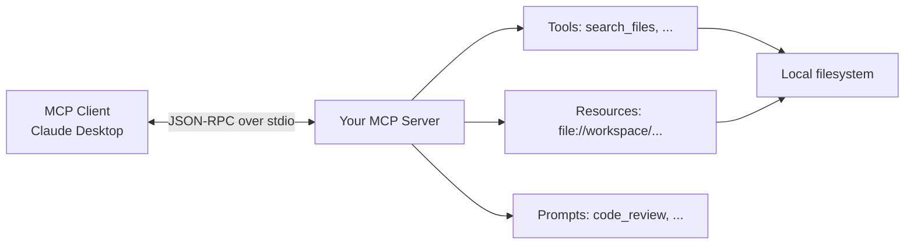

The Model Context Protocol (MCP) lets one server expose tools, resources, and prompts to any MCP client — Claude Desktop, Cursor, custom agent frameworks — over a standardized JSON-RPC protocol. This capstone builds a working MCP server with the official Python SDK: a filesystem search tool, a file resource, a code-review prompt, and the packaging and client configuration to make it installable. The protocol itself is covered in [[MCP Overview]]; this note is the hands-on build, indexed with the other capstones in [[Projects MOC]].

> [!info] TL;DR
> Build a Model Context Protocol (MCP) server that exposes resources, prompts, and tools to MCP clients (Claude Desktop, Cursor, custom agent frameworks). The server implements the MCP JSON-RPC protocol over stdio or SSE, registers its capabilities, and handles requests from clients. By the end, you'll have a working MCP server that a Claude Desktop user can install and use to access your custom tools and data — without writing any Claude-specific code.

## Project goals

By the end of this project, you will have built:

1. An MCP server using the official Python SDK (`mcp`).
2. A **tool** — `search_files` — that searches the local filesystem.
3. A **resource** — `file://workspace/{path}` — that exposes files via URI.
4. A **prompt** — `code_review` — a templated prompt clients can invoke.
5. A package configuration that lets users install the server via `uv` or `pip`.
6. A Claude Desktop configuration entry that activates the server.

The implementation uses the official MCP Python SDK and demonstrates the protocol from [[MCP Overview]] in code.

## Why MCP?

Before MCP, integrating tools with LLM clients required custom code per (client, tool) pair. A search tool integrated with Claude Desktop required Anthropic-specific glue. The same tool integrated with Cursor required Cursor-specific glue. The same tool integrated with a custom LangGraph agent required LangGraph-specific glue. N clients × M tools = N×M integrations.

MCP standardizes this. An MCP server exposes tools, resources, and prompts via a JSON-RPC protocol. Any MCP client (Claude Desktop, Cursor, custom agents) can consume any MCP server. N + M integrations instead of N×M.

Building an MCP server is also a good way to understand the protocol's design — what tools, resources, and prompts are; how capability negotiation works; how the request/response cycle flows.

## Architecture



The server runs as a subprocess of the client. Communication is over stdio (JSON-RPC messages on stdin/stdout). The server registers its capabilities (which tools/resources/prompts it exposes) at startup; the client calls them as needed.

## Prerequisites

```bash
pip install mcp
# Or use uv (recommended for MCP servers)
uv init my-mcp-server
uv add mcp
```

You'll also need an MCP client to test against. Claude Desktop is the easiest; Cursor also works.

## The server skeleton

The minimum viable server runs the MCP protocol over stdio but exposes no tools, resources, or prompts yet. Connecting it to a client should succeed without errors:

```python
# server.py
from mcp.server import Server
from mcp.server.stdio import stdio_server
import mcp.types as types

app = Server("my-mcp-server")

async def main():
    async with stdio_server() as (read_stream, write_stream):
        await app.run(read_stream, write_stream, app.create_initialization_options())

if __name__ == "__main__":
    import asyncio
    asyncio.run(main())
```

## A tool: search_files

Tools are functions the LLM can call. They take JSON arguments and return JSON results — the standardized counterpart of [[Function Calling]], described in detail in [[MCP Components]]. The `inputSchema` is a JSON Schema the client uses to validate arguments before calling and to inform the LLM what arguments are available; the return value is a list of `TextContent` (or `ImageContent`, `EmbeddedResource`).

```python
import os
import glob

@app.list_tools()
async def list_tools() -> list[types.Tool]:
    return [
        types.Tool(
            name="search_files",
            description="Search for files matching a glob pattern in the workspace directory.",
            inputSchema={
                "type": "object",
                "properties": {
                    "pattern": {
                        "type": "string",
                        "description": "Glob pattern, e.g., '**/*.py' for all Python files.",
                    },
                    "path": {
                        "type": "string",
                        "description": "Directory to search in. Defaults to the workspace root.",
                        "default": ".",
                    },
                },
                "required": ["pattern"],
            },
        )
    ]

@app.call_tool()
async def call_tool(name: str, arguments: dict) -> list[types.TextContent]:
    if name == "search_files":
        pattern = arguments["pattern"]
        path = arguments.get("path", ".")
        # SECURITY: restrict to the workspace directory
        workspace_root = os.path.abspath(os.environ.get("WORKSPACE_ROOT", "."))
        abs_path = os.path.abspath(path)
        if not abs_path.startswith(workspace_root):
            return [types.TextContent(type="text", text=f"Error: path '{path}' is outside the workspace.")]
        
        matches = glob.glob(os.path.join(abs_path, pattern), recursive=True)
        # Return the first 50 matches (avoid huge responses)
        result = "\n".join(matches[:50])
        if len(matches) > 50:
            result += f"\n... and {len(matches) - 50} more"
        return [types.TextContent(type="text", text=result)]
    else:
        return [types.TextContent(type="text", text=f"Unknown tool: {name}")]
```

> [!warning] Security
> Always validate paths and restrict to allowed directories. An MCP tool that searches the entire filesystem is a security hole — clients may pass arbitrary paths. [[MCP Security]] covers the full threat model.

## A resource: file://workspace/{path}

Resources are URI-addressable data the client can read on demand. They're useful for exposing files, database records, or any addressable data. Resources are listed via `list_resources` (so the client UI can show them) and read via `read_resource` (when the user or LLM asks for content):

```python
@app.list_resources()
async def list_resources() -> list[types.Resource]:
    """List available resources. Clients use this to populate their UI."""
    workspace_root = os.path.abspath(os.environ.get("WORKSPACE_ROOT", "."))
    resources = []
    for root, dirs, files in os.walk(workspace_root):
        for f in files:
            if f.endswith((".py", ".md", ".txt")):
                full = os.path.join(root, f)
                rel = os.path.relpath(full, workspace_root)
                resources.append(types.Resource(
                    uri=f"file://workspace/{rel}",
                    name=rel,
                    description=f"File at {rel}",
                    mimeType="text/plain",
                ))
                if len(resources) >= 100:
                    return resources  # don't list thousands
    return resources

@app.read_resource()
async def read_resource(uri: str) -> str:
    """Read a resource by URI."""
    if not uri.startswith("file://workspace/"):
        raise ValueError(f"Unsupported URI scheme: {uri}")
    
    workspace_root = os.path.abspath(os.environ.get("WORKSPACE_ROOT", "."))
    rel = uri[len("file://workspace/"):]
    full = os.path.abspath(os.path.join(workspace_root, rel))
    
    # SECURITY: prevent path traversal
    if not full.startswith(workspace_root):
        raise ValueError(f"Path traversal denied: {uri}")
    
    if not os.path.exists(full):
        raise FileNotFoundError(f"File not found: {uri}")
    
    with open(full, "r") as f:
        return f.read()
```

## A prompt: code_review

Prompts are templated messages clients can invoke. They're useful for codifying workflows ("review this code", "explain this error", "write tests for this function"). When a client invokes the `code_review` prompt with `file_path="src/server.py"`, the server returns a pre-formatted message the client sends to the LLM; the LLM then produces the review:

~~~python
@app.list_prompts()
async def list_prompts() -> list[types.Prompt]:
    return [
        types.Prompt(
            name="code_review",
            description="Review a Python file for bugs, style, and best practices.",
            arguments=[
                types.PromptArgument(
                    name="file_path",
                    description="Path to the Python file to review.",
                    required=True,
                ),
            ],
        )
    ]

@app.get_prompt()
async def get_prompt(name: str, arguments: dict) -> types.GetPromptResult:
    if name == "code_review":
        file_path = arguments["file_path"]
        # Read the file content (could also use the resource system)
        workspace_root = os.path.abspath(os.environ.get("WORKSPACE_ROOT", "."))
        full = os.path.abspath(os.path.join(workspace_root, file_path))
        if not full.startswith(workspace_root):
            raise ValueError("Path traversal denied.")
        with open(full, "r") as f:
            code = f.read()
        
        return types.GetPromptResult(
            description=f"Code review for {file_path}",
            messages=[
                types.PromptMessage(
                    role="user",
                    content=types.TextContent(
                        type="text",
                        text=f"""Please review the following Python file for:
1. Bugs and potential errors
2. Code style (PEP 8)
3. Best practices (type hints, error handling, docstrings)
4. Performance issues

File: {file_path}

```python
{code}
```

Provide specific, actionable feedback with line references.""",
                    ),
                )
            ],
        )
    raise ValueError(f"Unknown prompt: {name}")
~~~

## Package configuration

For the server to be installable, you need a `pyproject.toml` and an entry point:

```toml
[project]
name = "my-mcp-server"
version = "0.1.0"
description = "An MCP server exposing filesystem search and code review tools."
requires-python = ">=3.10"
dependencies = ["mcp>=1.0.0"]

[project.scripts]
my-mcp-server = "my_mcp_server.server:main"

[build-system]
requires = ["hatchling"]
build-backend = "hatchling.build"
```

The `[project.scripts]` entry creates a `my-mcp-server` command that runs the `main` function. Users can install the server with `pip install my-mcp-server` and run it via the `my-mcp-server` command.

## Claude Desktop configuration

To use the server in Claude Desktop, add it to the configuration file (`~/Library/Application Support/Claude/claude_desktop_config.json` on macOS):

```json
{
  "mcpServers": {
    "my-mcp-server": {
      "command": "uv",
      "args": ["--directory", "/path/to/my-mcp-server", "run", "my-mcp-server"],
      "env": {
        "WORKSPACE_ROOT": "/path/to/allowed/workspace"
      }
    }
  }
}
```

Restart Claude Desktop. The server should appear in the tools menu. You can now ask Claude "Search for all Python files in the workspace" and it will call your `search_files` tool.

## Common pitfalls

Five mistakes account for most broken MCP servers.

### Blocking I/O in async handlers

MCP handlers are async. If you do blocking I/O (file reads, network calls), you'll block the event loop and the server will appear hung. Use `asyncio.to_thread()` or `aiofiles`:

```python
content = await asyncio.to_thread(lambda: open(path).read())
```

### Path traversal

Resources and tools that accept paths are vulnerable to traversal (`../../../etc/passwd`). Always validate that the resolved absolute path is within the allowed root.

### Large responses

MCP responses go through the client's context window. A tool that returns 100KB of text will consume a significant fraction of the context. Paginate large responses or truncate with a "(showing first N of M)" note.

### Forgetting to register listeners

Each capability (`list_tools`, `call_tool`, `list_resources`, `read_resource`, `list_prompts`, `get_prompt`) requires its own decorator. Forgetting one means the server reports zero of that capability, and the client can't use it.

### Stdio vs SSE transport

Stdio (the default) requires the server to be a subprocess of the client. SSE (Server-Sent Events) runs the server as a long-lived HTTP service. SSE is appropriate for shared servers; stdio is appropriate for per-user local servers. Most local MCP servers use stdio.

## Production extensions

Beyond the core server, the protocol and production practice support five extensions.

### Authentication

For SSE-based servers exposed to the network, add authentication. The MCP spec supports OAuth 2.1; implement an auth handler that validates bearer tokens.

### Resource subscriptions

The MCP spec supports resource subscriptions — clients subscribe to a resource URI and receive notifications when it changes. This is useful for resources representing live data (logs, metrics, file changes).

### Tool annotations

Tools can have annotations like `readOnlyHint`, `destructiveHint`, `idempotentHint`. These help clients (and users) understand the safety properties of a tool before calling it.

### Multiple transports

A production server may support both stdio (for local use) and SSE (for network use). The SDK supports both; you configure the transport at startup.

### Metrics and tracing

Instrument the server with OpenTelemetry. Log every tool call, resource read, and prompt invocation. This is essential for debugging production issues — the [[Observability Stack]] and [[Build an Agent Observability Platform]] capstones cover the platform side.

## Production hardening checklist

Fifteen upgrades separate a demo server from a production one:

1. **Async throughout**: use `async def` for every tool/resource/prompt handler; never block the event loop with sync I/O.
2. **Pydantic schema validation**: declare args and result types as Pydantic models; reject invalid inputs at the boundary.
3. **OAuth 2.1 + PKCE**: implement the 2025-06 spec auth flow; never hardcode credentials.
4. **Per-user authorization**: extract user identity from the OAuth token; pass to every tool handler; enforce policy.
5. **Audit logging**: every tool call logged with timestamp, user, tool, args_hash, result_hash, duration, effect.
6. **Rate limiting**: per-user-per-tool rate limit (e.g., 60 calls/min); return 429 with Retry-After header.
7. **Timeout on tool execution**: cap every tool at 30s; return timeout error to client.
8. **Sandboxed execution**: run the server in Docker with read-only FS and no network except declared hosts.
9. **Streamable HTTP transport**: deploy behind a reverse proxy (nginx, Cloudflare); use Streamable HTTP, not SSE.
10. **Caching**: cache GET-style resources in Redis with TTL; invalidate on writes.
11. **Health check endpoint**: `/health` returns 200 if the server is ready; used by load balancer.
12. **Metrics**: expose Prometheus metrics (`/metrics`) — tool call count, latency histogram, error rate by tool.
13. **OpenTelemetry tracing**: trace every tool call end-to-end; integrate with Jaeger/Tempo.
14. **Versioning**: version the server (semver); break changes only on major versions; support old versions for N months.
15. **CI/CD**: every PR runs unit tests + integration tests against a real client; auto-deploy on merge.

## Modern developments (2024–2026)

The MCP ecosystem moved fast; five shifts matter for servers built today.

### MCP 2025-06 spec features

The June 2025 spec added: **resource templates** (parameterized URIs), **subscriptions** (push notifications), **elicitation** (server-initiated user prompts), **sampling** (server-initiated LLM calls), and **structured audit log fields**. Implement these to be spec-compliant and feature-complete.

### MCP-as-a-service by SaaS vendors

GitHub, Slack, Notion, Salesforce, and ServiceNow now host their own MCP servers. If you're building an MCP server for a SaaS product, consider whether the vendor already ships one — your server might be redundant. Differentiate by adding domain-specific tools the vendor doesn't ship.

### MCP gateway integration

Production MCP servers are typically deployed behind a gateway (Cloudflare AI Gateway, AWS Bedrock Agent Gateway, Pulumi MCP Hub). The gateway handles auth, caching, rate limiting, and audit; your server focuses on tool logic. Test your server against a real gateway before production — see [[Gateway and Router Patterns]] for the pattern.

### Composability — aggregating other servers

Your MCP server can act as a client to other MCP servers, aggregating their tools behind a unified interface. The 2025-11 spec defines how to declare inter-server dependencies. Use this to build a "company knowledge" server that combines filesystem, Slack, GitHub, and Notion behind one facade.

### Tool result schema validation

The 2025-06 spec made JSON Schema for tool results a first-class citizen. Declare result schemas; the client validates before passing to the LLM. This catches malformed outputs and prevents LLM hallucinations around unexpected JSON.

## Interview questions

**Walk through what happens when a client calls your MCP tool.** (1) Client sends `tools/call` JSON-RPC request with tool name + args. (2) Server receives via stdio or Streamable HTTP. (3) Server extracts OAuth token; validates with auth provider; extracts user identity. (4) Policy engine (OPA/Cedar) evaluates: is this user allowed to call this tool with these args? If not, return 403. (5) Pydantic validates args against the tool's schema. (6) Async handler executes with timeout (30s). (7) Result validated against result schema. (8) Audit log entry written. (9) Result returned to client. (10) Metrics incremented (call count, latency histogram).

**How do you handle auth in an MCP server?** Per the 2025-06 spec: OAuth 2.1 with PKCE. (1) Client requests a tool call; server returns 401 with WWW-Authenticate pointing to the OAuth provider. (2) Client opens browser to OAuth provider; user consents. (3) Provider redirects with auth code. (4) Client exchanges code for access token using PKCE verifier. (5) Client retries tool call with `Authorization: Bearer <token>`. (6) Server validates token (JWT signature check or introspection endpoint); extracts user identity. (7) Server caches the validated token (short TTL) to avoid re-validating on every call.

**How do you test an MCP server?** Three layers: (1) **Unit tests** — test each tool handler in isolation with mocked dependencies (DB, upstream API). (2) **Integration tests** — spin up the server + a mock client; test the full JSON-RPC round-trip including auth, validation, audit. (3) **End-to-end tests** — connect a real LLM client (Claude Desktop) and have it call tools; verify the LLM can use them correctly. Use the official MCP test client (`@modelcontextprotocol/test-client`).

**How do you version an MCP server?** (1) **Server version** (semver) — exposed via `server/info`; bump major on breaking changes. (2) **Tool versioning** — when a tool's schema changes breakingly, register both `tool_name_v1` and `tool_name_v2`; deprecate v1 with a sunset date. (3) **Spec version** — declare which MCP spec version the server supports; clients can refuse if they need a newer spec. (4) **Backward compat** — support old tool versions for at least 6 months after deprecation; log usage to identify when sunset is safe.

**How do you make an MCP server composable (aggregating other servers)?** The aggregating server acts as both server (to the client) and client (to upstream servers). On startup, it connects to all configured upstreams via stdio or HTTP. On `tools/list`, it queries each upstream's `tools/list`, prefixes tool names with the upstream server ID (`github__create_issue`), and merges. On `tools/call`, it routes by prefix. Auth: pass-through the user's OAuth token to each upstream (with scope reduction). Cache the merged `tools/list` for 5 min to avoid re-querying on every client request.

**How do you handle long-running tools (e.g., a 5-minute data export)?** (1) **Async pattern**: return immediately with a job ID; client polls `get_job_status(job_id)` until complete. (2) **Progress notifications**: send `notifications/progress` messages every N seconds with % complete; client displays a progress bar. (3) **Streaming results**: if the result is a stream (e.g., large export), use Streamable HTTP's streaming mode to send chunks as they're produced. (4) **Webhook callback**: client provides a webhook URL; server POSTs the result when complete. Pattern (1) + (2) is the most common in production.

## See also

- [[Projects MOC]] — the projects index.
- [[MCP Overview]] — the protocol this server implements.
- [[MCP Components]] — resources, tools, prompts in detail.
- [[MCP Security]] — security considerations.
- [[MCP Enterprise Integration]] — production patterns.
- [[Build an MCP Marketplace]] — distributing and discovering servers.
- [[Build a Mini Agent]] — an agent that consumes MCP tools.
- [[Build a Code Agent]] — a tool-heavy agent build.
- [[Function Calling]] — how MCP tools relate to function calling.
- [[Gateway and Router Patterns]] — the gateway fronting production servers.
- [[LLM Security and Prompt Injection]] — input validation.
- [[Observability Stack]] — the tracing and metrics platform.
