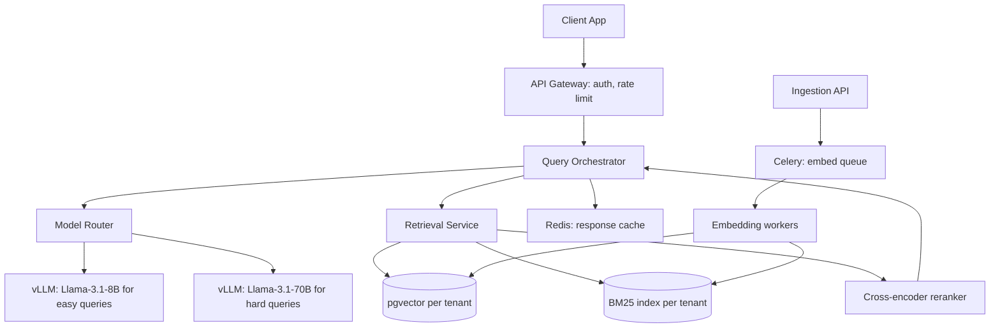
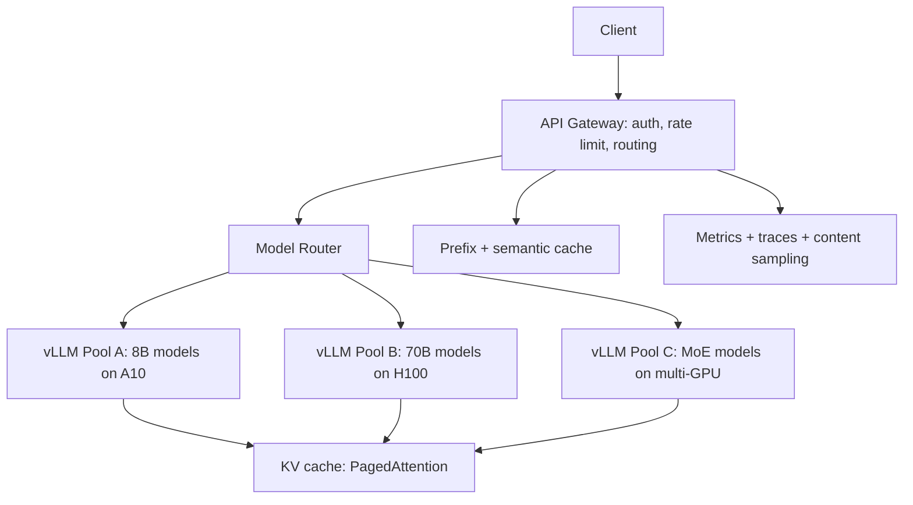
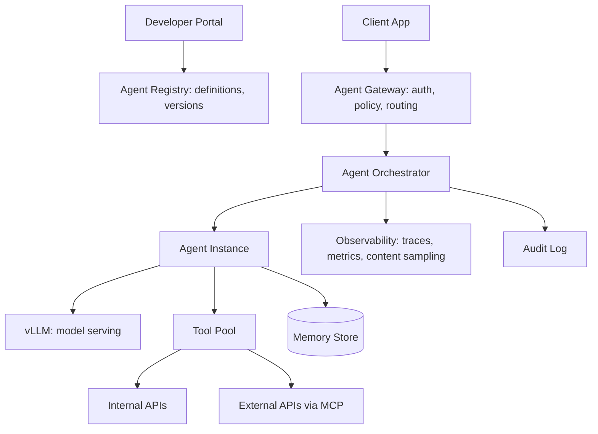
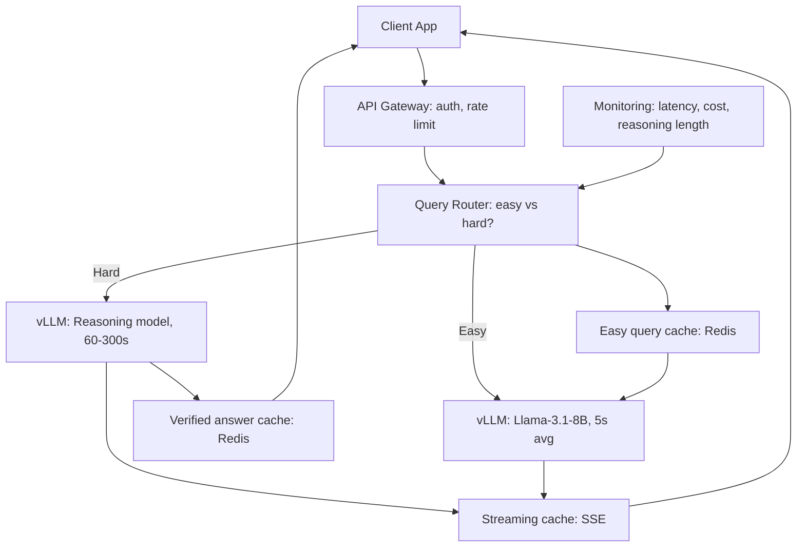
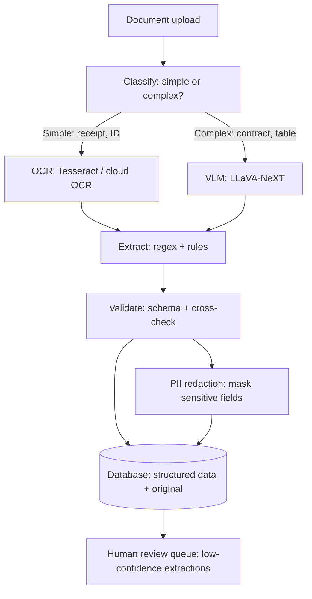
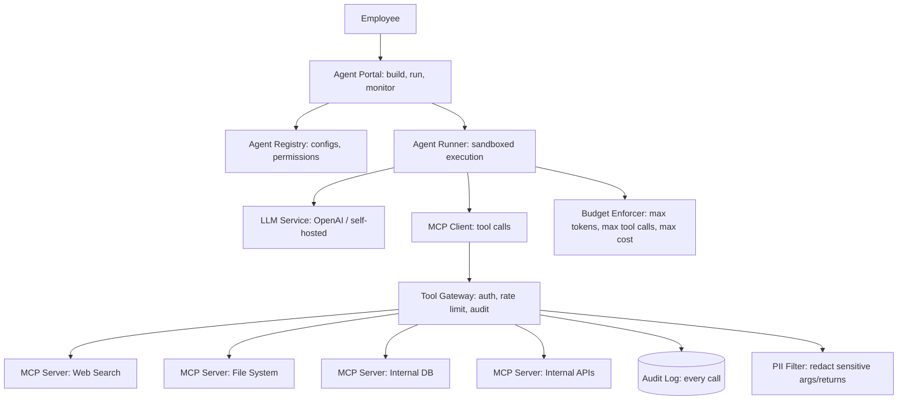
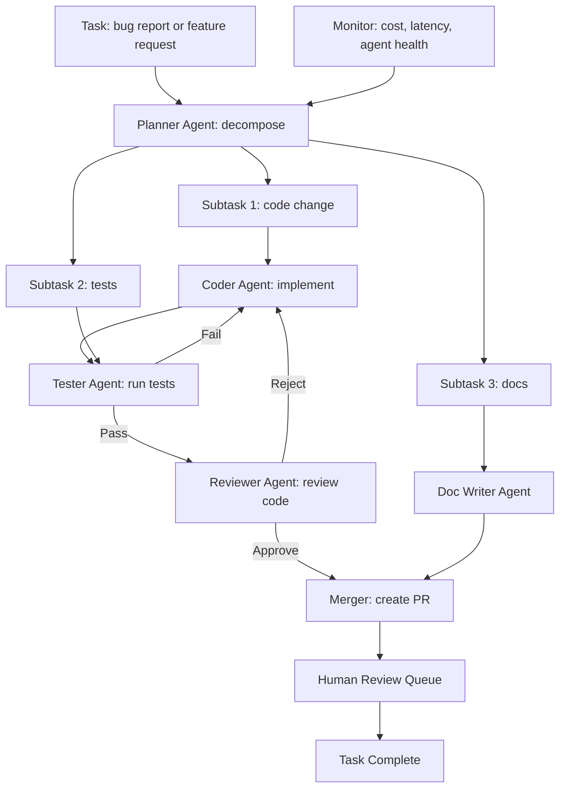

LLM system design interviews test the ability to design production AI systems end-to-end: serving architecture, cost optimization, evaluation, monitoring, multi-tenancy, and failure handling. The three most common questions — design a multi-tenant RAG platform, design an LLM serving system, and design an agent platform — are joined at the senior level by four advanced prompts covering reasoning-model serving, Vision-Language Model deployment, MCP-based agent architectures, and multi-agent production systems. Each question draws on the same core components (model serving, vector storage, prompt management, observability) but with a different emphasis, and each is worked through below with requirements clarification, architecture, key decisions, cost arithmetic, failure handling, and a scale-up plan; [[Interview Prep MOC]] orients the wider interview-prep area.

> [!info] TL;DR
> LLM system design interviews test your ability to design production AI systems end-to-end: serving architecture, cost optimization, evaluation, monitoring, multi-tenancy, and failure handling. The three most common questions are: design a multi-tenant RAG platform, design an LLM serving system, and design an agent platform. Each requires understanding the same core components (model serving, vector storage, prompt management, observability) but with different emphasis.

## How to approach LLM system design

Unlike classical system design (where the bottleneck is usually the database or the cache), LLM system design has four recurring bottlenecks that frame every answer:

1. **Latency**: LLM inference is slow (100ms–10s).
2. **Cost**: token-based pricing scales with usage.
3. **Quality**: hallucination, drift, prompt injection.
4. **Context**: long contexts cost more and slow down inference.

A good answer addresses all four explicitly. The structure that works:

1. **Clarify requirements**: users, traffic, latency SLO, cost budget, quality bar.
2. **High-level architecture**: components and data flow.
3. **Deep-dive on the hardest component**: usually the LLM serving or retrieval.
4. **Cost and quality strategy**: routing, caching, eval, monitoring.
5. **Failure handling**: provider outages, cost spikes, quality regressions.
6. **Scale-up plan**: how the system evolves from 1K to 1M users.

Spend the first 5 minutes on requirements clarification. Most candidates jump to architecture too early and miss critical constraints.

## Core design questions

The three questions in this section are the most common LLM system design prompts, and they share a skeleton: a gateway in front, an orchestration layer, model serving behind it, and caching plus monitoring on the side. What distinguishes a strong answer is the per-question emphasis — tenant isolation for the RAG platform, serving efficiency for the LLM serving system, and policy plus sandboxing for the agent platform.

### Design a multi-tenant RAG platform

The classic enterprise RAG prompt: many customers, isolated corpora, and a hard quality bar on every query.

#### Requirements clarification

Start by pinning down the shape of the problem, which is an enterprise product with many isolated customers:

- **Users**: enterprise customers, each with 10–1000 users.
- **Tenants**: 100+ tenants, each with their own document corpus (10K–10M documents).
- **Traffic**: 10–100 queries per second per tenant at peak.
- **Latency SLO**: p95 < 3 seconds end-to-end.
- **Cost**: per-tenant chargeback; budget caps.
- **Quality**: 95%+ retrieval relevance, <5% hallucination rate.
- **Isolation**: tenants cannot see each other's documents.

#### High-level architecture

The request path runs from the client through an API gateway into a query orchestrator that fans out to model serving and retrieval, with an asynchronous ingestion pipeline feeding the indexes:



#### Key decisions

**Multi-tenancy strategy**: a shared Postgres cluster with `tenant_id` on every row and row-level security. Each tenant has their own HNSW index within the shared `documents` table. This balances isolation (queries are tenant-scoped by RLS) with operational simplicity (one cluster to manage). For tenants with very large corpora (>1M documents), consider a dedicated Postgres instance; for smaller tenants, shared is more efficient. The Postgres-plus-pgvector approach is covered in [[Vector Storage with pgvector]].

**Retrieval**: hybrid search (vector + BM25) per tenant, with cross-encoder reranking on the top 20 to get the top 5 for generation, and RRF for fusion — the full pipeline is detailed in [[Chunking, Hybrid Search, and Reranking]] and [[RAG Pipeline Overview]].

**Model routing**: classify queries by difficulty. Easy queries (factual lookups, simple Q&A) go to Llama-3.1-8B; hard queries (multi-step reasoning, code generation) go to Llama-3.1-70B. Route via a small classifier or the 8B model itself with a "can you answer this?" prompt. Routing as a cost lever is covered in [[Cost Optimization]] and [[Gateway and Router Patterns]].

**Caching** comes in three tiers, each with a different hit-rate/reliability profile:

- Prefix caching for common system prompts (handled by vLLM).
- Response cache (Redis) for exact-match queries; 5–30% hit rate typical.
- Semantic cache for near-duplicate queries (using embedding similarity); higher hit rate but risks returning wrong answers.

**Cost governance**: per-tenant budget caps enforced at the API gateway. Requests that would exceed the cap are rejected with a clear error, and per-tenant usage tracking feeds daily/monthly chargeback reports.

**Quality monitoring** is a loop, not an afterthought:

- LLM-as-judge on 1% of responses (faithfulness, relevance) — see [[LLM-as-Judge Evaluation]].
- User feedback (thumbs up/down) captured and aggregated.
- Retrieval metrics: are the retrieved chunks actually relevant? Sample and audit weekly.
- Hallucination rate: faithfulness check on RAG outputs.

#### Failure handling

Plan for each subsystem failing independently:

- **LLM provider outage**: failover to a backup model (e.g., if OpenAI is down, switch to a self-hosted Llama).
- **Vector DB overload**: degrade to BM25-only retrieval (lower quality but still functional).
- **Cost spike**: alert on per-request cost >$0.50 (likely a bug); auto-disable expensive features.
- **Quality regression**: alert if LLM-as-judge score drops below threshold; rollback the latest prompt change.

#### Scale-up plan

Show how the design evolves across four orders of magnitude:

- **1K users**: single Postgres instance, single vLLM replica, in-process cache.
- **10K users**: Postgres read replica, 2–3 vLLM replicas, Redis cache, dedicated embedding workers.
- **100K users**: sharded Postgres (by tenant), vLLM autoscaling, semantic cache, dedicated retrieval service.
- **1M users**: multi-region deployment, dedicated vector DB (Qdrant or Milvus), disaggregated inference (prefill/decode split).

#### Common follow-up questions

**How do you handle a tenant whose corpus grows to 100M documents?** Migrate to a dedicated Postgres instance, then to a dedicated vector DB if needed, and re-embed if the embedding model changes.

**How do you handle multi-language documents?** Use a multilingual embedding model (BGE-M3, multilingual E5); detect language at ingest time and route to language-specific indexes if needed.

**How do you handle PII in documents?** Scrub at ingest time (use a PII detector like Presidio); never log raw prompts/responses; store only redacted versions — the same discipline required in [[PII and Data Leakage]].

**How do you handle document updates?** Re-embed the updated document, version the chunks, and handle in-flight queries by serving the old version until the new one is ready.

### Design an LLM serving system

The internal-platform serving prompt: mixed workloads, many concurrent models, and tight latency SLOs at high QPS.

#### Requirements clarification

- **Traffic**: 1000 QPS peak, mixed workload (chat, completion, embedding).
- **Models**: 5–10 models served concurrently (different sizes, different fine-tunes).
- **Latency SLO**: p95 TTFT < 1s, p95 total < 5s.
- **Cost**: minimize cost per token; budget cap.
- **Reliability**: 99.9% availability.
- **Clients**: internal applications via API.

#### High-level architecture

A gateway fronts a model router that dispatches to heterogeneous vLLM pools, with caching and metrics on the side and a shared KV-cache story underneath:



#### Key decisions

**Serving engine**: vLLM for all models — PagedAttention for memory efficiency, continuous batching for throughput, prefix caching for shared system prompts. See [[PagedAttention and vLLM]], [[PagedAttention]], [[Continuous Batching]], and [[14 - Inference and Production/Inference/vLLM|vLLM]].

**Hardware** is matched to model size, and stating the pairing shows capacity-planning fluency (see [[GPU Infrastructure and Sizing]]):

- 8B models: A10 (24GB) — 1 GPU per replica, 8 replicas per node.
- 70B models: H100 (80GB) — 2 GPUs per replica (tensor parallel), 4 replicas per node.
- MoE models: H100 — 4–8 GPUs per replica depending on expert count.

**Model routing**: route by model name + difficulty. For models with multiple fine-tunes (e.g., base + LoRA), use vLLM's multi-LoRA support to serve many adapters from one base model — see [[13 - Training and Adaptation/Fine-Tuning/LoRA|LoRA]].

**Caching** again comes in tiers, with realistic hit rates worth quoting:

- **Prefix cache** (vLLM native): cache KV state for shared system prompts; 50–80% hit rate for chat applications.
- **Response cache** (Redis): cache exact-match responses; 5–20% hit rate.
- **Semantic cache**: cache responses for semantically similar prompts; higher hit rate, lower reliability.

**Autoscaling**: scale vLLM replicas based on queue depth and GPU utilization — HPA (Horizontal Pod Autoscaler) on Kubernetes, with custom metrics (queue depth, KV cache utilization). The KV cache mechanics behind those metrics are covered in [[KV Cache Mechanics]].

**Multi-region**: deploy in 2–3 regions for latency and availability. Route by geography (closest region). Replicate model weights across regions (one-time cost); replicate state (cache, conversation) via Redis cross-region replication.

#### Failure handling

- **GPU failure**: Kubernetes restarts the pod; in-flight requests fail and are retried by the client. Use circuit breakers to avoid retry storms.
- **Model OOM**: detected by vLLM; trigger preemption of low-priority requests.
- **Traffic spike**: autoscaler adds replicas (takes 30–60 seconds); in the meantime, queue requests and apply rate limiting.
- **Cost spike**: alert on cost per request; auto-throttle if cost exceeds threshold.

#### Cost optimization

This is where strong candidates separate from the rest; every lever has a number attached:

- **Quantization**: INT8 for 70B models (fits on 1 H100 instead of 2); 2× throughput — see [[Quantization]].
- **Speculative decoding**: for chat workloads, use a 1B draft model; 2–3× throughput on accept-heavy workloads — see [[Speculative Decoding]], [[Medusa and EAGLE]], and [[Build a Speculative Decoding Server]].
- **Batching**: continuous batching (vLLM) gives 5–10× throughput vs. naive.
- **Caching**: prefix + response cache reduces effective QPS by 30–50%.
- **Spot instances**: for batch workloads, use spot GPUs with checkpointing.

#### Common follow-up questions

**How do you handle long-context requests (100K+ tokens)?** Use a dedicated pool with long-context models, chunked prefill, and prefix caching for shared context; consider Ring Attention for >1M tokens — the scaling options are surveyed in [[Long-Context Architectures]].

**How do you deploy a new model without downtime?** Blue-green deployment: deploy the new model in parallel, route a small percentage of traffic, monitor, ramp to 100%, then decommission the old model — the rollout patterns are covered in [[A-B Testing and Shadow Deployment]].

**How do you handle streaming responses?** Server-Sent Events (SSE) from vLLM through the gateway to the client, with buffer management to avoid blocking.

**How do you handle tool calls?** Parse tool-call JSON from the model, execute tools, feed results back. The serving system itself is tool-agnostic; the client (or an agent framework) handles tool execution — the calling conventions live in [[Function Calling]].

### Design an agent platform

The platform-engineering prompt: hundreds of developers shipping thousands of agents safely on shared infrastructure.

#### Requirements clarification

- **Use case**: internal company platform for building AI agents (customer support, research, automation).
- **Users**: 100+ developers across multiple teams.
- **Agents**: 1000+ deployed agents, each with custom prompts, tools, and integrations.
- **Traffic**: 100+ agent invocations per second at peak.
- **Reliability**: 99.9% availability; graceful degradation on component failures.
- **Security**: per-team access control; audit logging; prompt-injection defense.

#### High-level architecture

Developers register versioned agent definitions; clients invoke agents through a gateway and orchestrator that reach the LLM, a sandboxed tool pool, and a memory store, with observability and audit on the side:



#### Key decisions

**Agent definition**: each agent is a versioned bundle (base model + adapter + prompt + tools + parameters), stored in the registry and promoted through dev → staging → production — see [[Model Registry and Versioning]].

**Orchestrator**: the entry point for agent invocations. It authenticates the caller, loads the agent definition, spawns the agent process (or routes to a warm pool), enforces policies, and returns the result. The platform-level patterns are covered in [[Enterprise Multi-Agent Architectures]].

**Tool execution**: tools run in sandboxed containers (Docker, gVisor) with limited permissions. Each tool has an access-control list (which agents can call it, on which data), and all tool calls are logged for audit — see [[MCP Security]].

**Memory**: per-conversation and per-user memory, stored in Postgres + pgvector, with tenant isolation via row-level security — see [[Memory Operations]] and [[Vector Memory Backends]].

**Observability** has three legs, and together they are the difference between a demo and a platform (see [[Observability Stack]] and [[Build an Agent Observability Platform]]):

- Distributed tracing (OpenTelemetry) across the orchestrator, agent, tools, and LLM.
- Metrics: per-agent latency, per-tool call rate, per-tenant cost, error rates.
- Content sampling: 1% of agent outputs sampled for LLM-as-judge quality monitoring.

**Policy enforcement**: a centralized policy engine (OPA or custom) that enforces per-team access control (which teams can deploy agents that call which tools), cost caps per team, tool allowlists per agent (a customer-support agent cannot call finance tools), and data residency (PII cannot leave certain regions).

#### Failure handling

- **LLM provider outage**: failover to a backup model (different provider or self-hosted).
- **Tool failure**: retry with backoff; fall back to a degraded mode (e.g., return cached data); fail gracefully with a clear error.
- **Agent timeout**: enforce max execution time; return partial results if possible.
- **Cost cap exceeded**: reject new requests from the team; allow in-flight requests to complete.

#### Common follow-up questions

**How do you handle multi-agent workflows?** Use LangGraph-style state graphs; the orchestrator manages the graph traversal — see [[Multi-Agent Architectures]] and [[LangGraph]].

**How do you handle long-running agents (minutes to hours)?** Async pattern: client submits, gets a job ID, polls or subscribes for updates. Use Celery or Temporal for orchestration — see [[Messaging with Kafka and Celery]].

**How do you handle agent self-modification (MemGPT-style)?** Sandbox the agent's memory writes; validate changes before committing; audit all memory modifications — see [[MemGPT and Letta]].

**How do you handle prompt injection?** Defense-in-depth: input sanitization, output validation, tool allowlists per context, human-in-the-loop for high-risk tools — see [[MCP Security]], [[LLM Security and Prompt Injection]], and [[Human-in-the-Loop Patterns]].

## Advanced design questions

The questions in this section cover advanced AI engineering topics: reasoning model serving (o1/R1-style), Vision-Language Model deployment, MCP-based agent architectures, and multi-agent production systems. These are the questions that distinguish a senior AI engineer from a mid-level one — they test integration depth, cost awareness, and failure-mode thinking. Each question follows the standard AI system design structure: requirements clarification (users, traffic, latency SLO, cost budget, quality bar), high-level architecture (components and data flow), deep-dive on the hardest component (usually serving, retrieval, or orchestration), cost and quality strategy (routing, caching, eval, monitoring), failure handling (provider outages, cost spikes, quality regressions), and a scale-up plan (how the system evolves from 1K to 1M users). The same discipline applies as in the core questions: spend the first 5 minutes on requirements clarification, because most candidates jump to architecture too early and miss critical constraints.

### Design a reasoning model serving system

The first advanced prompt: serving o1/R1-style models whose long chain-of-thought makes latency and cost the central design problem.

#### Requirements clarification

- **Model**: a reasoning model (o1-style or DeepSeek-R1-style) that produces long chain-of-thought before answering — see [[Reasoning Models]], [[DeepSeek-R1]], and [[Chain of Thought]].
- **Users**: 10K daily active users, 5 queries/day average = 50K queries/day.
- **Latency SLO**: time-to-first-token (TTFT) < 2s; total response time < 60s for easy queries, < 5 minutes for hard queries.
- **Cost**: budget $0.10 per query average.
- **Quality**: must match or exceed the base model on reasoning benchmarks.
- **Use case**: math homework help, code debugging, multi-step planning.

#### Key challenge: long, variable latency

Reasoning models generate 1K–50K tokens of chain-of-thought before the final answer, and this changes the serving problem in four ways:

- **Latency is 10–100× higher than standard LLMs** — a query that takes 2s on GPT-4o takes 60–300s on o1.
- **Latency is highly variable** — easy queries finish in 30s; hard ones take 5 minutes. Hard to plan capacity.
- **Cost scales with reasoning length** — at $0.06/1K output tokens, a 10K-token reasoning trace costs $0.60. Cost per query varies 10×.
- **Users expect streaming** — showing the reasoning as it's generated (or at least progress indicators) is essential for UX.

#### High-level architecture

A difficulty router splits traffic between a fast model and the reasoner, each with its own cache, all feeding a streaming cache back to the client under a monitor:



#### Key decisions

**Query routing**: classify queries by difficulty. Easy queries (factual lookups, simple Q&A) go to a fast, cheap model: Llama-3.1-8B, ~5s, $0.001. Hard queries (math, code, multi-step reasoning) go to the reasoning model: ~60–300s, $0.10–$0.60. Routing runs via a small classifier or the 8B model itself with a "can you answer this in 5 seconds?" prompt. This is critical: sending every query to the reasoning model would cost $0.30 average (10× the budget). Routing 70% to the fast model and 30% to the reasoning model brings average cost to $0.10.

**Streaming with progress indicators**: the reasoning model's chain-of-thought is streamed via SSE (Server-Sent Events). Don't show the raw CoT (it's verbose and confusing to users); instead, show progress indicators like "Thinking... 30s elapsed, 2K tokens of reasoning". When the final answer is ready, stream it normally.

**Verified answer caching**: for math/code queries with verifiable answers, cache the verified answer. If the same query comes in again, return the cached answer immediately (no reasoning needed). Hit rate: 10–30% for homework help (same problems recur).

**Reasoning length budget**: set a max reasoning length (e.g., 32K tokens). If the model exceeds this, cut it off and produce the best answer it can. This bounds cost and latency but may hurt quality on very hard problems.

**Reasoning model deployment**: use vLLM with continuous batching. Reasoning models benefit less from KV cache (each query is independent) but benefit greatly from batching (multiple reasoning traces in parallel). Target: batch 16–32 concurrent reasoning queries per GPU.

#### Cost breakdown

The routing split is what keeps the system inside budget, and the arithmetic is worth stating out loud in the interview:

- Easy query (70% of traffic): Llama-3.1-8B, 5s, 200 tokens output → $0.001.
- Hard query (30% of traffic): reasoning model, 120s avg, 8K tokens output → $0.30.
- Weighted average: 0.7 × $0.001 + 0.3 × $0.30 = $0.09 per query. Within budget.

For 50K queries/day: $4,500/day = $135K/month. Significant but feasible.

#### Failure handling

- **Reasoning model timeout**: if a query exceeds 5 minutes, return a partial answer with "Reasoning incomplete — here's the best answer so far". Don't leave the user hanging.
- **Reasoning model crash**: reasoning models can enter loops or produce garbage. Detect via output monitoring (repetition, length without progress) and fall back to the fast model with a "couldn't solve this, here's a simpler answer".
- **Cost spike**: if daily cost exceeds 1.5× the budget, automatically tighten routing (send more queries to the fast model). Alert the team.
- **Quality regression**: if user feedback (thumbs up/down) drops below 80% positive, alert and roll back to a previous model version.

#### Scale-up plan

- **1K users/day**: single vLLM instance with 4 GPUs. $5K/month.
- **10K users/day**: 4 vLLM instances with autoscaling. $135K/month.
- **100K users/day**: dedicated GPU cluster (32+ GPUs), model distillation (train a smaller model to mimic the reasoning model's outputs on common query types). $500K–$1M/month.
- **1M users/day**: requires distillation or a custom-trained smaller reasoning model. The full reasoning model is too expensive at this scale; you need a distilled version that's 10× cheaper with similar quality on common queries — see [[Build a Model Distillation Pipeline]] and [[Test-Time Compute Scaling]].

#### Interview tips

- **Acknowledge the cost challenge upfront** — reasoning models are expensive. Show that you understand the cost-quality tradeoff and have a routing strategy.
- **Don't send every query to the reasoning model** — this is the #1 mistake. Always have a fast fallback.
- **Discuss streaming** — reasoning models are slow; users need to see progress. SSE is the standard.
- **Mention distillation for scale** — at 1M users, you can't afford the full reasoning model. Distillation is the answer.
- **Have a timeout strategy** — never let a query run forever. Bound it.

### Design a VLM deployment for document analysis

The multimodal prompt: extracting structured data from sensitive documents under a PII constraint that rules out closed APIs.

#### Requirements clarification

- **Model**: a Vision-Language Model (LLaVA-NeXT, Qwen-VL, or GPT-4V) that analyzes documents (PDFs, screenshots, scanned images) — see [[LLaVA]].
- **Users**: internal enterprise users, 1K daily active, 20 documents/day average = 20K documents/day.
- **Latency SLO**: < 10s per document for single-page; < 60s for 50-page documents.
- **Cost**: $0.05 per page average.
- **Quality**: 95%+ accuracy on key information extraction (names, dates, amounts, line items).
- **Use cases**: invoice processing, contract analysis, form extraction, receipt OCR.
- **Data sensitivity**: documents contain PII (names, financial data). Must not leave the enterprise network.

#### Key challenge: expensive and variable inference

VLM inference is 5–10× more expensive than text LLM inference (vision encoder + larger model), and document analysis adds four complications of its own:

- **Variable document length** — 1-page receipt vs. 50-page contract. Cost scales with pages.
- **Layout complexity** — tables, figures, multi-column layouts. Naive approaches lose information.
- **OCR vs. VLM tradeoff** — OCR is cheap but loses layout; VLM is expensive but understands layout.
- **PII concerns** — can't use closed APIs (GPT-4V) if documents are sensitive.

#### High-level architecture

Documents are classified by complexity on upload, routed to OCR or VLM, unified through extraction and validation, and gated by PII redaction before storage and human review:



#### Key decisions

**Modality routing**: classify documents by complexity. Simple documents (receipts, IDs, single-field forms) go to OCR + regex extraction (~$0.001/page, 1s); complex documents (contracts, multi-column tables, handwritten notes) go to the VLM (~$0.05/page, 5–30s). Routing runs via a small classifier on the first page image. This is critical: sending every document to the VLM would cost $0.05 × 20K × avg 50 pages = $50K/day. Routing 70% to OCR and 30% to VLM brings cost to $5K/day.

**Self-hosted VLM**: documents contain PII, so GPT-4V is off the table. Self-host LLaVA-NeXT (or Qwen-VL) on enterprise GPUs. This also gives better cost control ($0.01–0.02/page at scale vs. $0.05 for GPT-4V).

**Document chunking**: for long documents (50+ pages), don't feed the whole thing to the VLM at once (context window limits + cost). Chunk by page or section, process each chunk, then aggregate. Use a text LLM for aggregation (cheaper than VLM).

**Schema-driven extraction**: don't ask the VLM "what's in this document?". Ask "extract the invoice number, date, vendor name, and line items in this JSON schema". This gives structured output, enables validation, and reduces hallucination.

**Validation pipeline**: cross-check extracted fields against each other (e.g., invoice date should be after the contract date; line items should sum to the total). Low-confidence extractions go to a human review queue.

**PII redaction**: before storing or sending to any external service, redact PII (names, SSNs, account numbers). Use a combination of regex (for structured PII) and NER (for unstructured PII), and audit the redaction pipeline regularly — see [[PII and Data Leakage]].

#### Cost breakdown

- Simple (70% of pages): OCR + regex, $0.001, 1s.
- Complex (30% of pages): VLM, $0.05, 10s.
- Weighted average: 0.7 × $0.001 + 0.3 × $0.05 = $0.016 per page. Well under budget.

For 20K documents × avg 10 pages = 200K pages/day: $3,200/day = $96K/month. Feasible for enterprise.

#### Failure handling

- **VLM unavailable (GPU failure)**: fall back to OCR + text LLM. Lower quality but still functional. Alert the team.
- **Low-confidence extraction**: route to human review queue. Don't return garbage to the user.
- **Document too long**: chunk and process. If chunking fails (e.g., corrupted PDF), return an error with diagnostic info.
- **PII redaction failure**: if redaction fails, block the response and alert. Never expose unredacted PII.
- **Quality regression**: if extraction accuracy drops below 95%, alert and roll back to a previous model version.

#### Scale-up plan

- **1K documents/day**: single VLM instance with 2 GPUs. $5K/month.
- **20K documents/day**: 4 VLM instances with autoscaling. $96K/month.
- **100K documents/day**: dedicated GPU cluster (16+ GPUs), model fine-tuning (fine-tune LLaVA on your specific document types for better accuracy and lower cost). $300K–$500K/month.
- **1M documents/day**: requires distillation (train a smaller VLM to mimic the large one on common document types) or specialized models (e.g., LayoutLM for forms). $1M–$3M/month.

#### Interview tips

- **Acknowledge the PII constraint upfront** — this rules out closed APIs. Show you understand enterprise constraints.
- **Don't send every document to the VLM** — OCR is 50× cheaper for simple documents. Route.
- **Discuss chunking** — long documents can't fit in one VLM call. Chunk and aggregate.
- **Mention schema-driven extraction** — don't ask "what's in this?". Ask "extract these fields in this schema". Better quality, structured output.
- **Have a validation strategy** — cross-check fields, route low-confidence to humans.

### Design an MCP-based agent platform

The protocol-centric prompt: letting employees compose arbitrary MCP tools without having to trust them.

#### Requirements clarification

- **Platform**: an internal platform where employees can build and run agents that use MCP servers (web search, file system, databases, internal APIs) — see [[MCP Overview]] and [[MCP Components]].
- **Users**: 500 employees, 50 active agents, 1K agent runs/day.
- **Latency SLO**: agent runs complete in < 60s for simple tasks, < 10 minutes for complex tasks.
- **Cost**: $0.50 per agent run average.
- **Security**: agents access internal systems; must have per-user permissions, audit logs, and sandboxing.
- **Use cases**: research assistants, data analysis, code review, customer support triage.

#### Key challenge: untrusted tool composition

MCP lets agents call arbitrary tools from arbitrary servers, and that freedom creates four security and reliability challenges:

- **Tool poisoning** — a malicious or buggy MCP server could return harmful data or execute unwanted actions.
- **Permission creep** — agents accumulate permissions over time; users don't know what their agents can access.
- **Cost blowup** — an agent that loops calling expensive tools can rack up huge bills.
- **Audit requirements** — enterprise needs to know who called what tool when, with what arguments, and what was returned.

#### High-level architecture

Employees build and run agents through a portal; agents execute in sandboxes, call tools only through a gateway that enforces policy and writes the audit log, under a budget enforcer:



#### Key decisions

**Tool gateway**: every MCP tool call goes through a gateway that enforces authentication (the agent's identity — which employee, which agent — is verified), authorization (the agent has permission to call this tool; per-user, per-tool permissions), rate limiting (max calls per minute, per day, per agent), audit logging (every call — agent, tool, args, return, timestamp — is logged for compliance), PII filtering (sensitive args and returns are redacted before logging), and cost tracking (tool costs, if any, are attributed to the agent's owner). Enterprise integration of this shape is covered in [[MCP Enterprise Integration]].

**Sandboxed execution**: agents run in Docker containers with no network access except through the MCP gateway (prevents direct external calls), a read-only filesystem except for a scratch directory, resource limits (CPU, memory, time), and no secrets mounted unless explicitly granted.

**Budget enforcement**: every agent run has a budget — max LLM tokens (e.g., 100K), max tool calls (e.g., 50), max wall-clock time (e.g., 10 minutes), max cost (e.g., $5). When any budget is exceeded, the agent is terminated with a budget-exceeded error.

**Permission model**: permissions are per-agent, not per-user. Each agent has a manifest declaring which tools it can use and with what arguments; the manifest is reviewed and approved before the agent can run. A representative manifest looks like this:

```yaml
agent_name: research-assistant
owner: alice@company.com
tools:
  - name: web_search
    max_calls_per_run: 20
    allowed_args:
      query: "*"
      max_results: 5
  - name: internal_kb_search
    max_calls_per_run: 10
    allowed_args:
      query: "*"
      kb: ["engineering", "product"]
  # NO permission for: file_system, internal_db_write, email_send
budget:
  max_tokens: 100000
  max_tool_calls: 50
  max_time_seconds: 600
  max_cost_usd: 5.00
```

**LLM choice**: route to different LLMs based on the agent's needs — simple agents (research, lookup): Llama-3.1-8B, $0.001/run; complex agents (analysis, code): Llama-3.1-70B or GPT-4o, $0.05/run; reasoning agents (multi-step planning): o1 or DeepSeek-R1, $0.30/run.

#### Cost breakdown

- LLM: $0.05 average (mix of 8B and 70B).
- Tool calls: $0.01 average (mostly free internal tools, some paid APIs).
- Infrastructure: $0.01 (compute, storage).
- Total: $0.07 per run. Well under the $0.50 budget.

For 1K runs/day: $70/day = $2,100/month. Very feasible.

#### Failure handling

- **Tool unavailable**: if an MCP server is down, the agent gets a clear error and can choose an alternative tool or report failure.
- **Tool returns invalid data**: the gateway validates returns against the tool's schema; invalid returns are rejected.
- **Agent loops**: the budget enforcer catches infinite loops (max tool calls, max time).
- **Agent produces harmful output**: post-processing filters check the output for PII, secrets, harmful content. Flagged outputs are blocked and reviewed — the filtering layer is the subject of [[Guardrails]].
- **Permission revoked mid-run**: if an agent's permissions are revoked while it's running, the gateway stops accepting its tool calls. The agent must terminate.

#### Scale-up plan

- **50 agents, 1K runs/day**: single server with Docker, 2 GPUs for LLM serving. $5K/month.
- **500 agents, 10K runs/day**: Kubernetes cluster with autoscaling, 8 GPUs. $50K/month.
- **5K agents, 100K runs/day**: dedicated cluster (32+ GPUs), multi-region for HA. $500K/month.
- **50K agents, 1M runs/day**: requires significant infrastructure (100+ GPUs), custom tool gateway, advanced caching. $3M–$5M/month.

#### Interview tips

- **Acknowledge the security challenge upfront** — untrusted tool composition is the hard part. Show you have a gateway strategy.
- **Don't let agents call tools directly** — always go through a gateway that enforces auth, rate limits, and audit.
- **Discuss the permission model** — per-agent manifests, reviewed and approved. This is enterprise-grade.
- **Mention budget enforcement** — agents can loop forever without it. Always set max tokens, max calls, max time.
- **Have a sandboxing strategy** — Docker with no network, read-only FS, resource limits.
- **Audit everything** — every tool call, every argument, every return. Enterprise compliance requires this.

### Design a multi-agent production system

The coordination prompt: specialized agents collaborating on software-development tasks, with human review gating the output.

#### Requirements clarification

- **System**: a multi-agent system where multiple specialized agents collaborate on complex tasks (e.g., software development: planner + coder + tester + reviewer) — see [[Multi-Agent Architectures]].
- **Users**: internal engineering team, 100 daily active, 50 tasks/day.
- **Latency SLO**: tasks complete in < 30 minutes for simple, < 4 hours for complex.
- **Cost**: $5 per task average.
- **Quality**: 80% of tasks completed without human intervention; 95% with one round of human review.
- **Use case**: automated bug fixes, feature implementation, code review, documentation generation.

#### Key challenge: coordination and failure modes

Multi-agent systems have failure modes that single-agent systems don't, and naming them is half the answer:

- **Echo chamber** — agents agree with each other incorrectly, amplifying mistakes.
- **Deadlock** — agents wait for each other indefinitely.
- **Cascade errors** — one agent's mistake propagates to all downstream agents.
- **Cost blowup** — N agents each making LLM calls can cost N× a single agent.
- **Context bloat** — agents passing context to each other can blow up context windows.
- **Lack of accountability** — when something goes wrong, it's unclear which agent is responsible.

These failure modes and their mitigations are treated in depth in [[Coordination and Consensus]].

#### High-level architecture

A planner decomposes the task into subtasks; specialized agents implement, test, review, and document; a merger creates the PR; and a human review queue gates completion, all under a monitor:



#### Key decisions

**Hierarchical architecture**: a planner agent decomposes the task into subtasks, each handled by a specialized agent. The planner coordinates; the specialists execute. This is more controllable than a flat swarm (where all agents talk to each other) — the same tradeoff that motivates the [[Planner-Executor Pattern]].

**Clear agent contracts**: each agent has a defined input schema, output schema, and failure mode, so the planner knows exactly what to expect from each specialist:

- Coder: input = subtask description + relevant files; output = diff; failure = "couldn't implement".
- Tester: input = diff + test commands; output = test results; failure = "tests failed: [details]".
- Reviewer: input = diff + test results; output = approve/reject + comments; failure = "unclear, needs human review".

**Iteration budget**: each subtask has a max iteration count (e.g., 3 rounds of code-test-review). If the budget is exceeded, the task is escalated to human review. This prevents infinite loops.

**Context passing**: don't pass full context between agents — pass structured summaries. Coder → Tester: pass the diff and the list of affected files (not the full file contents). Tester → Reviewer: pass the diff and test results (not the full test output). Reviewer → Planner: pass approve/reject and key comments (not the full review). This keeps context windows manageable and forces agents to communicate concisely.

**Cost attribution**: track cost per agent per task. If one agent (e.g., the coder) is consuming 80% of the cost, that's a signal to optimize it (e.g., use a cheaper model for initial drafts, expensive model only for review).

**Model routing**: use different LLMs for different agents — Planner: GPT-4o (strong reasoning, expensive); Coder: Llama-3.1-70B or DeepSeek-Coder (good at code, cheaper); Tester: Llama-3.1-8B (simple test execution); Reviewer: GPT-4o (strong judgment); Doc Writer: Llama-3.1-8B (simple writing). This reduces cost 3–5× vs. using GPT-4o for everything.

**Failure detection and escalation**: if any agent reports failure, the planner decides — retry, use a different agent, or escalate to human. If the iteration budget is exceeded, escalate to human. If cost exceeds 2× the budget, terminate and escalate. If the system produces a PR that fails CI, escalate to human.

#### Cost breakdown

- Planner (1 call, GPT-4o): $0.10.
- Coder (3 iterations, Llama-3.1-70B): $0.30.
- Tester (3 iterations, Llama-3.1-8B): $0.05.
- Reviewer (3 iterations, GPT-4o): $0.30.
- Doc Writer (1 call, Llama-3.1-8B): $0.01.
- Infrastructure: $0.24 (compute, storage).
- Total: $1.00 per task. Well under the $5 budget.

For 50 tasks/day: $50/day = $1,500/month. Very feasible.

#### Failure handling

- **Agent failure**: if an agent crashes or times out, the planner retries (up to 2 retries) or uses a different agent.
- **Echo chamber**: the reviewer agent is given a "red team" prompt — explicitly asked to find flaws. This counteracts the tendency to agree.
- **Deadlock**: every agent call has a timeout. If an agent doesn't respond, the planner moves on.
- **Cascade errors**: the reviewer catches errors before they propagate. If the reviewer rejects, the coder must fix before the task proceeds.
- **Cost blowup**: the cost monitor terminates tasks that exceed 2× budget.
- **Quality regression**: if the human review rejection rate exceeds 20%, alert the team and pause new tasks.

#### Scale-up plan

- **50 tasks/day**: single server, 2 GPUs. $5K/month.
- **500 tasks/day**: Kubernetes cluster, 8 GPUs. $15K/month.
- **5K tasks/day**: dedicated cluster (32+ GPUs), model fine-tuning (fine-tune the coder agent on your codebase for better quality and lower cost). $100K/month.
- **50K tasks/day**: requires significant infrastructure, model distillation, and specialized agents. $500K–$1M/month.

#### Interview tips

- **Acknowledge the coordination challenge upfront** — multi-agent systems have failure modes single-agent systems don't. Show you understand echo chambers, deadlocks, and cascade errors.
- **Use a hierarchical architecture** — a planner coordinates; specialists execute. This is more controllable than a flat swarm.
- **Define clear agent contracts** — input schema, output schema, failure mode. The planner knows what to expect.
- **Set iteration budgets** — never let agents loop forever. Always escalate to human when the budget is exceeded.
- **Pass structured summaries, not full context** — keeps context windows manageable and forces concise communication.
- **Route to different models** — use expensive models (GPT-4o) for planning/review, cheap models (Llama-3.1-8B) for execution. 3–5× cost reduction.
- **Have a failure detection strategy** — timeouts, cost monitors, quality regression alerts.
- **Mention human-in-the-loop** — for production, always have a human review step. Don't auto-merge agent outputs.

## General interview tips

These habits apply across every question above, and they are the cheapest way to stand out.

**Be explicit about trade-offs.** Every design decision has trade-offs; state them: "I'm choosing pgvector over Pinecone because we already operate Postgres and the operational simplicity outweighs the performance difference at our scale."

**Use numbers.** "This gives us ~500 QPS per vLLM replica, so we need 4 replicas for 2K QPS with headroom." Numbers show you can do capacity planning.

**Address cost.** Most candidates ignore cost. Address it explicitly: "At $0.005 per request, 1M requests/day = $5K/day = $1.8M/year. With caching and routing, we can get this to $500K/year."

**Address quality.** Quality monitoring is often forgotten. Mention LLM-as-judge, content sampling, and feedback loops.

**Have a scale-up plan.** Show how the design evolves: "At 10× traffic, we'd shard the database, add a dedicated vector DB, and move to multi-region."

## See also

Interview-prep siblings:

- [[Interview Prep MOC]]
- [[Conceptual Interview Questions]]
- [[Coding Interview Questions]]

Retrieval and production foundations:

- [[RAG Pipeline Overview]]
- [[Chunking, Hybrid Search, and Reranking]]
- [[Advanced RAG Patterns]]
- [[Vector Storage with pgvector]]
- [[Production AI Stack]]
- [[Reference Production Architectures]]
- [[Gateway and Router Patterns]]
- [[Failure Modes and Graceful Degradation]]
- [[Production Monitoring]]
- [[LLM-as-Judge Evaluation]]
- [[Cost Optimization]]
- [[A-B Testing and Shadow Deployment]]
- [[Model Registry and Versioning]]
- [[Observability Stack]]

Serving and inference:

- [[14 - Inference and Production/Inference/vLLM|vLLM]]
- [[Continuous Batching]]
- [[PagedAttention]]
- [[PagedAttention and vLLM]]
- [[KV Cache Mechanics]]
- [[Speculative Decoding]]
- [[Medusa and EAGLE]]
- [[Quantization]]
- [[GPU Infrastructure and Sizing]]
- [[Reasoning Models]]
- [[DeepSeek-R1]]
- [[Chain of Thought]]
- [[Test-Time Compute Scaling]]
- [[LLaVA]]
- [[Long-Context Architectures]]

Agents, MCP, and multi-agent systems:

- [[MCP Overview]]
- [[MCP Components]]
- [[MCP Enterprise Integration]]
- [[MCP Security]]
- [[Multi-Agent Architectures]]
- [[Enterprise Multi-Agent Architectures]]
- [[Coordination and Consensus]]
- [[Planner-Executor Pattern]]
- [[Function Calling]]
- [[Human-in-the-Loop Patterns]]
- [[MemGPT and Letta]]
- [[Memory Operations]]
- [[Vector Memory Backends]]
- [[LLM Security and Prompt Injection]]
- [[Guardrails]]
- [[PII and Data Leakage]]
- [[Messaging with Kafka and Celery]]
- [[LangGraph]]

Hands-on builds that exercise the same designs:

- [[Build a Mini RAG Pipeline]]
- [[Build a Multimodal RAG Pipeline]]
- [[Build a RAG Evaluation Harness]]
- [[Build a Mini Agent]]
- [[Build a Multi-Agent System]]
- [[Build a Code Agent]]
- [[Build an MCP Server]]
- [[Build an Agent Observability Platform]]
- [[Build a Speculative Decoding Server]]
- [[Build a Model Distillation Pipeline]]
