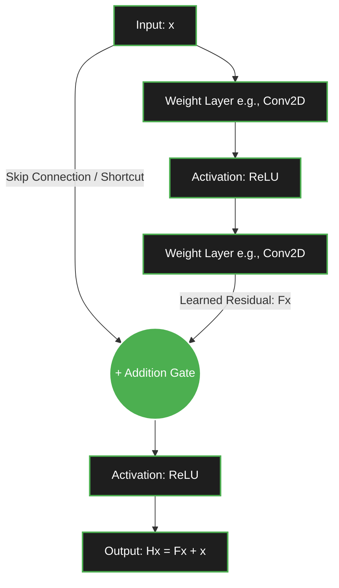

This quiz note pairs a study guide on residuals with a twenty-eight-question bank on the degradation problem they were invented to fix: it first answers the study question of what residuals, residual learning, and residual mapping actually are, then tests the terminology. The guide runs from the two roadblocks of depth — vanishing gradients and degradation — through the algebra of the residual mapping and the skip connection that implements it, to the zero solution and the $+ 1$ gradient term that make hundred-layer networks trainable. The full treatment lives in [[06 - Computer Vision/Architecture and Connectivity/The Degradation Problem and Residual Connections|The Degradation Problem and Residual Connections]] and [[06 - Computer Vision/Architecture and Connectivity/ResNet Bottleneck Blocks and Architectural Variants|ResNet Bottleneck Blocks and Architectural Variants]]; read the guide, then commit to an answer before unfolding it.

## The two roadblocks of depth

Residual learning — the training strategy behind the ResNet (residual network) architecture — is arguably one of the most important innovations in modern deep learning, and it is heavily utilized not just in computer vision (CNNs) but also in modern NLP models like Transformers. Before diving into residuals, it is critical to understand why the concept was invented: training very deep neural networks (networks with 50, 100, or 1000 layers) runs into two major roadblocks.

The first is the vanishing gradient problem. In standard feed-forward networks, gradients are calculated using the chain rule during backpropagation. As errors propagate backward from the output to the input layers, they are repeatedly multiplied by weight matrices and derivatives of activation functions. If these numbers are small (less than 1), the gradients shrink exponentially until they "vanish" to zero, and the early layers stop learning.

The second is the degradation problem, and it survives the fixes for the first. Even if vanishing gradients are addressed with techniques like batch normalization and proper weight initialization, deep networks still degrade. In theory, a deep network should perform at least as well as a shallow one: take a 20-layer network and add 30 layers to it, and the model could theoretically just learn the "identity function" — passing the input exactly as it is — for those 30 extra layers. In reality, as network depth increases, accuracy gets saturated and then rapidly degrades. This is not caused by overfitting, since training error actually increases alongside test error; it happens because modern optimization algorithms (like SGD or Adam) struggle incredibly hard to learn the identity function from a complex stack of non-linear layers.

> [!tip] What students often miss
> Students frequently confuse the degradation problem with overfitting. Remember: **overfitting** means training error is low and test error is high. **Degradation** means both training and test errors are high. The network simply becomes mathematically harder to optimize.

## What a residual is

To solve the degradation problem, researchers redefined what the network actually learns — and the word residual comes from statistics. Traditionally, a residual is defined as the difference between an observed (true) value and an estimated (predicted) value. It is the "error" or the "leftover" part that the model failed to capture.

$$ \text{Residual} = \text{True Value} - \text{Predicted Value} $$

*Example:* If the true house price is $10$, and your model predicts $8$, the residual is $2$.

Deep learning borrows this conceptual framework but applies it structurally to the transformations inside the network. Instead of a residual being an "error," it represents the difference between the input data and the desired underlying mapping.

## Residual mapping versus underlying mapping

Residual learning involves two functions. In a traditional neural network, an input $x$ is passed into a stack of layers, and those layers must figure out a complex transformation — the underlying mapping $H(x)$ — learning this entire, heavy mapping directly from scratch:

$$ \text{Network Output} = H(x) $$

The residual-learning reformulation asks a different question: what if, instead of forcing the layers to learn the entire complex transformation $H(x)$, they were just asked to learn the difference between the input $x$ and the output $H(x)$? That difference is the residual mapping, $F(x)$:

$$ F(x) = H(x) - x $$

Using basic algebra, the formula rearranges into what the final output of the network block should be:

$$ H(x) = F(x) + x $$

Instead of mapping $x \rightarrow H(x)$, the network now maps $x \rightarrow F(x)$. The original input $x$ is simply added back to the learned residual $F(x)$ at the very end.

## Skip connections and the residual block

Residual learning is the training strategy where a neural network is explicitly designed to learn $F(x)$ rather than $H(x)$. The structural mechanism that implements this mathematically is the skip connection (also known as a shortcut connection). A skip connection literally takes the input $x$, bypasses (skips) one or more convolutional layers, and adds it directly to the output of those layers.

> [!warning] Critical detail: element-wise addition
> The addition performed at the `+` gate is **element-wise**, which means the dimensions of $F(x)$ and $x$ MUST be perfectly identical. What happens if the dimensions change — for example, the convolution layer reduces the spatial size or increases the channel count? The solution is a $1 \times 1$ convolution applied to the skip connection path, strictly projecting the input $x$ into the correct shape before the addition occurs.

## Why residual learning works

Why did this simple addition $F(x) + x$ allow researchers to suddenly train 152-layer networks (ResNet-152) and win every computer vision competition? Two mechanisms.

First, the "zero" solution fixes degradation. The extra layers of a deep network were only ever supposed to learn the identity function if they were not needed. Without residuals, learning $H(x) = x$ requires a complex matrix of weights to perfectly mirror the input, and neural networks are incredibly bad at doing this through non-linear activations like ReLU. With residuals, the output is $H(x) = F(x) + x$: if the optimal transformation is just to pass the input forward (the identity mapping), the network only has to learn to push the weights of $F(x)$ to $0$. Learning $F(x) = 0$ is trivially easy for an optimizer, because it just pushes weights toward zero — exactly what L2 regularization (weight decay) already does.

Second, skip connections act as an "express highway" for gradients during backpropagation, fixing vanishing gradients. Differentiating the output with respect to the input gives:

$$ \frac{\partial H}{\partial x} = \frac{\partial (F(x) + x)}{\partial x} = \frac{\partial F}{\partial x} + 1 $$

That $+ 1$ is the key. Even if the gradients passing through the complex layers ($\frac{\partial F}{\partial x}$) become infinitely small (vanish), the $+ 1$ ensures that a gradient of at least $1$ is safely propagated backward to the earlier layers. Early layers always get a strong signal to learn from.

## The painter analogy

To cement the concept, consider a real-world scenario. Imagine you are an artist who drew a sketch of a landscape ($x$). You hand it to a master painter (the neural network) to create a perfect, polished masterpiece ($H(x)$). Under traditional deep learning, you give the painter a blank canvas: they must look at your sketch, throw it away, and try to perfectly redraw the landscape from scratch, while also making it a masterpiece. This takes immense effort, and they might mess up the underlying proportions. Under residual learning, you hand the sketch directly to the master painter on a semi-transparent canvas: the painter only needs to paint over the flaws, add shading, and make small corrections ($F(x)$). Their corrections are then combined with your original sketch ($F(x) + x$) to form the masterpiece.

Residual learning is simply: learn the corrections, do not relearn the foundation.

## Cheat sheet

For quick recall and exam or interview preparation, memorize the vocabulary in one table:

| Term | Definition / Role in Neural Networks | Formula |
| :--- | :--- | :--- |
| **Residual** | The difference between the desired mapping and the original input. | $H(x) - x$ |
| **Underlying Mapping** | The complete, final transformation we actually want to achieve. | $H(x)$ |
| **Residual Mapping** | The specific correction/adjustment the intermediate layers learn. | $F(x) = H(x) - x$ |
| **Skip Connection** | The structural architecture (the wire bypassing layers) that performs the addition operation. | N/A |
| **Final Output** | The combination of the learned correction and the bypassed original input. | $H(x) = F(x) + x$ |

> [!tip] Ultimate takeaway
> Without skip connections, networks deeper than ~30 layers suffer severely from degradation. With skip connections, networks can easily exceed 100+ layers (ResNet-101, ResNet-152), enjoying stable gradients and highly efficient optimization. This single mathematical addition changed deep learning forever.

## True or false

Ten statements open the quiz: three on the identity mapping argument and why it fails in practice, four on what the degradation problem is and is not, and three on what does and does not fix it. The false statements swap which error grows or which mechanism solves the problem — degradation is neither vanishing gradients nor overfitting — so check each claim against the training-error evidence.

### The identity mapping argument

Three statements on what deeper networks should in principle be able to do with their extra layers, and on why ReLU makes doing it hard.

> [!question] According to the identity mapping argument, deeper networks should perform at least as well as shallower networks because the extra layers can learn to pass their input through unchanged.
>> [!success]- Answer
>> True

> [!question] The identity mapping argument states that a deeper network with L+K layers should perform at least as well as a shallower network with L layers because the extra K layers can learn to do nothing.
>> [!success]- Answer
>> True

> [!question] The ReLU activation function makes it difficult for layers to learn identity mappings because it zeroes out all negative values.
>> [!success]- Answer
>> True

### What the degradation problem is

Four statements on the 20-versus-56-layer CIFAR-10 evidence, on what degradation is not, and on what rising training error would and would not prove.

> [!question] The degradation problem refers to the observation that deeper networks converge to solutions with higher test error than their shallower counterparts, while having lower training error.
>> [!success]- Answer
>> False

> [!question] When comparing a 20-layer network to a 56-layer network on CIFAR-10, the 56-layer network had higher training error than the 20-layer network.
>> [!success]- Answer
>> True

> [!question] The degradation problem is fundamentally the same as the vanishing gradient problem, which occurs when gradients diminish as they propagate backwards through many layers.
>> [!success]- Answer
>> False

> [!question] In the context of the degradation problem, if a deeper network has higher training error than a shallower network, this is evidence of overfitting.
>> [!success]- Answer
>> False

### What does and does not fix it

Three statements on why degradation happens, on why batch normalization is not the cure, and on what the ResNet reformulation actually asks the layers to learn.

> [!question] Batch normalization effectively solves the degradation problem by ensuring that activations have roughly unit variance throughout the network.
>> [!success]- Answer
>> False

> [!question] According to the text, the degradation problem occurs because it is fundamentally difficult for standard optimization algorithms to learn identity mappings through many stacked nonlinear layers.
>> [!success]- Answer
>> True

> [!question] The ResNet solution reformulates the learning problem to have layers learn the desired mapping H(x) directly rather than learning the residual F(x) = H(x) - x.
>> [!success]- Answer
>> False

## Multiple choice

Nine questions mirror the guide: the theory and the evidence, ruling out overfitting and batch normalization as explanation or cure, why identity mappings are hard to find, what the ResNet reformulation changes, and the analogies and diagnostics that make the idea stick. The wrong options are plausible neighbors of the right ones, so anchor each answer in the relationship between training error and test error.

### The theory and the evidence

Two questions on why deeper networks should perform at least as well as shallower ones, and on the surprising observation He et al. made on CIFAR-10.

> [!question] What is the primary theoretical argument that deeper networks should perform at least as well as shallower networks?
> a) Deeper networks have more parameters and can represent more complex functions
> b) The extra layers in deeper networks can learn the identity mapping
> c) Deeper networks benefit from batch normalization
> d) Deeper networks are less prone to vanishing gradients
>> [!success]- Answer
>> b) The extra layers in deeper networks can learn the identity mapping

> [!question] What surprising observation did He et al. make when comparing 20-layer and 56-layer networks on CIFAR-10?
> a) The 56-layer network had lower training error but higher test error
> b) The 56-layer network had higher training error than the 20-layer network
> c) The 56-layer network failed to converge entirely
> d) The 56-layer network showed signs of severe overfitting
>> [!success]- Answer
>> b) The 56-layer network had higher training error than the 20-layer network

### Ruling out overfitting and batch normalization

Two questions on why degradation is not overfitting and on why batch normalization does not make it go away.

> [!question] Why is the degradation problem NOT the same as overfitting?
> a) Because overfitting only occurs in shallow networks
> b) Because overfitting is characterized by low training error and high test error
> c) Because overfitting only happens when batch normalization is not used
> d) Because overfitting is solved by adding more layers to the network
>> [!success]- Answer
>> b) Because overfitting is characterized by low training error and high test error

> [!question] Why does the degradation problem persist even when batch normalization is used?
> a) Batch normalization actually makes the optimization landscape more difficult
> b) Batch normalization only solves vanishing gradients but not the fundamental optimization difficulty
> c) Batch normalization introduces new types of numerical instabilities
> d) Batch normalization is incompatible with deep networks
>> [!success]- Answer
>> b) Batch normalization only solves vanishing gradients but not the fundamental optimization difficulty

### Why identity mappings are hard to learn

One question on what makes the identity so difficult for optimizers to reach through stacked nonlinear layers.

> [!question] What makes it difficult for standard optimization algorithms to learn identity mappings through many stacked nonlinear layers?
> a) The gradients become too large and cause exploding gradients
> b) The narrow region in parameter space where identity mappings are representable is hard to find
> c) The ReLU activation function prevents any form of identity mapping
> d) The batch normalization destroys information necessary for identity mappings
>> [!success]- Answer
>> b) The narrow region in parameter space where identity mappings are representable is hard to find

### The ResNet reformulation

Two questions on the core insight of the solution and on what a residual block outputs when its layers learn the zero mapping.

> [!question] What is the core insight behind the ResNet solution to the degradation problem?
> a) Removing batch normalization from deep networks
> b) Reformulating the learning problem to have layers learn residuals rather than direct mappings
> c) Using different activation functions that can represent identity mappings more easily
> d) Limiting the depth of networks to prevent degradation
>> [!success]- Answer
>> b) Reformulating the learning problem to have layers learn residuals rather than direct mappings

> [!question] What would be the output of a residual block if the layers learn the zero mapping (F(x) = 0)?
> a) The output would be undefined
> b) The output would be x, the original input
> c) The output would be 0
> d) The output would be F(x)
>> [!success]- Answer
>> b) The output would be x, the original input

### Analogies and diagnostics

Two questions on the message-passing analogy for accumulated distortion and on the diagnostic that separates degradation from its lookalikes.

> [!question] According to the intuitive analogy provided, why is passing a message through 36 people difficult without degradation?
> a) Each person intentionally modifies the message
> b) Small distortions accumulate across many transformations
> c) The message gets shorter with each person
> d) The people cannot understand the original message
>> [!success]- Answer
>> b) Small distortions accumulate across many transformations

> [!question] What is the key diagnostic to distinguish the degradation problem from vanishing gradients or overfitting?
> a) The presence of batch normalization in the network
> b) The relationship between training error and test error
> c) The depth of the network relative to the dataset size
> d) The optimizer being used (SGD vs. Adam)
>> [!success]- Answer
>> b) The relationship between training error and test error

## Matching

Nine matching questions pair the core concepts of degradation and residual learning with their definitions, map the parts of a residual block, and drill the optimization, dataset, and architecture vocabulary the topic leans on. The two groups in each question are shuffled independently, so reconstruct each mapping from meaning rather than position.

### The core concepts

Two questions matching degradation, residual learning, and their neighbors to their definitions, and matching the confusion sources — overfitting, batch normalization, ReLU — to theirs.

> [!question] Match the core concept with its description.
>> [!example] Group A
>> a) Identity mapping argument
>> b) Degradation problem
>> c) Residual learning
>> d) Vanishing gradients
>
>> [!example] Group B
>> n) The observation that deeper networks converge to solutions with higher training error than shallower networks
>> o) The reformulation where layers learn F(x) = H(x) - x rather than H(x) directly
>> p) The argument that deeper networks should perform at least as well as shallower networks because extra layers can learn to do nothing
>> q) The problem where gradients diminish as they propagate backwards through many layers
>
>> [!success]- Answer
>> a) -> p)
>> b) -> n)
>> c) -> o)
>> d) -> q)

> [!question] Match the concept with its description.
>> [!example] Group A
>> a) Overfitting
>> b) Batch normalization
>> c) ResNet solution
>> d) ReLU activation
>
>> [!example] Group B
>> n) An activation function that zeroes out negative values, making identity mappings difficult
>> o) The solution to degradation problem that reformulates learning to compute residuals
>> p) A regularization technique characterized by low training error and high test error
>> q) A technique that ensures activations have roughly unit variance to mitigate internal covariate shift
>
>> [!success]- Answer
>> a) -> p)
>> b) -> q)
>> c) -> o)
>> d) -> n)

### Inside the residual block

One question on the residual block itself, its main path, its skip connection, and its residual path.

> [!question] Match the residual-block part with its description.
>> [!example] Group A
>> a) Residual block
>> b) Main path
>> c) Skip connection
>> d) Residual path
>
>> [!example] Group B
>> n) The connection that passes the input directly to the output of the block
>> o) The sequence of layers that computes F(x) in a residual block
>> p) A building block in ResNet that implements residual learning
>> q) Another name for the residual path in a residual block
>
>> [!success]- Answer
>> a) -> p)
>> b) -> o)
>> c) -> n)
>> d) -> q)

### Optimization and hypothesis-space vocabulary

Two questions on hypothesis spaces, local minima, parameter spaces, and computational graphs, and on transformations and information preservation.

> [!question] Match the optimization term with its description.
>> [!example] Group A
>> a) Hypothesis space
>> b) Local minimum
>> c) Parameter space
>> d) Computational graph
>
>> [!example] Group B
>> n) The set of all possible functions a network can represent
>> o) The multidimensional space of all possible parameter values
>> p) A graphical representation of the sequence of operations and computations in a network
>> q) A suboptimal solution in the optimization landscape that the optimizer converges to
>
>> [!success]- Answer
>> a) -> n)
>> b) -> q)
>> c) -> o)
>> d) -> p)

> [!question] Match the item with its description.
>> [!example] Group A
>> a) Nonlinear transformation
>> b) Information preservation
>> c) Local minimum
>> d) Hypothesis space
>
>> [!example] Group B
>> n) The set of all functions a model can represent
>> o) A transformation that changes the input in a non-linear way
>> p) The maintenance of information through computational steps
>> q) A suboptimal solution in the optimization landscape
>
>> [!success]- Answer
>> a) -> o)
>> b) -> p)
>> c) -> q)
>> d) -> n)

### Training machinery and error metrics

Two questions on backpropagation, gradient descent, learning rates, and convolution layers, and on training error, test error, convergence, and the optimization landscape.

> [!question] Match the training concept with its description.
>> [!example] Group A
>> a) Backpropagation
>> b) Gradient descent
>> c) Learning rate
>> d) Convolution layer
>
>> [!example] Group B
>> n) A hyperparameter that controls the step size during parameter updates
>> o) The algorithm used to compute gradients efficiently in neural networks
>> p) A layer that applies convolution operations to extract features from input
>> q) An optimization algorithm that iteratively moves parameters in the direction of steepest descent
>
>> [!success]- Answer
>> a) -> o)
>> b) -> q)
>> c) -> n)
>> d) -> p)

> [!question] Match the error or optimization term with its description.
>> [!example] Group A
>> a) Training error
>> b) Test error
>> c) Convergence
>> d) Optimization landscape
>
>> [!example] Group B
>> n) The error measured on a held-out dataset not used for training
>> o) The process by which an optimization algorithm approaches a minimum
>> p) The multidimensional surface representing all possible parameter values and their associated loss
>> q) The error measured on the training data during or after training
>
>> [!success]- Answer
>> a) -> q)
>> b) -> n)
>> c) -> o)
>> d) -> p)

### Datasets and landmark architectures

Two questions on the datasets and optimizers surrounding the problem, and on the AlexNet–VGG–Inception–ResNet lineage.

> [!question] Match the item with its description.
>> [!example] Group A
>> a) Internal covariate shift
>> b) SGD optimizer
>> c) CIFAR-10 dataset
>> d) ImageNet dataset
>
>> [!example] Group B
>> n) A popular benchmark dataset for deep learning with 60,000 32x32 color images in 10 classes
>> o) A stochastic optimization algorithm commonly used for training neural networks
>> p) A large-scale visual recognition dataset with over 14 million labeled images
>> q) The phenomenon where the distribution of activations changes during training, affecting gradient flow
>
>> [!success]- Answer
>> a) -> q)
>> b) -> o)
>> c) -> n)
>> d) -> p)

> [!question] Match the architecture with its defining trait.
>> [!example] Group A
>> a) AlexNet
>> b) VGG
>> c) Inception
>> d) ResNet
>
>> [!example] Group B
>> n) A network known for its use of residual connections to enable very deep architectures
>> o) A network that introduced the use of small 3x3 filters throughout the architecture
>> p) A network that popularized deep CNNs and used ReLU activations
>> q) A network that uses multi-scale processing with parallel convolutions of different sizes
>
>> [!success]- Answer
>> a) -> p)
>> b) -> o)
>> c) -> q)
>> d) -> n)

## See also

The topical concept notes this quiz practices, its sibling quizzes in the same chapter, and adjacent reading on the training-stability problems residuals solve:

- [[06 - Computer Vision/Architecture and Connectivity/The Degradation Problem and Residual Connections|The Degradation Problem and Residual Connections]]
- [[06 - Computer Vision/Architecture and Connectivity/ResNet Bottleneck Blocks and Architectural Variants|ResNet Bottleneck Blocks and Architectural Variants]]
- [[06 - Computer Vision/Architecture and Connectivity/Evolution of CNN Architectures|Evolution of CNN Architectures]]
- [[05 - Neural Network Foundations/Training Dynamics and Stability/Vanishing and Exploding Gradients|Vanishing and Exploding Gradients]]
- [[05 - Neural Network Foundations/Training Dynamics and Stability/Batch Normalization|Batch Normalization]]
- [[05 - Neural Network Foundations/Training Dynamics and Stability/Weight Initialization|Weight Initialization]]
- [[19 - Reference and Practice/Quizzes/Deep Learning Chapter 2 CNN/Evolution of CNN Architectures|Evolution of CNN Architectures]]
- [[19 - Reference and Practice/Quizzes/Deep Learning Chapter 2 CNN/ResNet Bottleneck Blocks and Architectural Variants|ResNet Bottleneck Blocks and Architectural Variants]]
- [[19 - Reference and Practice/Quizzes/Deep Learning Chapter 2 CNN/Batch Normalization|Batch Normalization]]
- [[19 - Reference and Practice/Quizzes/Deep Learning Chapter 2 CNN/VGG16 Architecture Deep Dive|VGG16 Architecture Deep Dive]]
- [[19 - Reference and Practice/Quizzes/Deep Learning Chapter 2 CNN/Inception Architecture Deep Dive|Inception Architecture Deep Dive]]
- [[Residual Connections]]
- [[Receptive Fields and 1x1 Convolutions]]
- [[Convolutional Neural Networks]]
