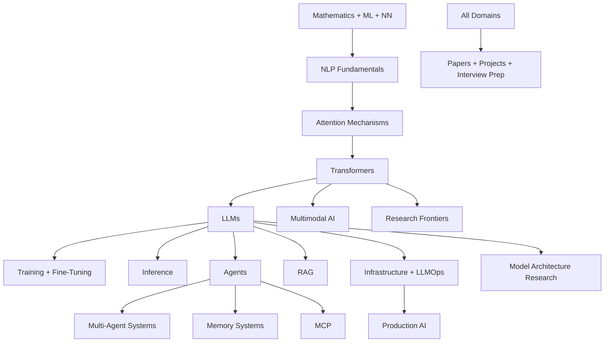

This note preserves the collection's front-door map of content — the single entry point a newcomer was told to start from when they didn't know where to begin. It records the big-picture teaching flow of the AI engineering curriculum, the complete domain directory with one-line purposes, four role-based starting paths, the cross-domain themes that cut across chapter boundaries, and the pointers to the fuller reading lists and project-state records. The vault's live navigation lives in the topical area maps; this record is kept as the archived navigation layer of the collection's construction.

## The big picture

The collection teaches the complete AI engineering stack, organized as a curriculum: mathematics, machine learning, and neural-network foundations lead into NLP; NLP leads into attention; attention leads into the Transformer; and the Transformer and LLM layers then branch into training, inference, multimodality, agents, retrieval, infrastructure, and research. The dependency flow exactly as the front door presented it:

The graph is also readable bottom-up: papers, projects, and interview preparation draw on every domain, production AI closes the infrastructure branch, and research frontiers hang directly off the Transformer layer.

## Domains

The directory grouped the collection's thirty chapters into eight blocks, from foundations to meta. Each entry keeps the original domain name and its one-line purpose; the links resolve to the topical area maps where that domain's material now lives.

### Foundations

- [[Foundations MOC|01 AI Foundations]] — what AI engineering is, roles, the modern stack
- [[Mathematics MOC|02 Mathematics]] — linear algebra, probability, calculus, optimization, information theory
- [[Machine Learning MOC|03 Machine Learning]] — supervised, unsupervised, reinforcement learning, evaluation
- [[Neural Network Foundations MOC|04 Neural Networks]] — perceptrons, MLPs, CNNs, RNNs, training
- [[NLP and Language Models MOC|05 NLP Fundamentals]] — tokenization, embeddings, language modeling

### Core sequence modeling

- [[Attention and Transformers MOC|06 Attention Mechanisms]] — Bahdanau → Luong → self-attention → multi-head → positional → efficient → long-context
- [[Attention and Transformers MOC|07 Transformers]] — the Transformer block, encoder/decoder variants, components
- [[Large Language Models MOC|08 LLMs]] — LLM architecture, context/KV, sampling, evaluation, capabilities

### Advanced models

- [[Foundation Models and Multimodal MOC|09 Foundation Models]] — vision, multimodal, embedding, code, reasoning
- [[Interpretability and Research MOC|10 Model Architecture Research]] — per-model deep dives (Llama, DeepSeek, GPT, Claude, Gemini, Mistral, Qwen, etc.)
- [[Foundation Models and Multimodal MOC|23 Multimodal AI]] — vision-language, audio, video, diffusion

### Training and inference

- [[Training and Adaptation MOC|11 Training]] — pretraining, alignment, data, distributed training
- [[Training and Adaptation MOC|12 Fine-Tuning]] — PEFT ([[13 - Training and Adaptation/Fine-Tuning/LoRA|LoRA]], [[QLoRA]]), RLHF, DPO, instruction tuning, distillation
- [[Inference and Production MOC|13 Inference]] — KV cache, decoding, quantization, serving, optimization
- [[Interpretability and Research MOC|14 Interpretability]] — mechanistic interp, attention analysis, SAEs

### Agents and systems

- [[Agents and Tooling MOC|15 AI Agents]] — architecture, planning, reasoning, tool calling, autonomy
- [[Agents and Tooling MOC|16 Multi-Agent Systems]] — coordination, communication, enterprise
- [[Agents and Tooling MOC|17 RAG]] — end-to-end retrieval-augmented generation
- [[Agents and Tooling MOC|18 Memory Systems]] — memory types, architectures, operations
- [[Agents and Tooling MOC|19 MCP]] — Model Context Protocol

### Production

- [[Inference and Production MOC|20 AI Infrastructure]] — serving, storage, messaging, compute, observability
- [[Inference and Production MOC|21 LLMOps and MLOps]] — pipelines, monitoring, evaluation, deployment
- [[Inference and Production MOC|22 Production AI]] — architectures, reliability, security, scaling
- [[Agents and Tooling MOC|25 Frameworks and Tools]] — LangChain, LangGraph, vLLM, etc.

### Research and reference

- [[Interpretability and Research MOC|24 Research Frontiers]] — SSMs, hybrids, reasoning, long-context, 2026 emerging
- [[Papers MOC|26 Papers]] — landmark papers (Bahdanau → 2026)
- [[Projects MOC|27 Projects]] — implementations, mini-projects, capstones
- [[Glossary MOC|28 Glossary]] — A–Z glossary, acronyms, notation
- [[Interview Prep MOC|29 Interview Prep]] — conceptual, system design, coding

### Meta

- [[Vault Management README|00 Vault Management]] — project state, roadmap, status, handoff

## Where to start (choose your path)

The front door offered four entry paths by role, each an ordered walk through the domains.

### I'm a student learning AI engineering

1. [[Mathematics MOC|Mathematics]]
2. [[Machine Learning MOC|Machine Learning]]
3. [[Neural Network Foundations MOC|Neural Networks]]
4. [[NLP and Language Models MOC|NLP Fundamentals]]
5. [[Attention and Transformers MOC|Attention Mechanisms]]
6. [[Attention and Transformers MOC|Transformers]]
7. [[Large Language Models MOC|LLMs]]
8. Continue per [[Learning Roadmap]]

### I'm an engineer building LLM applications

1. [[Large Language Models MOC|LLMs]]
2. [[Inference and Production MOC|Inference]]
3. [[Agents and Tooling MOC|RAG]]
4. [[Agents and Tooling MOC|AI Agents]]
5. [[Agents and Tooling MOC|MCP]]
6. [[Agents and Tooling MOC|Frameworks]]
7. [[Inference and Production MOC|Production AI]]

### I'm a researcher tracking frontiers

1. [[Attention and Transformers MOC|Attention]] (full)
2. [[Attention and Transformers MOC|Transformers]]
3. [[Interpretability and Research MOC|Model Architecture Research]]
4. [[Interpretability and Research MOC|Research Frontiers]]
5. [[Papers MOC|Papers]]
6. [[Research Queue]]

### I'm preparing for interviews

1. [[Interview Prep MOC|Interview Prep]]
2. [[Glossary MOC|Glossary]]
3. Cross-reference concept notes for depth.

## Cross-domain themes

Some topics span multiple domains. The front door called these out as theme links, a way to explore horizontally rather than chapter by chapter:

- **Attention** appears in [[Attention and Transformers MOC|06]], [[Attention and Transformers MOC|07]], [[Large Language Models MOC|08]], [[Interpretability and Research MOC|10]], [[Inference and Production MOC|13]] (KV cache — [[KV Cache Mechanics]]), and [[Interpretability and Research MOC|24]] (linear attention — [[Linear Attention]]).
- **Memory** appears in [[Inference and Production MOC|13]] (KV cache), [[Agents and Tooling MOC|18]] (agent memory — [[Memory Types]]), and [[Interpretability and Research MOC|24]] (neural memory).
- **Tools** appear in [[Agents and Tooling MOC|15]] (tool calling — [[Function Calling]]), [[Agents and Tooling MOC|19]] (MCP tools — [[MCP Components]]), and [[Agents and Tooling MOC|25]] (frameworks).
- **Embeddings** appear in [[NLP and Language Models MOC|05]] ([[Word2Vec GloVe and FastText]]), [[Large Language Models MOC|08]], [[Agents and Tooling MOC|17]] ([[Embedding Models for Retrieval]]), [[Agents and Tooling MOC|18]], and [[Foundation Models and Multimodal MOC|23]].
- **Reasoning** appears in [[Agents and Tooling MOC|15]] (CoT, ToT — [[Chain of Thought]], [[Tree of Thoughts]]), [[Foundation Models and Multimodal MOC|09]] (reasoning models — [[Reasoning Models]]), and [[Interpretability and Research MOC|24]] (test-time compute — [[Test-Time Compute Scaling]]).

## Reading lists

- [[Learning Roadmap]] — full curriculum order.
- [[Reading Orders]] — alternative reading orders (researcher, engineer, interviewer).
- [[Papers MOC]] — paper-reading order.

## Vault state

For project-state information — iteration, status, what's done, what's next — see [[Vault Management README]]; the running records live in the management logs ([[Vault Status Log]], [[Completed Work Log]], [[Remaining Work Log]], [[Next Iteration Log]]).

## See also

- [[Master AI README]] — the collection's introduction: what it is, its status, the domain table, reading orders, construction protocol, and quality standards.
- [[Master Roadmap]] — the complete intended coverage tree, every domain and planned topic with status markers.
- [[Learning Roadmap]] — the fourteen-phase curriculum path from foundations to research frontiers.
- [[Reading Orders]] — the role-based alternative reading orders in full.
- [[Master AI Index]] — the collection's master index record.
- [[Vault Management README]] — the project-state records of the collection's construction.
