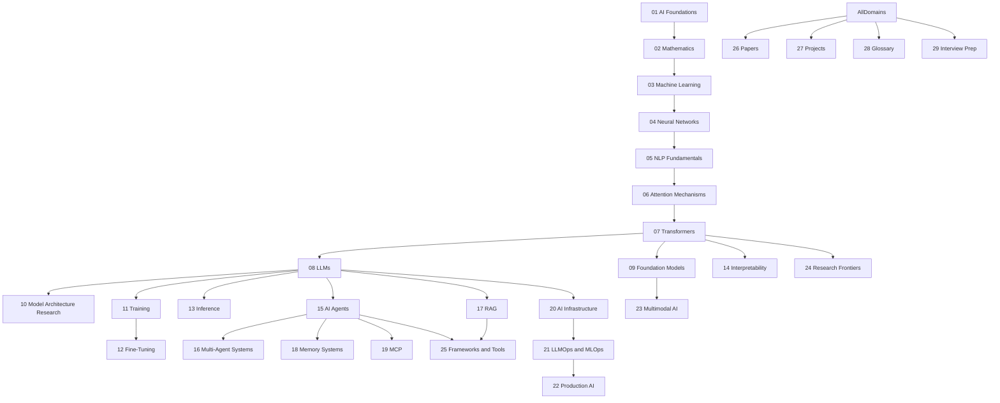

This note archives the collection's master roadmap — the record of the **entire intended vault**, not merely the work planned for the current iteration. It was the source of truth for what the collection must eventually contain, explicitly allowed to evolve, with its governing decisions recorded in [[Architecture Decisions Log]]. Every numbered domain below is a top-level chapter of the collection's design and every sub-item a planned subfolder or concept note, each carrying a status marker. The full tree is preserved as project context, together with the high-level dependency graph, the cross-domain connections, and the thirteen-iteration revision history.

## How to read this roadmap

Each numbered domain is a top-level chapter; sub-items are recursive subfolders / concept notes. The status markers:

- `[ ]` Not Started
- `[~]` Planned / Stub
- `[·]` In Progress
- `[Partial]` Partially Complete
- `[x]` Complete
- `[!]` Needs Review / Research / Expansion

The tree keeps the collection's original chapter numbering (00–29 plus 99 for archives); concept-note links resolve to the topical notes where each planned topic now lives.

## Domain 00 — Vault Management

The management chapter held the collection's project-state files, all complete at this record; they survive in this area as the log records ([[Vault Status Log]], [[Completed Work Log]], [[Remaining Work Log]], [[Current Iteration Log]], [[Next Iteration Log]], [[Architecture Decisions Log]], [[Coverage Audit Log]], [[Research Queue]]).

- [x] Project-state files
- [x] Master Roadmap
- [x] Vault Status
- [x] Completed Work / Remaining Work
- [x] Current / Next Iteration
- [x] Architecture Decisions
- [x] Coverage Audit
- [x] Research Queue

## Domain 01 — AI Foundations

The foundations chapter framed the discipline — definitions, roles, history, and the modern stack — and was still entirely at the planning stage.

- [~] What is AI / ML / DL
- [~] AI Engineering as a discipline — [[What Is AI Engineering]]
- [~] Roles: AI Engineer, LLM Engineer, Applied AI Engineer, AI Platform Engineer, AI Infra Engineer, Agentic AI Engineer
- [~] AI vs ML vs DL vs GenAI vs Agentic AI — [[AI vs ML vs DL]]
- [~] A brief history of AI (symbolic → connectionist → deep learning → transformers → agents) — [[History and Evolution of AI]]
- [~] The modern AI stack (data → training → serving → apps → agents) — [[The Modern AI Stack]]
- [~] Map of the field — links to all domains

## Domain 02 — Mathematics

The mathematics chapter spanned six branches, with linear algebra the furthest along — vectors through block matrices in progress — and probability, calculus, optimization, information theory, and statistics planned.

### Linear Algebra

- [·] Vectors, vector spaces — [[Vectors]]
- [·] Dot products, cosine similarity, norms, orthogonality, projection — [[Dot Product]], [[Cosine Similarity]]
- [·] Matrix multiplication, transpose, inverse, identity — [[Matrix Multiplication]]
- [·] Rank, decomposition (LU, QR, SVD, eigendecomposition) — [[Matrix Decomposition]]
- [·] Block matrices
- [~] Tensors, broadcasting, tensor contraction, reshaping, slicing — [[Tensors and Broadcasting]]

### Probability

- [~] Distributions, conditional probability, Bayes theorem — [[Probability Essentials]], [[Bayes Theorem]]
- [~] Expectation, variance, covariance, Gaussian — [[Gaussian Distribution]]
- [~] Entropy, cross entropy, KL divergence — [[Entropy Cross-Entropy and KL Divergence]]

### Calculus

- [~] Derivatives, partial derivatives, chain rule — [[Gradient and Chain Rule]]
- [~] Jacobians, Hessians, gradients — [[02 - Mathematics/Calculus/Jacobians and Hessians|Jacobians and Hessians]]
- [~] Automatic differentiation (forward / reverse mode)

### Optimization

- [~] Gradient descent, SGD, momentum — [[Gradient Descent]]
- [~] Adam, AdamW, RMSProp — [[Adam Optimizer Derivation]]
- [~] LR schedules: warmup, cosine decay — [[Learning Rate Schedules]]
- [~] Gradient clipping

### Information Theory

- [~] Entropy, mutual information
- [~] Cross entropy, compression
- [~] Information bottleneck

### Statistics

- [~] Estimators, bias-variance — [[Estimators and Bias]]
- [~] Hypothesis testing, confidence intervals — [[Hypothesis Testing]]

## Domain 03 — Machine Learning

The machine-learning chapter covered the classical triad — supervised, unsupervised, and reinforcement learning — plus evaluation and generalization, all planned.

### Supervised Learning

- [~] Linear / logistic regression — [[04 - Machine Learning/Regression/Linear Regression|Linear Regression]], [[04 - Machine Learning/Regression/Logistic Regression|Logistic Regression]]
- [~] Decision trees, random forests, gradient boosting — [[Decision Trees]], [[Random Forests and Bagging]], [[Gradient Boosting]]
- [~] SVM, kNN — [[Support Vector Machines]], [[K-Nearest Neighbors]]

### Unsupervised Learning

- [~] Clustering (k-means, hierarchical, DBSCAN) — [[Clustering]]
- [~] Dimensionality reduction (PCA, t-SNE, UMAP) — [[Principal Component Analysis]], [[t-SNE and UMAP]]
- [~] Density estimation

### Reinforcement Learning

- [~] MDPs, value functions, Bellman equations — [[Markov Decision Processes and Bellman Equations]]
- [~] Q-learning, DQN, policy gradients — [[Q-Learning and Deep Q Networks]], [[Policy Gradients and Actor Critic]]
- [~] PPO (deep treatment — feeds into RLHF) — [[Proximal Policy Optimization]]
- [~] Actor-critic, A2C, A3C, SAC

### Evaluation

- [~] Metrics (accuracy, precision/recall, F1, ROC/AUC, log loss) — [[Model Evaluation Metrics]]
- [~] Cross-validation, bootstrapping
- [~] Calibration

### Generalization

- [~] Bias-variance tradeoff — [[Bias Variance Tradeoff]]
- [~] Overfitting / underfitting
- [~] Regularization (L1/L2, dropout, early stopping) — [[Regularization Techniques]]

## Domain 04 — Neural Networks

The neural-networks chapter had its foundations in progress — perceptrons, activations, forward/backward propagation — with architectures, training, regularization, and optimizers planned.

### Foundations

- [·] Perceptrons, MLPs, universal approximation — [[Perceptrons and Multi-Layer Perceptrons]]
- [·] Activation functions (ReLU, GELU, SwiGLU, GEGLU, sigmoid, tanh) — [[Activation Functions]]
- [·] Forward / backward propagation — [[Forward Propagation]]
- [~] Backpropagation derivation — [[Backpropagation]]

### Architectures

- [~] CNNs (conv, pooling, ResNet) — [[Convolutional Neural Networks]]
- [~] RNN / LSTM / GRU — [[Recurrent Neural Networks]], [[LSTM]], [[GRU]]
- [~] Seq2Seq, encoder-decoder — [[Seq2Seq and the Information Bottleneck]]

### Training

- [~] Initialization (Xavier, He) — [[05 - Neural Network Foundations/Training Dynamics and Stability/Weight Initialization|Weight Initialization]]
- [~] Batch normalization, layer normalization, RMSNorm — [[05 - Neural Network Foundations/Training Dynamics and Stability/Batch Normalization|Batch Normalization]], [[Normalization Layers]]
- [~] Vanishing / exploding gradients — [[05 - Neural Network Foundations/Training Dynamics and Stability/Vanishing and Exploding Gradients|Vanishing and Exploding Gradients]]

### Regularization

- [~] Dropout, weight decay, label smoothing — [[05 - Neural Network Foundations/Training Dynamics and Stability/Dropout and Regularization|Dropout and Regularization]]
- [~] Data augmentation, mixup — [[05 - Neural Network Foundations/Training Dynamics and Stability/Data Augmentation|Data Augmentation]]

### Optimizers

- [~] SGD, Momentum, Nesterov
- [~] Adam, AdamW, LAMB, Lion — [[Optimizers and Learning Rate Schedulers]]

## Domain 05 — NLP Fundamentals

The NLP chapter had all four tokenization schemes and the classic embedding families in progress or complete, with language modeling, pre-transformer NLP, and sequence models planned.

### Tokenization

- [·] BPE — [[BPE]]
- [·] WordPiece — [[WordPiece]]
- [·] Unigram LM
- [·] SentencePiece — [[SentencePiece]]
- [~] Vocabulary design, special tokens, byte-level

### Embeddings

- [·] One-hot, learned embeddings — [[Embedding Layer]]
- [·] Word2Vec (CBOW, skip-gram) — [[Word2Vec GloVe and FastText]]
- [·] GloVe, FastText
- [~] Contextual embeddings (ELMo → BERT) — [[Contextual Embeddings ELMo to BERT]]

### Language Modeling

- [~] N-gram LMs — [[N-Gram Language Models]]
- [~] Neural LMs
- [~] Perplexity — [[Perplexity]]
- [~] Causal vs masked LMs

### Pre-Transformer NLP

- [~] TF-IDF, BM25 — [[TF-IDF]], [[BM25]]
- [~] HMM, CRF
- [~] Constituency / dependency parsing

### Sequence Models

- [~] RNN, LSTM, GRU (deep treatment — link to NN) — [[Recurrent Neural Networks]], [[LSTM]], [[GRU]]
- [~] Seq2Seq, attention origins — [[Seq2Seq and the Information Bottleneck]], [[Origins of Attention]]
- [~] Vanishing gradients, long-term dependencies, information bottleneck — [[Long-Range Dependencies]], [[The Bottleneck Problem]]

## Domain 06 — Attention Mechanisms

Attention was the deepest chapter in the tree: origins, self-attention, multi-head, cross-attention, and positional information largely in progress or complete, efficient attention underway with the FlashAttention family, and long-context and modern attention planned.

### Origins

- [·] Bahdanau (additive) attention — [[08 - Attention and Transformers/Attention Mechanism/Bahdanau Attention|Bahdanau Attention]]
- [·] Luong (multiplicative) attention — [[08 - Attention and Transformers/Attention Mechanism/Luong Attention|Luong Attention]]
- [·] Alignment scores, context vectors
- [~] Hard vs soft attention
- [~] Local vs global attention
- [~] Windowed attention

### Self-Attention

- [·] Scaled dot-product attention derivation — [[Scaled Dot-Product Attention]]
- [·] Q, K, V projections — [[Queries Keys and Values]]
- [·] Why scale by √d_k
- [·] Softmax, temperature, saturation
- [·] Computational complexity O(n²)

### Multi-Head Attention

- [·] Head specialization
- [·] Parallel attention, feature subspaces — [[Multi-Head Attention]]
- [~] Head pruning, redundancy

### Cross-Attention

- [·] Decoder queries, encoder K/V
- [·] Translation, image captioning, multimodal

### Positional Information

- [·] Sinusoidal encoding — [[Sinusoidal and Learned Positional Encodings]]
- [·] Learned positional embeddings
- [·] Relative positional encoding (Shaw, Transformer-XL) — [[Transformer-XL]]
- [·] RoPE — deep treatment — [[RoPE]]
- [~] ALiBi — [[ALiBi]]
- [~] xPos, YaRN, NTK-aware scaling — [[YaRN and NTK-Aware Scaling]]
- [~] Dynamic positional methods

### Efficient Attention

- [~] Sparse attention, Longformer, BigBird — [[Sparse Attention]], [[Longformer]], [[BigBird]]
- [~] Sliding window, dilated — [[Sliding Window Attention]]
- [~] Performer, Linformer, Nyströmformer, Reformer — [[Performer]], [[Linformer]], [[Reformer]]
- [~] Linear attention — [[Linear Attention]]
- [·] FlashAttention, FlashAttention-2, FlashAttention-3 (overview) — [[08 - Attention and Transformers/Efficient Attention/FlashAttention|FlashAttention]]

### Long-Context Attention

- [~] Transformer-XL, Memorizing Transformers — [[Transformer-XL]]
- [~] Infini-Attention, Ring Attention
- [~] LongRoPE, LongNet — [[Long-Context Architectures]]

### Modern Attention

- [~] GQA, MQA, MLA (DeepSeek) — [[GQA MQA and MLA]]
- [~] Hybrid attention patterns
- [~] Sliding-window + global mixtures

## Domain 07 — Transformers

The Transformer chapter had its whole architecture section in progress — block, norms, sublayers, residuals — with components, the three model families, and variants planned.

### Architecture

- [·] The full Transformer block — [[Transformer Block]]
- [·] Pre-norm vs post-norm — [[Pre-Norm vs Post-Norm]]
- [·] Residual connections — [[Residual Connections]]
- [·] Embedding + positional — [[Embedding Layer]], [[Positional Encoding]]
- [·] Attention sublayer
- [·] Feed-forward sublayer (SwiGLU, GEGLU) — [[Feed-Forward Network]]
- [·] LayerNorm, RMSNorm, ScaleNorm — [[Normalization Layers]]
- [·] Dropout, training-time considerations

### Components

- [·] Tokenization, vocabulary, embeddings
- [~] MLP expansion ratios
- [~] Activation functions in transformers

### Encoder Models

- [~] BERT, RoBERTa, DeBERTa, ELECTRA — [[08 - Attention and Transformers/Transformer Architecture/BERT|BERT]]
- [~] MLM, NSP, discriminative pretraining

### Decoder Models

- [~] GPT-1/2/3 — [[GPT Family]]
- [~] Llama, Mistral, Gemma, DeepSeek
- [~] Causal masking, next-token prediction, KV cache — [[KV Cache Mechanics]]

### Encoder-Decoder Models

- [~] T5, BART, FLAN, UL2 — [[T5 and BART]]
- [~] Cross-attention in practice

### Variants

- [~] Mixture-of-Experts transformers — [[Mixture of Experts]]
- [~] Multimodal transformers
- [~] Diffusion transformers (DiT, U-ViT, FLUX) — [[DiT and FLUX]]

## Domain 08 — LLMs

The LLM chapter had KV-cache mechanics and sampling in progress; architecture, tokenization, embeddings, evaluation, capabilities, and limitations were planned.

### Architecture

- [~] Decoder-only stack — [[Decoder-Only Architecture]]
- [~] GQA / MQA / MHA — [[GQA MQA and MLA]]
- [~] MoE in modern LLMs — [[Mixture of Experts]]

### Tokenization

- [~] Tiktoken, SentencePiece in production
- [~] Token economics, vocab size tradeoffs

### Embeddings

- [~] Token embeddings, tied vs untied
- [~] Positional embeddings (RoPE in modern LLMs) — [[RoPE]]

### Context and KV Cache

- [·] KV cache mechanics — [[KV Cache Mechanics]]
- [~] PagedAttention — [[PagedAttention]]
- [~] Context window extension techniques — [[Long-Context Architectures]]

### Sampling

- [·] Greedy, beam search, top-k, top-p, temperature — [[Sampling Strategies]], [[Beam Search and Decoding Strategies]]
- [~] Repetition penalties, typical sampling, mirostat
- [~] Constrained decoding — [[Constrained Decoding]]

### Evaluation

- [~] Benchmarks (MMLU, GPQA, HumanEval, MATH, etc.) — [[LLM Benchmarks]]
- [~] Evaluation methodology, contamination
- [~] Human eval, chatbot arena

### Capabilities

- [~] In-context learning — [[In-Context Learning]]
- [~] Chain-of-thought — [[Chain of Thought]]
- [~] Tool use, function calling — [[Function Calling]]
- [~] Code generation, math reasoning

### Limitations

- [~] Hallucination — [[Hallucination]]
- [~] Context length limits
- [~] Knowledge cutoff
- [~] Reasoning brittleness

## Domain 09 — Foundation Models

The foundation-models chapter covered vision, multimodal, embedding, code, and reasoning models, all planned.

### Vision

- [~] ViT, DeiT, Swin — [[ViT Architecture]], [[Swin Transformer]]
- [~] CLIP, SigLIP — [[CLIP]]
- [~] SAM

### Multimodal

- [~] LLaVA, Qwen-VL, Gemini — [[LLaVA]]
- [~] Flamingo, BLIP, PaLI — [[Flamingo]], [[BLIP-2]]

### Embedding Models

- [~] BGE, E5, GTE, OpenAI embeddings — [[Embedding Models for Retrieval]]
- [~] Contrastive training — [[Embedding Model Training]]

### Code Models

- [~] Codex, StarCoder, Code Llama, DeepSeek-Coder — [[Code Models]]

### Reasoning Models

- [~] OpenAI o1/o3, DeepSeek-R1, Claude thinking, Gemini thinking — [[Reasoning Models]], [[DeepSeek-R1]]
- [~] Test-time compute scaling — [[Test-Time Compute Scaling]]

## Domain 10 — Model Architecture Research

Per master-prompt §5: analyze models from the **neural-network architecture** perspective — see [[Interpretability and Research MOC]]. The chapter held per-model deep dives across open- and closed-source families, all planned.

### Open Source

- [~] Llama family (1/2/3/4) — [[Llama Family Architecture]]
- [~] Mistral / Mixtral — [[Mistral and Mixtral Architecture]]
- [~] DeepSeek (V2/V3/R1) — [[DeepSeek Architecture]]
- [~] Qwen family — [[Qwen Family Architecture]]
- [~] Gemma — [[Gemma Architecture]]
- [~] GLM family — [[GLM 5.2 Architecture]]
- [~] MiniMax — [[MiniMax 3 Architecture]]
- [~] Kimi / Moonshot — [[Kimi K3 Architecture]]

### Closed Source

- [~] GPT family (GPT-4, GPT-5 inference) — [[GPT-4 Inferred Architecture]]
- [~] Claude family (3.5/3.7/4/Opus) — [[Claude Architecture]]
- [~] Gemini family — [[Gemini Architecture]]

### Architectural Components

- [~] Attention variants per model
- [~] Positional encoding per model
- [~] MoE configurations
- [~] Normalization choices

### Comparative Analysis

- [~] Dense vs MoE — [[Mixture of Experts]]
- [~] Hybrid (attention + SSM) models
- [~] Reasoning architectures

## Domain 11 — Training

The training chapter covered pretraining, alignment, data, distributed training, and optimization, all planned.

### Pretraining

- [~] Pretraining objectives (CLM, MLM, span corruption) — [[Pretraining Objectives and Scaling Laws]]
- [~] Data composition, scaling laws (Chinchilla) — [[Scaling Laws (Kaplan and Chinchilla)]]
- [~] Curriculum, annealing

### Alignment

- [~] SFT
- [~] RLHF (PPO) — [[RLHF with PPO]]
- [~] DPO / IPO / KTO — [[DPO Derivation]]
- [~] RLAIF, Constitutional AI — [[Constitutional AI]]

### Data

- [~] Data pipelines, deduplication, filtering — [[Data Pipelines and Deduplication]]
- [~] Synthetic data
- [~] Data quality vs quantity

### Distributed Training

- [~] Data parallel, tensor parallel, pipeline parallel — [[Distributed Training]]
- [~] ZeRO, FSDP
- [~] Mixed precision (bf16, fp8) — [[Mixed Precision Training]]
- [~] Gradient accumulation, checkpointing

### Optimization

- [~] AdamW in practice — [[Adam Optimizer Derivation]]
- [~] LR schedules — [[Learning Rate Schedules]]
- [~] Stability (loss spikes, gradient clipping) — [[Loss Spikes and Stability]]

## Domain 12 — Fine-Tuning

The fine-tuning chapter had LoRA, QLoRA, and the DPO derivation in progress, with the remaining PEFT variants, RLHF practice, instruction tuning, and distillation planned.

### PEFT

- [·] LoRA — deep treatment — [[13 - Training and Adaptation/Fine-Tuning/LoRA|LoRA]]
- [·] QLoRA — [[QLoRA]]
- [~] Adapter, prefix tuning, prompt tuning
- [~] DoRA, ReLoRA

### RLHF

- [~] Reward modeling
- [~] PPO for RLHF — [[RLHF with PPO]]
- [~] Challenges (reward hacking, KL control)

### DPO

- [·] DPO derivation — [[DPO Derivation]]
- [~] IPO, KTO, SimPO

### Instruction Tuning

- [~] Instruction datasets
- [~] Chat templates — [[Instruction Tuning and Chat Templates]]
- [~] Multi-turn tuning

### Distillation

- [~] Logit distillation
- [~] Response distillation
- [~] Self-distillation

## Domain 13 — Inference

The inference chapter had KV-cache mechanics, decoding, and the draft-plus-target pattern of speculative decoding in progress; quantization, serving, and optimization were planned.

### KV Cache

- [·] Mechanics and memory layout — [[KV Cache Mechanics]]
- [~] PagedAttention (vLLM) — [[PagedAttention]]
- [~] Prefix caching, RadixAttention

### Decoding

- [·] Greedy, beam, sampling — [[Sampling Strategies]], [[Beam Search and Decoding Strategies]]
- [~] Constrained decoding, CFG — [[Constrained Decoding]]

### Quantization

- [~] INT8, INT4, FP8 — [[Quantization]]
- [~] GPTQ, AWQ, GGUF, GGML
- [~] SmoothQuant, ZeroQuant

### Serving

- [~] vLLM, TGI, TensorRT-LLM — [[14 - Inference and Production/Inference/vLLM|vLLM]], [[TGI]], [[14 - Inference and Production/Inference/TensorRT-LLM|TensorRT-LLM]]
- [~] Continuous batching — [[Continuous Batching]]
- [~] Model parallelism at serving time

### Optimization

- [~] Kernel fusion, FlashAttention — [[08 - Attention and Transformers/Efficient Attention/FlashAttention|FlashAttention]]
- [~] Speculative decoding — [[Speculative Decoding]]
- [~] Compilation (torch.compile, ONNX)

### Speculative Decoding

- [·] Draft model + target model
- [~] Medusa, EAGLE, lookahead — [[Medusa and EAGLE]]

## Domain 14 — Interpretability

The interpretability chapter spanned mechanistic interpretability, attention analysis, sparse autoencoders, and probing, all planned.

### Mechanistic

- [~] Circuits, induction heads — [[Mechanistic Interpretability]]
- [~] Activation patching, causal tracing — [[Activation Patching and Causal Tracing]]
- [~] Logit lens, tuned lens — [[Logit Lens and Tuned Lens]]

### Attention Analysis

- [~] Attention visualization
- [~] Attention rollout, attention flow

### Sparse Autoencoders

- [~] SAE training — [[Sparse Autoencoders]]
- [~] Monosemantic features
- [~] Dictionary learning

### Probing

- [~] Linear probes — [[Probing]]
- [~] Probing for syntax, semantics, world knowledge

## Domain 15 — AI Agents

The agents chapter had ReAct, Chain-of-Thought, and the function-calling API in progress, with architecture, planning, patterns, and autonomy planned.

### Architecture

- [~] Agent loop (perceive → reason → act → observe)
- [~] LLM application vs workflow vs agent vs autonomous agent — [[Agent vs Workflow vs LLM Application]]
- [~] State machines, event loops

### Planning

- [~] Task decomposition
- [~] Plan-and-execute, ReWOO — [[Planner-Executor Pattern]]
- [~] Hierarchical planning

### Reasoning

- [·] ReAct — [[ReAct Pattern]]
- [·] Chain-of-Thought — [[Chain of Thought]]
- [~] Tree-of-Thoughts, Graph-of-Thoughts — [[Tree of Thoughts]], [[Graph of Thoughts]]
- [~] Self-consistency, reflection loops — [[Self-Consistency]], [[Reflection]]

### Tool Calling

- [·] Function calling API — [[Function Calling]]
- [~] Tool schemas, JSON-mode
- [~] Tool selection, error recovery

### Patterns

- [~] Reflection, refinement, critic — [[Reflection]]
- [~] Planner-executor, manager-worker — [[Planner-Executor Pattern]]
- [~] Long-running agents

### Autonomy

- [~] Autonomous agents — [[Autonomous Agent Lifecycles]]
- [~] Scheduling, lifecycles
- [~] Human-in-the-loop, supervision — [[Human-in-the-Loop Patterns]]

## Domain 16 — Multi-Agent Systems

The multi-agent chapter covered architectures, communication, coordination, and enterprise patterns, all planned.

### Architectures

- [~] Hierarchical, swarm, blackboard, marketplace — [[Multi-Agent Architectures]]
- [~] Planner-executor, manager-worker

### Communication

- [~] Message passing, event buses, brokers — [[Communication Patterns]]
- [~] Shared memory, shared state
- [~] Consensus, negotiation — [[Coordination and Consensus]]

### Coordination

- [~] Collaboration patterns
- [~] Failure recovery
- [~] Scalability

### Enterprise

- [~] LangGraph enterprise patterns — [[LangGraph]], [[Enterprise Multi-Agent Architectures]]
- [~] AutoGen / Semantic Kernel / CrewAI / PydanticAI — [[AutoGen]], [[Semantic Kernel]], [[CrewAI]], [[PydanticAI]]
- [~] Multi-agent orchestration

## Domain 17 — RAG

The RAG chapter ran from ingestion through chunking, embeddings, retrieval, and reranking to advanced patterns and evaluation, all planned.

### Ingestion

- [~] Document loaders, OCR
- [~] Knowledge extraction

### Chunking

- [~] Fixed-size, sentence, semantic, recursive — [[Chunking, Hybrid Search, and Reranking]]
- [~] Layout-aware chunking

### Embeddings

- [~] Embedding model selection — [[Embedding Models for Retrieval]]
- [~] Multi-vector, late interaction (ColBERT) — [[ColPali]]

### Retrieval

- [~] Vector search, BM25, hybrid — [[BM25]]
- [~] Metadata filtering
- [~] Parent-document retrieval
- [~] Multi-hop retrieval

### Reranking

- [~] Cross-encoder rerankers — [[Chunking, Hybrid Search, and Reranking]]
- [~] Cohere, bge-reranker

### Advanced Patterns

- [~] Query rewriting, HyDE
- [~] Context compression
- [~] GraphRAG
- [~] Agentic RAG
- [~] Self-RAG, Corrective RAG — [[Advanced RAG Patterns]]

### Evaluation

- [~] RAGAS, TruLens
- [~] Retrieval metrics, generation metrics
- [~] Citation faithfulness

## Domain 18 — Memory Systems

The memory-systems chapter covered types, architectures, operations, vector memory, and knowledge graphs, all planned.

### Types

- [~] Working, episodic, semantic, procedural, long-term — [[Memory Types]]

### Architectures

- [~] MemGPT, Mem0, Letta — [[MemGPT and Letta]]
- [~] Vector memory, KG memory — [[Vector Memory Backends]]

### Operations

- [~] Memory write, read, consolidation, decay — [[Memory Operations]]
- [~] Memory ranking, retrieval

### Vector Memory

- [~] Vector DBs (pgvector, Pinecone, Qdrant, Weaviate, Milvus) — [[Vector Memory Backends]], [[Vector Storage with pgvector]]

### Knowledge Graphs

- [~] KG construction from unstructured text
- [~] Neo4j, GraphRAG

## Domain 19 — MCP

The MCP chapter covered the protocol's architecture, components, security, and integration, all planned.

### Architecture

- [~] MCP spec overview — [[MCP Overview]]
- [~] Client-server architecture

### Components

- [~] Resources, Prompts, Tools — [[MCP Components]]
- [~] Servers, Clients

### Security

- [~] Authentication, permissions — [[MCP Security]]
- [~] Enterprise security considerations

### Integration

- [~] MCP with agent frameworks — [[MCP Enterprise Integration]]
- [~] Enterprise MCP deployments
- [~] Reference implementations

## Domain 20 — AI Infrastructure

The infrastructure chapter covered serving, storage, messaging, compute, and observability, all planned.

### Serving

- [~] FastAPI, model servers — [[Production AI Stack]]
- [~] GPU infrastructure — [[GPU Infrastructure and Sizing]]
- [~] Distributed inference

### Storage

- [~] PostgreSQL, pgvector — [[Vector Storage with pgvector]]
- [~] Redis, Elasticsearch
- [~] Object storage (S3)

### Messaging

- [~] Kafka, Celery — [[Messaging with Kafka and Celery]]
- [~] Async task queues

### Compute

- [~] GPU types, sizing — [[GPU Infrastructure and Sizing]]
- [~] Multi-GPU, multi-node
- [~] Spot vs on-demand

### Observability

- [~] Monitoring, logging, tracing — [[Production Monitoring]]
- [~] Prometheus, Grafana, OpenTelemetry — [[Observability Stack]]

## Domain 21 — LLMOps and MLOps

The LLMOps chapter covered pipelines, monitoring, evaluation, deployment, and cost optimization, all planned.

### Pipelines

- [~] CI/CD for ML/LLM
- [~] Model registry — [[Model Registry and Versioning]]
- [~] Data versioning (DVC)

### Monitoring

- [~] Drift detection — [[Production Monitoring]]
- [~] Quality monitoring
- [~] Safety monitoring

### Evaluation

- [~] Offline / online eval
- [~] A/B testing, shadow deployment — [[A-B Testing and Shadow Deployment]]
- [~] LLM-as-judge — [[LLM-as-Judge Evaluation]]

### Deployment

- [~] Blue/green, canary
- [~] Rollback strategies

### Cost Optimization

- [~] Token economics — [[Cost Optimization]]
- [~] Caching, model routing
- [~] Right-sizing, autoscaling

## Domain 22 — Production AI

The production-AI chapter covered architecture, reliability, security, scaling, and patterns, all planned.

### Architecture

- [~] Reference architectures — [[Reference Production Architectures]]
- [~] RAG in production
- [~] Agent systems in production

### Reliability

- [~] Failure modes — [[Failure Modes and Graceful Degradation]]
- [~] Graceful degradation
- [~] Fallbacks, retries

### Security

- [~] Prompt injection, jailbreaks — [[LLM Security and Prompt Injection]]
- [~] Data leakage, PII — [[PII and Data Leakage]]
- [~] Model security, supply chain

### Scaling

- [~] Horizontal, vertical
- [~] Multi-region
- [~] Cost-at-scale — [[Cost Optimization]]

### Patterns

- [~] Gateway pattern — [[Gateway and Router Patterns]]
- [~] Router pattern
- [~] Guardrails, observability — [[Guardrails]], [[Observability Stack]]

## Domain 23 — Multimodal AI

The multimodal chapter covered vision-language, audio, video, diffusion, and fusion architectures, all planned.

### Vision-Language

- [~] CLIP, BLIP, Flamingo — [[CLIP]], [[Flamingo]]
- [~] LLaVA, Qwen-VL — [[LLaVA]]
- [~] Gemini, GPT-4V

### Audio

- [~] Whisper — [[Whisper]]
- [~] Speech transformers, TTS
- [~] Music transformers

### Video

- [~] Video transformers
- [~] Sora-class models (architecture overview)

### Diffusion

- [~] DDPM, DDIM, Latent Diffusion — [[Score-Based and Latent Diffusion]]
- [~] DiT, U-ViT, FLUX — [[DiT and FLUX]]
- [~] Classifier-free guidance

### Fusion Architectures

- [~] Cross-modal attention — [[Cross-Modal Attention]]
- [~] Shared embedding spaces
- [~] Early vs late fusion

## Domain 24 — Research Frontiers

The research-frontiers chapter tracked state space models, hybrids, reasoning, long-context, efficiency, and memory, with the emerging-2026 section to be tracked in the [[Research Queue]].

### State Space Models

- [~] S4, S5, S6
- [~] Mamba, Mamba-2 — [[Mamba]], [[Mamba-2]]
- [~] Selective scan

### Hybrid Architectures

- [~] Jamba, Falcon-Mamba — [[Jamba]]
- [~] Attention + SSM hybrids
- [~] RWKV, RetNet, Hyena — [[RWKV and RetNet]], [[Hyena and Long Convolutions]]
- [~] DeltaNet, Titans, Monarch Mixer — [[DeltaNet and Titans]], [[Titans]]

### Reasoning

- [~] Test-time compute — [[Test-Time Compute Scaling]]
- [~] Process / outcome reward models — [[Process Reward Models]], [[Verifiable Rewards vs PRMs]]
- [~] o1-style reasoning
- [~] Open reasoning recipes (DeepSeek-R1) — [[DeepSeek-R1]]

### Long-Context

- [~] Million-token context — [[Long-Context Architectures]]
- [~] Ring attention, distributed context
- [~] Memory-augmented context

### Efficiency

- [~] Sub-quadratic attention
- [~] Linear attention — [[Linear Attention]]
- [~] Hardware-aware design

### Memory

- [~] Titans, neural memory — [[Titans]]
- [~] Long-term memory architectures
- [~] Continuous learning

### Emerging 2026

- [~] Latest architectural innovations (track in [[Research Queue]]) — [[Research Frontier Update 2026]], [[Frontier Model Synthesis 2026]]

## Domain 25 — Frameworks and Tools

The frameworks chapter inventoried the tooling landscape — agent frameworks, LLM frameworks, serving engines, vector databases, and orchestration — all planned.

### Agent Frameworks

- [~] LangGraph — [[LangGraph]]
- [~] OpenAI Agents SDK — [[OpenAI SDK and Agents SDK]]
- [~] AutoGen — [[AutoGen]]
- [~] CrewAI — [[CrewAI]]
- [~] Semantic Kernel — [[Semantic Kernel]]
- [~] PydanticAI — [[PydanticAI]]
- [~] Haystack — [[Haystack]]
- [~] DSPy — [[DSPy]]

### LLM Frameworks

- [~] LangChain — [[LangChain]]
- [~] LlamaIndex — [[LlamaIndex]]
- [~] OpenAI SDK — [[OpenAI SDK and Agents SDK]]

### Serving

- [~] vLLM — [[15 - Agents and Tooling/Frameworks and Tools/vLLM|vLLM]]
- [~] TGI — [[TGI]]
- [~] TensorRT-LLM — [[15 - Agents and Tooling/Frameworks and Tools/TensorRT-LLM|TensorRT-LLM]]
- [~] Ollama — [[Ollama and llama.cpp]]
- [~] llama.cpp — [[Ollama and llama.cpp]]

### Vector Databases

- [~] pgvector — [[Vector Storage with pgvector]]
- [~] Pinecone
- [~] Qdrant
- [~] Weaviate
- [~] Milvus

### Orchestration

- [~] Prefect, Airflow, Dagster
- [~] Modal, Replicate, Together

## Domain 26 — Papers

Landmark papers — see [[Papers MOC]]. The papers chapter was the archive of landmark papers from Bahdanau 2014 through the emerging 2026 literature, all planned.

- [~] Bahdanau 2014 — [[17 - Papers/Attention and Transformers/Bahdanau Attention|Bahdanau Attention]]
- [~] Luong 2015 — [[17 - Papers/Attention and Transformers/Luong Attention|Luong Attention]]
- [~] Attention Is All You Need 2017 — [[Attention Is All You Need]]
- [~] BERT 2018 — [[17 - Papers/Attention and Transformers/BERT|BERT]]
- [~] GPT / GPT-2 / GPT-3 — [[GPT-1]], [[GPT-2]], [[GPT-3]]
- [~] Transformer-XL 2019 — [[Transformer-XL]]
- [~] T5 2019 — [[T5]]
- [~] Reformer, Longformer, Linformer, BigBird 2020 — [[Reformer]], [[Longformer]], [[Linformer]], [[BigBird]]
- [~] Vision Transformer 2020 — [[Vision Transformer]]
- [~] Performer 2021, Swin 2021 — [[Performer]], [[Swin Transformer]]
- [~] RoFormer / RoPE 2021 — [[RoPE]]
- [~] FlashAttention 2022, FlashAttention-2 2023, FlashAttention-3 2024 — [[17 - Papers/Efficiency/FlashAttention|FlashAttention]], [[FlashAttention-2 and FlashAttention-3]]
- [~] LLaMA 2023, Mistral 2023 — [[LLaMA]], [[Mistral 7B]]
- [~] Gemma 2024, DeepSeek-V3 2024 — [[DeepSeek-V2 and V3]]
- [~] Kimi Linear 2025 — [[Kimi Linear]]
- [~] Mamba / Mamba-2 — [[Mamba]], [[Mamba-2]]
- [~] Emerging 2026 papers (track in [[Research Queue]])

## Domain 27 — Projects

The projects chapter held the build program in three tiers — from-scratch implementations, mini-projects, and capstones — all planned.

### Implementations

- [~] Build attention from scratch — [[Build Attention and Transformer From Scratch]]
- [~] Build a Transformer block
- [~] Build GPT from scratch
- [~] Build BERT from scratch
- [~] Build RoPE from scratch
- [~] Build FlashAttention (naive)
- [~] Build KV cache

### Mini-Projects

- [~] Tiny LLM trainer — [[Build a Tiny LLM Trainer]]
- [~] Mini RAG pipeline — [[Build a Mini RAG Pipeline]]
- [~] Mini agent — [[Build a Mini Agent]]
- [~] Mini MoE — [[Build a Mini MoE]]

### Capstones

- [~] Production RAG system
- [~] Multi-agent system — [[Build a Multi-Agent System]]
- [~] Reasoning model fine-tune — [[Build a Reasoning Model Fine-Tune]]
- [~] Inference engine

## Domain 28 — Glossary

The glossary chapter planned an A–Z term list, an acronyms index, and notation conventions.

- [~] A–Z glossary of AI engineering terms — [[A-Z Terms]]
- [~] Acronyms index — [[Acronyms Index]]
- [~] Notation conventions — [[Notation Conventions]]

## Domain 29 — Interview Prep

The interview-prep chapter planned three banks — conceptual, system design, and coding (see [[Conceptual Interview Questions]], [[System Design Interview Questions]], [[Coding Interview Questions]]).

### Conceptual

- [~] Attention / Transformer questions
- [~] LLM training / fine-tuning
- [~] RAG / Agents / MCP

### System Design

- [~] Design a production LLM serving system
- [~] Design a multi-tenant RAG platform
- [~] Design an agent platform

### Coding

- [~] Implement attention
- [~] Implement KV cache
- [~] Implement top-k sampling

## Domain 99 — Archives

The archives slot was reserved for superseded notes and deprecated content.

- [~] Superseded notes
- [~] Deprecated content

## Dependency graph

The roadmap also fixed the high-level dependency structure between the thirty chapters — which chapters feed which, and where the reference tiers attach:

## Cross-domain connections

Five cross-domain threads were called out, each linking notes whose topics span chapters:

- [[Entropy Cross-Entropy and KL Divergence]] · [[Perplexity]] · [[Pretraining Objectives and Scaling Laws]] — information theory, language modeling, pretraining
- [[Self-Attention]] · [[Transformer Block]] · [[KV Cache Mechanics]] — self-attention, Transformer architecture, KV cache
- [[Function Calling]] · [[MCP Components]] — tool calling, MCP components
- [[Embedding Models for Retrieval]] · [[Vector Storage with pgvector]] — RAG embeddings, vector storage
- [[RoPE]] · [[Long-Context Architectures]] — positional information, long-context research

## Revision history

The roadmap was a living document; its iteration log records how the collection grew from the initial architecture to near-complete coverage:

| Iteration | Date       | Change                                                          |
|-----------|------------|----------------------------------------------------------------|
| 1         | 2026-08-07 | Initial roadmap created — 30 top-level domains, 175 folders.   |
| 2         | 2026-08-07 | Chapter-by-chapter build; numbered filenames. 161 files.       |
| 3         | 2026-08-07 | Deepened under-built chapters (16, 18, 19, 20, 21, 26, 27, 29). 197 files. 12 landmark paper notes added. |
| 4         | 2026-08-08 | Deepened chapters 14, 22, 23, 25, 26, 28. 232 files. 12 more landmark papers (total 24). Glossary expanded. |
| 5         | 2026-08-08 | Deepened chapters 02, 10, 24, 26, 27. 258 files. 8 more landmark papers (total 32). Statistics, model architectures, research frontiers, projects added. |
| 6         | 2026-08-08 | Added depth across the vault: 6 frameworks, 4 projects, 12 expansion notes (chapters 09/11/13/15), 5 papers, 1 glossary note. 286 files. All chapters now Strong. ~75% completion. |
| 7         | 2026-08-08 | Deepened existing notes (per user instruction): 18 notes substantially expanded across 11 chapters. No new files. ~150% average line count increase. ~80% effective completion (via depth). |
| 8         | 2026-08-08 | Deepened existing notes (per user instruction): 19 notes substantially expanded across 14 chapters. No new files. ~165% average line count increase. ~85% effective completion (via depth). |
| 9         | 2026-08-08 | Deepened foundational chapters (02, 04, 05, 06) per user instruction: 20 notes substantially expanded. No new files. ~150% average line count increase. ~88% effective completion (via depth). |
| 10        | 2026-08-08 | Completed incomplete chapters (per user mid-iteration clarification): added 14 new files across chapters 25, 26, 27, 29 (Frameworks +2, Papers +6, Projects +4, Interview Prep +2). 4 chapter MOCs updated. File count 286 → 300. ~92% effective completion (via breadth). Chapter 25 structurally complete (all 16 frameworks present). |
| 11        | 2026-08-08 | Resumed deepening foundational chapters (02, 04, 05, 06): 24 notes substantially expanded. No new files. ~200% average line count increase. ~94% effective completion (via depth). Foundational chapters now comprehensively deepened. |
| 12        | 2026-08-08 | Iteration 12 (3 phases): (1) First half deepened chapters 08, 11, 12, 13, 15 (23 notes expanded). (2) Continuation deepened 6 notes in chapters 18 (Memory) and 19 (MCP), 6 project notes in chapter 27; added 7 new paper notes (44–50: H3, Mamba-2, Titans, Based, ColPali, Medusa/EAGLE, PRM) to chapter 26; added 5 new capstone project notes (15–19: Multimodal Agent, Spec Decoding Server, Quantization Toolkit, MCP Marketplace, LoRA+DPO Pipeline) to chapter 27; updated 2 MOCs; performed wikilink audit (6.1% breakage rate). (3) Continuation 2 deepened all 20 remaining shallow notes (8 chapter 27 projects + 7 chapter 26 papers + 5 chapter 27 capstones). File count 300 → 312. ~99% effective completion. All chapters now comprehensively deepened. |
| 13        | 2026-08-08 | Iteration 13 (tackle ALL 7 gaps deeply, per user instruction): (1) Added 7 new 2026 model architecture notes (Fable 5, Kimi K3, Opus 5, Mythos, GLM 5.2, Qwen 3.8, MiniMax 3) + 1 synthesis note (2026 Frontier Model Synthesis) to chapter 10. (2) Added 5 new paper notes (51–55: EAGLE-3, MTP, Verifiable Rewards vs PRMs, DeiT v2, SigLIP-2) to chapter 26. (3) Added 5 new capstone project notes (20–24: RLHF-PPO, GraphRAG, Long-context eval harness, Agent observability, Distillation) to chapter 27. (4) Added 2 new interview prep notes (06 conceptual + 05 coding part 3) to chapter 29. (5) Added 1 synthesis note (2026 Research Frontier Update) to chapter 24. (6) Deepened 2 short notes (A Brief History of AI: 133→190 lines; Embedding Models for Retrieval: 122→247 lines). (7) Fixed 156 wikilinks (reduced breakage from 6.1% to 0.1% — 99% reduction). (8) Updated 5 MOCs (chapters 10, 24, 26, 27, 29). (9) Updated all 9 project-state files. File count 312 → 333. ~100% effective completion. All 7 documented gaps deeply addressed. |

## See also

- [[Master AI README]] — the collection's introduction, domain table, and quality standards.
- [[Master AI MOC]] — the front-door map of content.
- [[Learning Roadmap]] — the curriculum-style study path derived from this coverage.
- [[Reading Orders]] — role-based alternative paths through the same material.
- [[Master AI Index]] — the collection's master index record.
- [[Vault Status Log]], [[Completed Work Log]], [[Remaining Work Log]], [[Current Iteration Log]], [[Next Iteration Log]] — the project-state records each iteration updated.
- [[Architecture Decisions Log]] — the governing decisions under which this roadmap evolved.
- [[Coverage Audit Log]] — the audit of this tree against the built collection.
- [[Research Queue]] — where emerging-2026 items were tracked.
